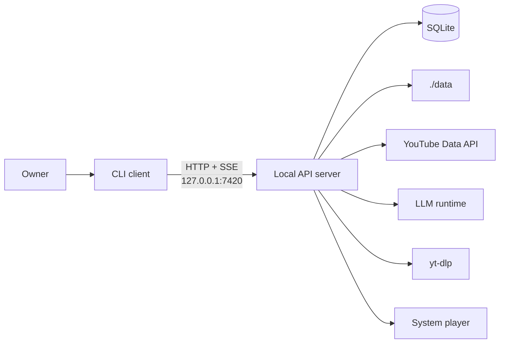

# ytfeed — system design index

## Status

Active. This tree is the system-design reference for the implemented code.

`ytfeed` is a local-first, single-binary CLI that composes a personal YouTube feed. It
discovers candidates, fetches transcripts, analyzes them against a versioned rubric and a
structured taste profile, and serves a finite card feed. Gestures train the profile.

## System at a glance

| Fact | Decision |
|------|----------|
| Runtime | One binary, two process roles: short-lived CLI client and long-lived local API server (`ADR-0001`). |
| Storage | SQLite behind repository interfaces. WAL, `foreign_keys=ON`, `synchronous=FULL`, one writer (`ADR-0002`). |
| Domain | Six bounded contexts as vertical slices (`ADR-0003`). |
| Analysis | One OpenAI-compatible adapter, schema-constrained JSON, versioned rubric (`ADR-0004`). |
| Pipeline | In-process, resumable from checkpoints. Transcripts staged briefly (`ADR-0005`). |
| Failure | Explicit degradation, stable exit codes, cached feed, local traces (`ADR-0006`). |
| Users | One owner. Friends run independent instances. |

## Reading paths

| Reader | Start here |
|--------|------------|
| Product | [`prd-ytfeed.md`](../10-product/prd-ytfeed.md) |
| Architecture | This file, then C4 Level 1 and Level 2 |
| Implementation | `cmd/`, `internal/` and [`adr/INDEX.md`](adr/INDEX.md) |
| Rules | [`README.md`](../00-rules/README.md) |

## Artifact map

| Area | Artifact | Status |
|------|----------|--------|
| Rules | [`00-rules/`](../00-rules/README.md) | Frozen |
| Product | [`prd-ytfeed.md`](../10-product/prd-ytfeed.md) | Approved |
| C4 Level 1 | [`c4/01-system-context.md`](c4/01-system-context.md) | Confirmed at `G1` |
| C4 Level 2 | [`c4/02-container-diagram.md`](c4/02-container-diagram.md) | Confirmed at `G2` |
| C4 Level 3 | [`c4/03-components/`](c4/03-components/) | Confirmed at `G3` |
| Data flow | [`flows/batch-pipeline.md`](flows/batch-pipeline.md) | In review |
| Control flow | [`flows/session-and-degradation.md`](flows/session-and-degradation.md) | In review |
| DDD strategic | [`ddd/strategic/context-map.md`](ddd/strategic/context-map.md) | Confirmed at `G4` |
| DDD subdomains | [`ddd/strategic/subdomain-map.md`](ddd/strategic/subdomain-map.md) | Confirmed at `G4` |
| Glossary | [`ddd/strategic/glossary.md`](ddd/strategic/glossary.md) | Confirmed at `G4` |
| Tactical `taste` | [`ddd/tactical/taste/`](ddd/tactical/taste/) | Confirmed at `G5` |
| Tactical `feed` | [`ddd/tactical/feed/`](ddd/tactical/feed/) | Confirmed at `G5` |
| Tactical `discovery` | [`ddd/tactical/discovery/`](ddd/tactical/discovery/) | Confirmed at `G5` |
| Tactical `analysis` | [`ddd/tactical/analysis/`](ddd/tactical/analysis/) | Confirmed at `G5` |
| Tactical `identity` | [`ddd/tactical/identity/`](ddd/tactical/identity/) | Confirmed at `G5` |
| Tactical `library` | [`ddd/tactical/library/`](ddd/tactical/library/) | Confirmed at `G5` |
| Evented decision | [`ddd/tactical/evented-patterns.md`](ddd/tactical/evented-patterns.md) | Confirmed at `G5` |
| ADRs | [`adr/INDEX.md`](adr/INDEX.md) | Confirmed at `G6` |
| Executive summary | [`executive-summary.md`](executive-summary.md) | Confirmed at the final gate |
| Rules audit | [`audit/rules-coverage.md`](audit/rules-coverage.md) | Confirmed at the final gate |

## Bounded contexts

| Context | Class | Owns |
|---------|-------|------|
| `identity` | Supporting | Credential, subscription graph |
| `taste` | Core | Profile, signals, cold periods |
| `discovery` | Supporting | Candidate pool, quota ledger |
| `analysis` | Core | Analysis result, transcript stage |
| `feed` | Supporting | Batches, sessions, cards, ratings |
| `library` | Supporting | Saved and downloaded videos |

The map is acyclic. Every runtime path ends in `feed`. No shared kernel, conformist,
open host service or partnership (`context-map.md` §5).

## Global invariants

1. One person, one instance. No shared state between instances.
2. Read-only toward Google. The scope is `youtube.readonly`.
3. A signal commits before the UI advances (`D-20`).
4. Transcript text is never stored permanently. Staging is bounded and deleted on commit.
5. The app starts if the database is readable. Network failures degrade.
6. Exit codes are a public contract (`CLI-6`).
7. No queue, broker, worker binary or cache server.
8. All documentation is written in ASD-STE100 (`DOC-20`).

## Maintenance guide

1. **Do not edit the rules or the PRD directly.** A rule change needs a rules PR (`H-9`).
2. **ADRs are immutable.** A change is a new ADR that supersedes the old one (`DOC-6`).
3. **Write in STE-100.** `DOC-20` applies to every file under `docs/`. Keep sentences
   short and active. Keep code, IDs, links and Mermaid unchanged.
4. **Keep diagrams in Mermaid and in-file.** No external tooling.
5. **Link, do not copy.** A rule or contract referenced in three places will diverge
   (`DOC-18`).
6. **Re-run the link check after a move.** Relative links are the most common breakage.
7. **Do not add a seventh context or a fourth layer.** Each needs an ADR and a rules-PR
   proposal (`A-1`, `A-7`).
