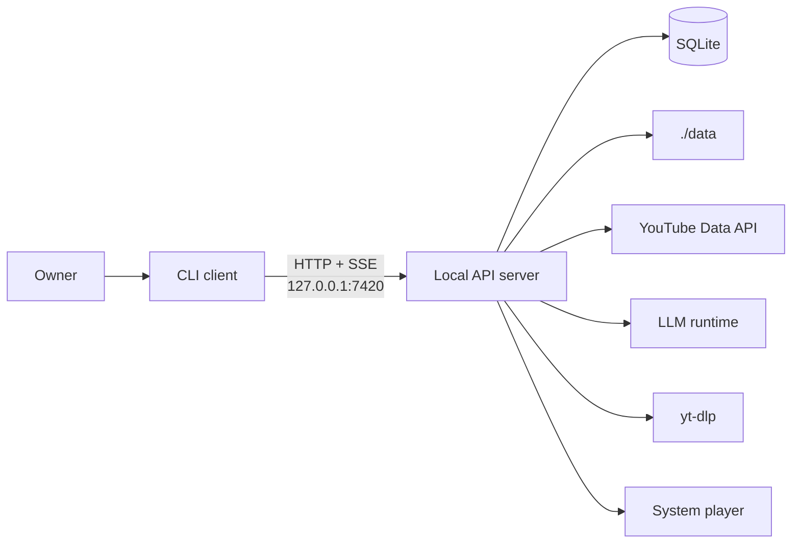

# ytfeed — system design index

## Status

Final gate passed on 2026-11-04. Gates `G0` to `G6` and the assembly audit are
confirmed. `ARCH-601` remains a proposal.

`ytfeed` is a local-first, single-binary CLI that composes a personal YouTube feed. It
discovers candidates, fetches transcripts, analyzes them against a versioned rubric and a
structured taste profile, and serves a finite card feed. Gestures train the profile. No
code exists yet. This tree is the system-design contract for the implementation.

## System at a glance

| Fact | Decision |
|------|----------|
| Runtime | One binary, two process roles: short-lived CLI client and long-lived local API server (`ADR-0001`). |
| Storage | SQLite behind repository interfaces. WAL, `foreign_keys=ON`, `synchronous=FULL`, one writer (`ADR-0002`). |
| Domain | Six bounded contexts as vertical slices (`ADR-0003`). |
| Analysis | One OpenAI-compatible adapter, schema-constrained JSON, versioned rubric (`ADR-0004`). |
| Pipeline | In-process, resumable from checkpoints. Transcripts staged briefly (`ADR-0005`). |
| Failure | Explicit degradation, stable exit codes, cached feed, local traces (`ADR-0006`). |
| Users | One owner. Friends run independent instances. |

## Reading paths

| Reader | Start here |
|--------|------------|
| Product | [`prd-ytfeed.md`](../10-product/prd-ytfeed.md) |
| Architecture | This file, then C4 Level 1 and Level 2 |
| Implementation | [`backlog.md`](backlog.md) and [`adr/INDEX.md`](adr/INDEX.md) |
| New agent session | [`handoff.md`](handoff.md) |
| Rules | [`README.md`](../00-rules/README.md) |

## Artifact map

| Area | Artifact | Status |
|------|----------|--------|
| Rules | [`00-rules/`](../00-rules/README.md) | Frozen |
| Product | [`prd-ytfeed.md`](../10-product/prd-ytfeed.md) | Approved |
| C4 Level 1 | [`c4/01-system-context.md`](c4/01-system-context.md) | Confirmed at `G1` |
| C4 Level 2 | [`c4/02-container-diagram.md`](c4/02-container-diagram.md) | Confirmed at `G2` |
| C4 Level 3 | [`c4/03-components/`](c4/03-components/) | Confirmed at `G3` |
| Data flow | [`flows/batch-pipeline.md`](flows/batch-pipeline.md) | In review |
| Control flow | [`flows/session-and-degradation.md`](flows/session-and-degradation.md) | In review |
| DDD strategic | [`ddd/strategic/context-map.md`](ddd/strategic/context-map.md) | Confirmed at `G4` |
| DDD subdomains | [`ddd/strategic/subdomain-map.md`](ddd/strategic/subdomain-map.md) | Confirmed at `G4` |
| Glossary | [`ddd/strategic/glossary.md`](ddd/strategic/glossary.md) | Confirmed at `G4` |
| Tactical `taste` | [`ddd/tactical/taste/`](ddd/tactical/taste/) | Confirmed at `G5` |
| Tactical `feed` | [`ddd/tactical/feed/`](ddd/tactical/feed/) | Confirmed at `G5` |
| Tactical `discovery` | [`ddd/tactical/discovery/`](ddd/tactical/discovery/) | Confirmed at `G5` |
| Tactical `analysis` | [`ddd/tactical/analysis/`](ddd/tactical/analysis/) | Confirmed at `G5` |
| Tactical `identity` | [`ddd/tactical/identity/`](ddd/tactical/identity/) | Confirmed at `G5` |
| Tactical `library` | [`ddd/tactical/library/`](ddd/tactical/library/) | Confirmed at `G5` |
| Evented decision | [`ddd/tactical/evented-patterns.md`](ddd/tactical/evented-patterns.md) | Confirmed at `G5` |
| ADRs | [`adr/INDEX.md`](adr/INDEX.md) | Confirmed at `G6` |
| Executive summary | [`executive-summary.md`](executive-summary.md) | Confirmed at the final gate |
| Traceability | [`traceability.md`](traceability.md) | Confirmed at the final gate |
| Rules audit | [`audit/rules-coverage.md`](audit/rules-coverage.md) | Confirmed at the final gate |
| Open questions | [`open-questions.md`](open-questions.md) | Living |
| Backlog | [`backlog.md`](backlog.md) | Living |
| Handoff | [`handoff.md`](handoff.md) | Living |

## Bounded contexts

| Context | Class | Owns |
|---------|-------|------|
| `identity` | Supporting | Credential, subscription graph |
| `taste` | Core | Profile, signals, cold periods |
| `discovery` | Supporting | Candidate pool, quota ledger |
| `analysis` | Core | Analysis result, transcript stage |
| `feed` | Supporting | Batches, sessions, cards, ratings |
| `library` | Supporting | Saved and downloaded videos |

The map is acyclic. Every runtime path ends in `feed`. No shared kernel, conformist,
open host service or partnership (`context-map.md` §5).

## Global invariants

1. One person, one instance. No shared state between instances.
2. Read-only toward Google. The scope is `youtube.readonly`.
3. A signal commits before the UI advances (`D-20`).
4. Transcript text is never stored permanently. Staging is bounded and deleted on commit.
5. The app starts if the database is readable. Network failures degrade.
6. Exit codes are a public contract (`CLI-6`).
7. No queue, broker, worker binary or cache server.
8. All documentation is written in ASD-STE100 (`DOC-20`).

## Known gaps

| Gap | Effect | Owner or next step |
|-----|--------|--------------------|
| `ARCH-107` and `ARCH-108` are in review | Data and control flow are not confirmed. | Owner confirmation before the final gate. |
| `OQ-01` quota exit code | The cached-feed case can be `5` or `6`. | Owner decision before the quota path is implemented. |
| `OQ-07` rubric location | The machine-readable rubric path is provisional. | Owner decision before the rubric is loaded. |
| Other open OQs | Interest count, weight rule, library state, lease, late analysis, `--json`. | See [`open-questions.md`](open-questions.md). |
| Traceability matrix | Not written yet. | `ARCH-503`. |
| Rules audit | Not written yet. | `ARCH-505`. |
| Implementation backlog | Does not exist yet. | `ARCH-601`. |
| Executable code | None. This is documentation only. | Implementation phase after `ARCH-601`. |

## Gap analysis

| Gap | Severity | Effect | Next step |
|-----|----------|--------|-----------|
| `ARCH-107` and `ARCH-108` are in review | Medium | The data-flow and control-flow documents are not confirmed. | Owner confirms them before the final gate. |
| `OQ-01` quota exit code | Medium | The cached-feed case can return `5` or `6`. | Owner decision before the quota path is implemented. |
| `OQ-07` rubric location | Medium | The machine-readable rubric path is provisional. | Owner decision before the rubric is loaded. |
| 17 open OQs | Low to medium | Each has a provisional default and is cited where used. | Resolve in the implementation backlog or earlier. |
| Rule audit not written | Medium | Rule coverage is claimed, not yet audited. | `ARCH-505`. |
| Implementation backlog absent | Medium | No code task sequence exists. | `ARCH-601` proposal. |
| No executable code | Expected | This tree is documentation only. | Implementation phase after `ARCH-601`. |
| ADR gaps for process rules | Low | Error, config, testing, git and docs rules have no ADR. | Accepted by `SD-2`. The index lists them. |
| P1 features out of v1 | Expected | `F29`…`F34` are not in the P0 matrix. | Future scope. |

There are **no P0 traceability gaps**. Every `F1`…`F28` maps to a component and a
context, or to transport or storage where that is the correct home.

## Maintenance guide

1. **Update the backlog first.** [`backlog.md`](backlog.md) is the only status source
   (`DOC-12`). Move the task, recalculate the counters, update the gate log.
2. **Do not edit the rules or the PRD directly.** Record a contradiction in
   [`open-questions.md`](open-questions.md). A rule change needs a rules PR (`H-9`).
3. **ADRs are immutable.** A change is a new ADR that supersedes the old one (`DOC-6`).
4. **Write in STE-100.** `DOC-20` applies to every file under `docs/`. Keep sentences
   short and active. Keep code, IDs, links and Mermaid unchanged.
5. **Keep diagrams in Mermaid and in-file.** No external tooling.
6. **Link, do not copy.** A rule or contract referenced in three places will diverge
   (`DOC-18`).
7. **Keep the archive read-only.** The pre-STE originals are in
   [`_archive/pre-ste-2026-11-03/`](../_archive/pre-ste-2026-11-03/).
8. **Re-run the link check after a move.** Relative links are the most common breakage.
9. **Do not add a seventh context or a fourth layer.** Each needs an ADR and a rules-PR
   proposal (`A-1`, `A-7`).

## Session summary

The design suite now covers:

- the rules and the approved PRD.
- C4 Level 1, Level 2 and Level 3.
- data flow and control flow.
- DDD strategic design: viability, subdomains, context map, glossary.
- DDD tactical design for all six contexts and the evented-pattern decision.
- six ADRs and the ADR index.
- the master index, the executive summary, the traceability matrix and this gap analysis.
- the rules audit is pending and is the last design task before the final gate.

Gates `G0` to `G6` are passed. All tactical models and ADRs are confirmed. The assembly tasks `ARCH-501`…`ARCH-505` are confirmed. `ARCH-601` remains a proposal and
is outside this backlog's scope.

The main open product decisions are the quota exit code (`OQ-01`) and the rubric location
(`OQ-07`). The main technical risks are local model quality, `yt-dlp` fragility and the
privacy trade-off of transcript staging. Each has a documented mitigation.

## Next

`ARCH-505` (rules audit), then the final gate. `ARCH-601` proposes the implementation
backlog and folds this temporary backlog into it.
