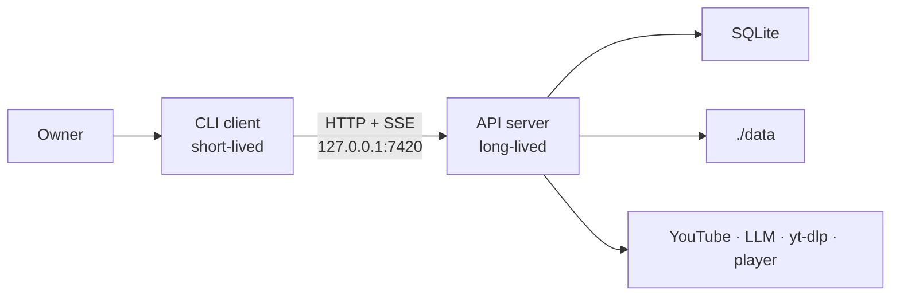

# ADR-0001: Single binary with a client/server split over loopback HTTP

## Status

Accepted

## Date

2026-11-02

## Deciders

- Oleg K (product owner)

## Context

`ytfeed` is a local-first tool for one owner. It must run on a laptop, need no hosted
backend and keep all state on the machine. The product also needs a long-running API
server for the batch pipeline, the UI lease and Server-Sent Events. A future web or mobile
client must be able to reuse the API without a rewrite.

The architecture rules already fix the shape. `A-9` requires a single binary and a
client/server split from day one. `A-10` makes the CLI a client of the local server.
`A-10a` binds the server to loopback. `A-10b` requires a bearer token. `A-11` allows one
UI connection. `R-9` chooses HTTP over `127.0.0.1`. `R-10` chooses one binary.

The open question is how to express that shape at runtime without adding a second binary
or a broker. `OQ-16` covers the server lifecycle.

## Driving factors

- **Must:** ship one binary for the product.
- **Must:** keep the server on loopback and protect it with a local token.
- **Must:** let a future web or mobile client reuse the API.
- **Must:** isolate a long batch from a crashed terminal session.
- **Must:** allow one UI connection at a time.
- **Should:** avoid a second binary, a service manager or a message broker.
- **Should:** keep the CLI startup path simple for a daily command.

## Considered options

### Option 1: One process, no server

The CLI calls the domain directly. There is no HTTP server, no token and no lease.

**Pros:** the simplest runtime. One process and no port.

**Cons:** a future web client needs a new server and a new API. A long batch dies with
the terminal. There is no place for a UI lease. This contradicts `A-9` and `A-10`.

### Option 2: One binary, two process roles over loopback HTTP

`cmd/ytfeed` produces one executable. `ytfeed serve` runs the long-lived API server. Other
commands run as short-lived clients and call the server over `127.0.0.1`. The CLI starts
the server when it is absent.

**Pros:** one artifact for the owner. The API is reusable by a future client. A crashed
CLI does not kill a batch. The lease and SSE live in the server. It matches `A-9`, `A-10`
and `R-9`.

**Cons:** two processes to manage. The lifecycle, port collision and orphan server are
real concerns (`OQ-16`). A local token file is required.

### Option 3: Two binaries

Build a separate CLI binary and a separate server binary.

**Pros:** a clear process boundary. Each binary can have its own flags.

**Cons:** two artifacts to build, install and version. The product promise is one binary.
It contradicts `R-10`.

### Option 4: Unix socket or named pipe

Use a local socket instead of TCP.

**Pros:** no TCP port. File permissions can protect the socket.

**Cons:** a future web client cannot use it directly. Platform differences add work. The
HTTP contract is simpler to test and document.

## Decision

Adopt **Option 2**. `ytfeed` ships as one binary with two process roles:

- A short-lived CLI client.
- A long-lived local API server.
- Loopback HTTP on `127.0.0.1:7420`.
- A bearer token stored with `0600`.
- One UI lease.
- SSE for card streaming.

## Rationale

The decision follows the strongest constraints. One binary is a product requirement. A
separate server process is the only way to keep a batch alive when the terminal exits and
to support a future client. HTTP is already required by `R-9` and is easier to test than a
socket. The token and the lease are small local controls that fit the single-user model.

The decision does not add a broker, a worker binary or a hosted service. The server is a
subcommand of the same executable. The CLI starts it on demand. That keeps the daily path
short while preserving the process boundary.

## Consequences

### Positive

- One artifact to build and install.
- The API can serve a future web or mobile client without domain changes.
- A crashed CLI does not corrupt a batch.
- The lease, SSE and token have one owner: the server.
- The loopback boundary is explicit and testable.

### Negative

- The owner runs two processes at runtime.
- Server lifecycle is more complex than a single process (`OQ-16`).
- A port collision needs an explicit error and a process hint.
- A local token file must be created and protected.
- A stale lease can block the UI until the idle timeout (`OQ-13`).

### Risks and mitigations

| Risk | Mitigation |
|------|------------|
| Orphan server after a CLI crash | The server exits after the idle timeout when it was auto-started. It is never killed by a client that did not start it. |
| Port already in use | Fail with an explicit message that names the port and the process hint. |
| Token leak | `0600` file, constant-time comparison, never logged, fingerprint only in `doctor`. |
| Stale lease | Reclaim after `SESSION_IDLE_TIMEOUT` (`OQ-13`). |
| Loopback exposed | Bind `127.0.0.1`. A non-loopback bind requires `--allow-remote` and prints a warning. |
| Two clients fight | One lease. The second gets `409`, exit `4`. |

## Related decisions

- `ADR-0002` — SQLite behind repository interfaces.
- `ADR-0006` — degradation and the public HTTP and exit-code contracts.
- `OQ-16` — server lifecycle.
- `OQ-13` — lease expiry and reclaim.

## References

- PRD `F22`, `F28`, `F14`, `F18`
- `02-architecture.md` `A-9`, `A-10`, `A-10a`, `A-10b`, `A-11`
- `DECISIONS.md` `R-9`, `R-10`
- `c4/02-container-diagram.md`
- `flows/session-and-degradation.md`
