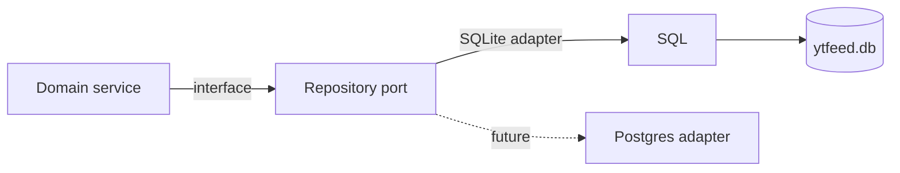

# ADR-0002: SQLite behind repository interfaces

## Status

Accepted

## Date

2026-11-02

## Deciders

- Oleg K (product owner)

## Context

`ytfeed` keeps the product's only durable asset in one local database. That asset is the
signal history, the analyses and the feed state. The product runs on one laptop, has one
writer and must start without a database server. A future version may use Postgres, but
v1 must not pay the operational cost of a hosted database.

The repository pattern is already required by `A-4`, `A-5` and `D-1` to `D-24`. The open
decision is the storage boundary and the durability policy. The choice must keep SQL
visible in review, keep the domain testable and survive a crash.

## Driving factors

- **Must:** store all durable state in one local database.
- **Must:** keep SQL out of domain services and transport (`A-4`, `A-15`).
- **Must:** keep the domain independent of the storage engine (`A-5`, `A-12`).
- **Must:** survive power loss for committed signals (`D-20`).
- **Must:** apply migrations without a separate tool (`D-11`).
- **Must:** take a backup before a migration (`D-11a`).
- **Should:** allow a future Postgres adapter without a domain rewrite.
- **Should:** keep the database file inside `./data` (`C-15`).

## Considered options

### Option 1: Direct SQL in services and handlers

Call `database/sql` from domain services or HTTP handlers.

**Pros:** the shortest path for a small tool. No interfaces.

**Cons:** SQL leaks into the domain and transport. The domain cannot be tested without a
database. A future engine change becomes a rewrite. It contradicts `A-4`, `A-5` and
`A-15`.

### Option 2: Repository interfaces in the domain, SQLite adapter

The domain declares the repository interface. `internal/repository/sqlite` implements it.
The adapter owns all SQL. The domain is tested with fakes.

**Pros:** SQL stays in one layer. The domain is testable. A Postgres adapter is a package
plus config (`D-6`). It matches the frozen rules.

**Cons:** hand-written mapping. More code than an ORM. The team must keep query constants
and scan order aligned.

### Option 3: ORM

Use an ORM for entities and migrations.

**Pros:** less mapping code. Faster CRUD.

**Cons:** SQL becomes implicit. Review is harder. ORM migrations and schema control add a
dependency and a failure mode. `D-4` rejects an ORM.

### Option 4: Postgres in v1

Run a local Postgres server.

**Pros:** stronger concurrency and a familiar server model.

**Cons:** a second process to install and operate. It breaks the single-binary,
local-first promise. It is not needed for one writer and one user. `D-6` keeps it as a
future adapter.

### Option 5: Embedded key-value store

Use a key-value engine such as BoltDB.

**Pros:** simple file storage. No SQL layer.

**Cons:** no relational queries for cards, signals and quota. Migrations and ad-hoc audit
queries become application code. It fits the data model poorly.

## Decision

Adopt **Option 2**. `ytfeed` uses SQLite behind repository interfaces:

- One database file under `./data`.
- WAL journal mode.
- `foreign_keys = ON`.
- `busy_timeout = 5000`.
- `synchronous = FULL`.
- One writer. Writes use a single connection or one goroutine.
- Embedded, numbered migrations with a backup before applying.
- No cross-context foreign key. A reference is a value (`context-map.md` §7).

## Rationale

SQLite is the right engine for one writer, one user and a local file. It needs no server
and fits the single-binary product. The repository boundary keeps the domain free of SQL
and makes the engine replaceable. `synchronous = FULL` is a deliberate cost. A committed
signal is the product's asset. The write rate is a few per minute, so the fsync cost is
small compared with the loss of a signal.

The migration policy is part of the decision. An embedded migration runner keeps the
single-binary promise. A backup before migration and a hard refusal for a newer schema
make a failed upgrade recoverable. A destructive migration needs an ADR and a recovery
path.

## Consequences

### Positive

- All durable state lives in one file under `./data`.
- SQL is visible in review.
- The domain is testable with fake repositories.
- A future Postgres adapter does not change the domain.
- Committed signals survive power loss.
- Upgrades are automatic and backed up.

### Negative

- Mapping code is hand-written.
- SQLite allows one writer. Concurrent writes are serialized.
- The adapter must keep query constants and scan order aligned.
- A schema change needs a migration and a repository change.
- A database newer than the binary refuses to start.

### Risks and mitigations

| Risk | Mitigation |
|------|------------|
| Lost signal on power loss | `synchronous = FULL` (`D-7`). |
| Migration failure | Backup before apply, transaction, schema check (`D-11a`). |
| Newer database opened by an older binary | Hard refusal with an upgrade message (`D-11b`). |
| Busy database | `busy_timeout = 5000`, one writer (`D-7`, `D-8`). |
| Schema drift | Numbered migrations, never edited after apply (`D-9`). |
| Destructive change | ADR plus a documented recovery path (`D-12`). |
| Cross-context coupling | No cross-context FK. Values, not joins (`context-map.md` §7). |
| SQL in the domain | Repository interfaces and `A-4` review. |

## Related decisions

- `ADR-0001` — single binary and client/server split.
- `ADR-0005` — resumable pipeline and transcript staging.
- `D-1` to `D-24` — data and persistence rules.
- `context-map.md` §7 — logical data ownership.

## References

- `02-architecture.md` `A-4`, `A-5`, `A-12`, `A-15`
- `04-data-persistence.md` `D-1` to `D-24`
- `c4/02-container-diagram.md` — SQLite container and data ownership
- `flows/batch-pipeline.md` — crash checkpoints
