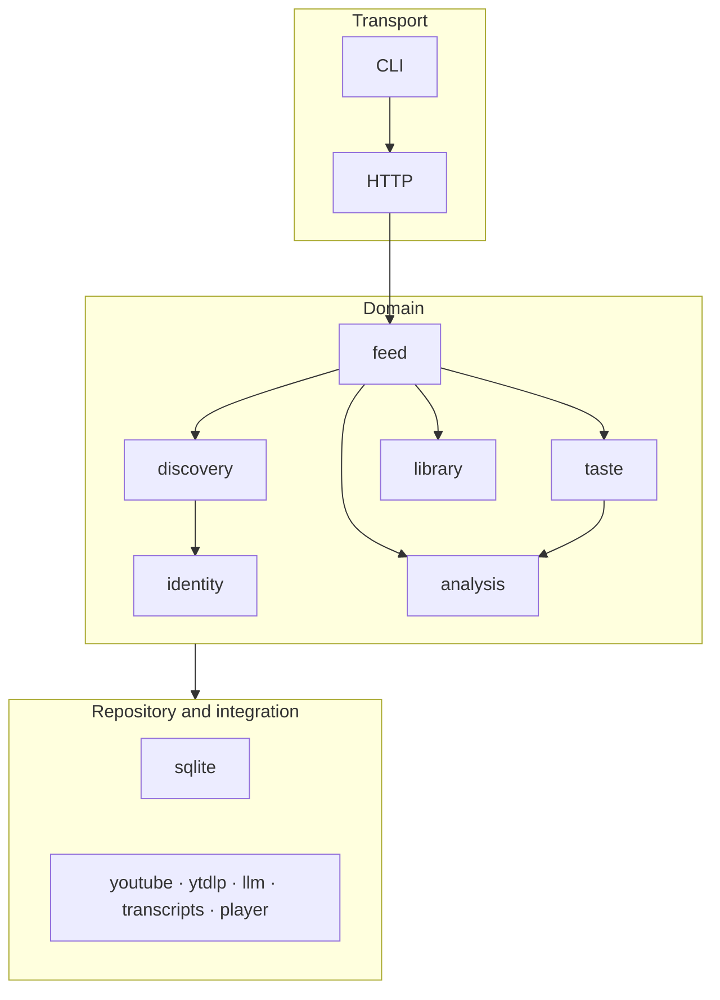

# ADR-0003: Six bounded contexts as vertical slices

## Status

Accepted

## Date

2026-11-02

## Deciders

- Oleg K (product owner)

## Context

`ytfeed` has one owner, one binary and three architecture layers (`A-1`). The domain still
has six distinct failure modes and six distinct models (`A-7`). A layer-only package
layout would put every model in one `domain` folder. That layout hides the boundaries and
lets one context import another's internals.

The DDD strategic design validated the six contexts at gate `G4`. The contexts are
`identity`, `taste`, `discovery`, `analysis`, `feed` and `library`. No context was merged,
split or added. The question is how to express that split in the package layout without
adding a fourth layer or a second binary.

## Driving factors

- **Must:** keep three layers and no fourth layer (`A-1`).
- **Must:** keep the six contexts from `A-7`.
- **Must:** isolate the failure mode of each context.
- **Must:** keep one binary and one process role for the server (`ADR-0001`).
- **Must:** allow each context to be tested with its own fakes.
- **Must:** avoid a shared domain model (`A-8`, `context-map.md` §5.3).
- **Should:** make a future extraction of a context possible without a rewrite.
- **Should:** keep the package tree easy to review.

## Considered options

### Option 1: Layer-only packages

Put all models in `domain/model`, all services in `domain/service` and all repositories
in `domain/repository`.

**Pros:** a small number of folders. A new developer sees the layers at once.

**Cons:** every context shares one package. A change to `feed` can import a `taste`
internal. The failure boundaries disappear. It contradicts `A-7`.

### Option 2: Six vertical slices inside the layers

Each context has `internal/domain/<context>` with its aggregates, value objects,
repository interface and tests. Adapters live in `internal/integration/*` and
`internal/repository/*`. Contexts call published interfaces only.

**Pros:** the model boundary and the failure boundary coincide. Each context is testable
alone. A context can move to another package or service later. It matches `A-7` and the
`G4` decision.

**Cons:** more packages. Some value objects look similar across contexts. The team must
resist cross-context imports.

### Option 3: A service per context

Deploy six services with network calls.

**Pros:** strong isolation. Independent deployment.

**Cons:** six processes, six configurations and a network boundary for a local single-user
tool. It breaks the one-binary promise (`ADR-0001`). It is far more operational work than
the product needs.

### Option 4: Merge `taste` and `analysis`

Put the profile and the judgment in one core context.

**Pros:** one owner for the differentiator. Fewer contracts.

**Cons:** the merged context would hold two failure modes: corrupted personalization and
model failure. It would also reopen `A-7` and the `G4` decision. It needs a new ADR and a
rules-PR proposal. The current split is already validated.

### Option 5: A shared domain package

Put common types such as `VideoID` and `ChannelID` in `shared/`.

**Pros:** no duplicate value objects.

**Cons:** `A-8` forbids a grab-bag. A shared type becomes a coupling point. `video_id` is
a shared key, not a shared type (`context-map.md` §7). Each context defines its own value
object.

## Decision

Adopt **Option 2**. The code is organized as six vertical slices inside the three layers:

Each context owns:

- Its domain package and model.
- Its repository interface.
- Its tables and migrations.
- Its tests and fakes.
- Its published contract to other contexts.

A context does not import another context's internals. It calls the published interface.
`feed` is the only orchestrator between contexts (`A-14`).

## Rationale

The split follows the failure modes, not the org chart. There is one owner and no team
boundary. The six contexts are technical isolation boundaries. Vertical slices make that
explicit. They also keep the core (`taste`, `analysis`) separate from the supporting
contexts and from the generic plumbing.

The layout keeps the one-binary decision. A context is a package boundary, not a process
boundary. A future extraction is possible because the contracts are already explicit.

## Consequences

### Positive

- Each context can be tested with its own fakes.
- A failure in one context does not corrupt another model.
- The package tree shows the boundaries.
- A future Postgres adapter or web client can reuse the contracts.
- The core contexts get full tactical depth without leaking into supporting code.

### Negative

- More packages and more interfaces.
- Some value objects are defined per context, even when the shape is similar.
- `feed` becomes a coupling sink by design (`context-map.md` §9 risk 1).
- The team must review imports to prevent boundary erosion.
- `shared/` stays empty, which can look unfinished.

### Risks and mitigations

| Risk | Mitigation |
|------|------------|
| A context imports another's internals | Review the import graph. Use published interfaces (`A-7`). |
| `feed` absorbs product rules | Keep `feed` thin. Put rules in the owning context (`context-map.md` §9). |
| Duplicate value objects drift | Keep the shared key stable. Do not share the type (`context-map.md` §7). |
| `shared/` becomes a grab-bag | `A-8`. A package needs two consumers and a written justification. |
| Onboarding sits in a supporting context | Treat it as a use case (`G4-6`). Move it only with an ADR. |
| The split is reopened without evidence | A change needs an ADR and a rules-PR proposal (`H-9`). |

## Related decisions

- `ADR-0001` — one binary, two process roles.
- `ADR-0002` — SQLite behind repository interfaces.
- `ADR-0004` — analysis contract between `taste` and `analysis`.
- `context-map.md` — six contexts, contracts and boundary risks.
- `G4` — the owner confirmed the six contexts on 2026-11-03.

## References

- `02-architecture.md` `A-1`, `A-7`, `A-8`, `A-9`, `A-14`
- `c4/02-container-diagram.md` — container and package mapping
- `c4/03-components/*.md` — Level 3 components
- `ddd/strategic/context-map.md`
- `ddd/strategic/subdomain-map.md`
- `ddd/tactical/*/README.md`
