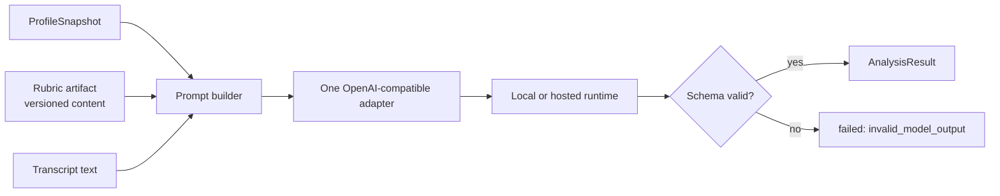

# ADR-0004: The analysis contract

## Status

Accepted

## Date

2026-11-02

## Deciders

- Oleg K (product owner)

## Context

`analysis` is the core of the product. It turns a transcript into a per-axis judgment
under a versioned rubric and a structured profile. The LLM runtime is the highest
technical risk (`R1`, `R2`, `R6`). Local runtimes differ in features and quality. A small
model can return confident prose where the product needs numbers.

The frozen rules already constrain the answer. `A-12a` requires one OpenAI-compatible
chat adapter. `A-12b` requires schema-constrained JSON. `A-19` makes the rubric a
versioned content artifact. `A-20` requires a structured profile and a justification per
axis. `F11` requires explicit failure states. `F12` binds the rubric version to every
result. `F26` allows any compatible endpoint.

The open questions are `OQ-06` (opencode as a preset) and `OQ-07` (where the rubric
artifact lives).

## Driving factors

- **Must:** use one adapter for every local runtime (`A-12a`).
- **Must:** validate the model output against a schema before persistence (`A-12b`).
- **Must:** return one score per profile axis with a one-line justification (`A-20`).
- **Must:** record the rubric version and the model identity on every result (`F12`).
- **Must:** classify failures explicitly: `no_transcript`, `analysis_slow`,
  `invalid_model_output` (`F11`).
- **Must:** never log transcript text or prompts (`L-10`).
- **Should:** allow a hosted OpenAI-compatible endpoint when the owner sets one (`SD-5`).
- **Should:** keep the adapter replaceable without touching the domain.
- **Should:** bound concurrency to what a local model can serve.

## Considered options

### Option 1: One adapter per provider

Write a separate adapter for Ollama, llama-server, LM Studio, opencode and each hosted
provider.

**Pros:** each adapter can use provider-specific features.

**Cons:** many adapters, many test matrices and many failure modes. A new runtime is a new
package. It contradicts `A-12a`.

### Option 2: One OpenAI-compatible adapter with presets

Use `/v1/chat/completions` for every runtime. Provider differences are presets:
`base_url`, `model`, `api_key` and `json_mode`.

**Pros:** one adapter and one test path. A new runtime is a preset. It matches `A-12a`
and `F26`. It works with Ollama, llama-server, LM Studio and opencode.

**Cons:** a provider that does not implement the compatible surface cannot be used. A
preset can still be wrong for a specific model.

### Option 3: Free-text output with a parser

Ask the model for prose and parse the fields.

**Pros:** no schema support required.

**Cons:** parsing is fragile. A small model can produce plausible prose without numbers.
It contradicts `A-12b` and `A-20`.

### Option 4: Hosted API only

Use one paid hosted model.

**Pros:** higher quality and a stable API.

**Cons:** cost per analysis is not near zero. It contradicts the product premise and the
Cost NFR. `SD-5` allows a hosted endpoint but does not require one.

### Option 5: Profile as a prompt string

Send the taste profile as free text instead of structured axes.

**Pros:** simpler prompt.

**Cons:** no per-axis score, no justification and no way to audit a rejection. It
contradicts `A-20`.

### Option 6: Provider tool calling instead of JSON mode

Use tool or function calling to obtain the schema.

**Pros:** some runtimes validate arguments.

**Cons:** support is uneven across local runtimes. JSON mode plus local validation is the
common surface. Tool calling can be a future preset detail, not the contract.

## Decision

Adopt **Option 2** with the following contract:

- One OpenAI-compatible chat adapter.
- JSON mode where the runtime supports it.
- A JSON schema sent with the request and validated before persistence.
- One score per profile axis, each with a one-line justification.
- The rubric artifact is external. Its version is bound to the result.
- The profile snapshot is structured: axes, weights, examples and note.
- The result records `rubric_version`, `profile_version` and `model_id`.
- A validation failure becomes `failed: invalid_model_output`. The result is never coerced.
- A timeout becomes `failed: analysis_slow`. A missing transcript becomes
  `failed: no_transcript`.
- In-flight calls are bounded by `ANALYSIS_CONCURRENCY` (default 2).
- Transcript text and prompts are never logged or traced.

## Rationale

The compatible surface is the widest common denominator for local runtimes. It keeps the
adapter small and the tests real. JSON mode plus local validation protects the product
from a model that writes prose. A structured profile is the only way to produce a
per-axis justification. The rubric version makes a change in quality measurable. The
failure states make a bad result visible instead of hidden.

The decision keeps the LLM external. It does not claim that transcripts never leave the
host. It claims that `ytfeed` does not retain them beyond the analysis window (`SD-5`).

## Consequences

### Positive

- One adapter and one test path for every runtime.
- A new runtime is a config preset.
- The result is auditable and comparable across rubric versions.
- A bad model response is visible as a failure, not a plausible card.
- A hosted endpoint remains possible without a code change.

### Negative

- The adapter cannot use provider-specific features that are outside the compatible
  surface.
- JSON mode support varies. Some runtimes need a lower temperature or a retry.
- A small model can still fail the schema. The failure rate is a product risk.
- The prompt is larger because it carries axes, examples and justification rules.
- The contract couples the product to the OpenAI-compatible shape.

### Risks and mitigations

| Risk | Mitigation |
|------|------------|
| Small model returns invalid JSON | Local validation, explicit failure, model evaluation spike (`Q1`, `Q2`). |
| Provider differences break a preset | Presets are tested. `doctor` reports reachability and model. |
| Prompt injection from transcript | The transcript is data. The schema and the system prompt constrain the role. Log prompts never. |
| Rubric drift | The rubric version is recorded per result. A change is a content version bump (`A-19`). |
| Profile axis mismatch | Scores are matched to the profile. Unknown axes are ignored for the weight update (`D-305`). |
| Latency | Bounded concurrency, per-request deadline, `analysis_slow`. |
| Cost on a hosted endpoint | Default is loopback. `doctor` prints the endpoint host. |
| Transcript leakage | Never log content. Staging is bounded and deleted (`OQ-05`). |

## Related decisions

- `ADR-0003` — six bounded contexts.
- `ADR-0005` — resumable pipeline and transcript staging.
- `ADR-0006` — degradation and public contracts.
- `OQ-05` — transcript staging, resolved.
- `OQ-06` — opencode as a preset.
- `OQ-07` — rubric location.
- `OQ-18` — profile weight update.

## References

- PRD `F9`, `F10`, `F11`, `F12`, `F26`, `Q1`, `Q2`, `Q3`, `Q8`
- `02-architecture.md` `A-12`, `A-12a`, `A-12b`, `A-19`, `A-20`
- `04-data-persistence.md` `D-20`
- `08-cli-and-ux.md` `CLI-13`
- `ddd/tactical/analysis/*`
- `ddd/tactical/taste/*`
