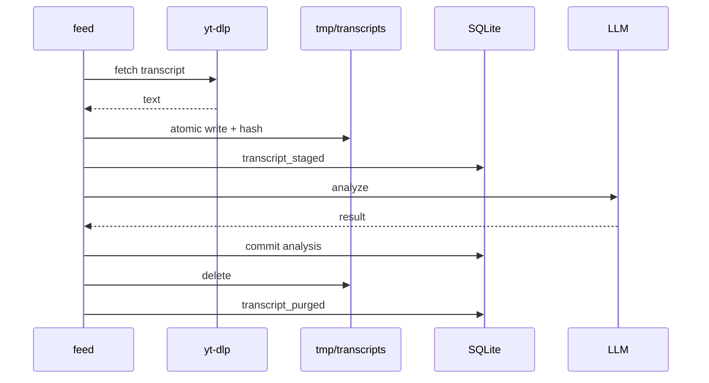

# ADR-0005: Resumable pipeline with bounded transcript staging

## Status

Accepted

## Date

2026-11-02

## Deciders

- Oleg K (product owner)

## Context

The batch pipeline has explicit stages: candidates, dedupe, transcript fetch, analysis,
scoring and feed composition (`A-14`). The product must survive a crash without a second
fetch of every transcript (`F25`). It must also fetch only transcript text, never video or
audio (`F9`). The original privacy text said transcripts are never persisted. That made
`F25` impossible for a crash between fetch and analysis.

`OQ-05` records the conflict. The owner resolved it with bounded staging. A transcript may
exist for a short time in `./data/tmp/transcripts/`, with `0600` files, and must be deleted
when the analysis commits. The PRD was amended for this on 2026-11-02.

The pipeline runs in one process. There is no queue, broker or worker binary (`A-14`).
Resume must come from persisted checkpoints.

## Driving factors

- **Must:** resume an interrupted batch without a full re-fetch (`F25`).
- **Must:** fetch only transcript text (`F9`).
- **Must:** keep the transcript out of the database, logs, traces and backups (`OQ-05`).
- **Must:** delete a staged transcript when the analysis commits.
- **Must:** keep one binary and no external job system (`A-14`).
- **Must:** never fail a card because staging failed. Staging is an optimization.
- **Should:** bound the staged data by size and age.
- **Should:** make the resume testable with a crash test.

## Considered options

### Option 1: Memory-only pipeline with re-fetch on crash

Keep the transcript in memory. On a crash, fetch it again.

**Pros:** the strongest privacy claim. No file on disk.

**Cons:** a crash in a 20-card batch pays the fragile `yt-dlp` cost again. It makes `F25`
false. The original default was this option, and it was rejected.

### Option 2: Store the transcript in SQLite

Keep the text in a database column or a `BLOB`.

**Pros:** resume is simple. One storage engine.

**Cons:** the transcript enters every backup and every database copy. Deletion needs a
`VACUUM`. It is worse for privacy than an unlinked file. It contradicts `OQ-05`.

### Option 3: Bounded staging file with a database checkpoint

Write the transcript to a restricted file. Record the hash and size in the database.
Delete the file after the analysis commits. Sweep old files by TTL.

**Pros:** resume without a fetch. The transcript stays out of the database and backups. A
crash is recoverable. It keeps one binary and no queue. It is the chosen option.

**Cons:** the plaintext touches disk. The privacy claim is weaker. The staging directory
needs permissions, a TTL and path checks.

### Option 4: External queue and worker

Use a queue and a worker process for analysis.

**Pros:** strong resume semantics and backpressure.

**Cons:** a broker, a second binary and a new failure surface. It contradicts the
single-binary, in-process design.

### Option 5: Permanent transcript archive

Keep transcripts for re-analysis.

**Pros:** cheap re-analysis.

**Cons:** turns a temporary buffer into a content archive. It is out of v1 (`Q8`) and
contradicts the privacy promise.

## Decision

Adopt **Option 3**:

- The pipeline stages are explicit and ordered (`A-14`).
- A transcript is staged in `./data/tmp/transcripts/` with `0700` directory and `0600`
  files.
- The database records `transcript_state`, SHA-256, bytes and `staged_at`.
- The file is deleted when the analysis row commits.
- A TTL sweep removes abandoned files.
- Staging is best effort. A failure falls back to memory and never fails a card.
- A crash after staging re-analyzes from the file with zero fetch calls.
- A crash after the analysis commit does not re-analyze and does not re-fetch.
- No queue, broker or worker binary is introduced.
- The database is the authority. The file is the payload.

## Rationale

The staging file is the smallest mechanism that makes `F25` true without a queue. It keeps
the content out of the database and out of backups. The hash makes a corrupt file a
re-fetch, not a wrong analysis. The TTL is a backstop for abandoned batches. The
best-effort rule keeps a disk problem from failing a card.

The privacy cost is real. The guarantee changes from "transcript text never touches disk"
to "transcript text touches disk only inside one restricted directory, between fetch and
analysis commit, and for no longer than the TTL". The PRD states the narrower guarantee.

## Consequences

### Positive

- A crash during analysis does not pay the fetch cost twice.
- Batch cost is more predictable.
- The pipeline has one durable checkpoint per candidate.
- Resume is testable with `kill -9`.
- The staging directory is excluded from backups by construction.

### Negative

- Transcript plaintext touches disk for a short time.
- The privacy claim is weaker and must be explained.
- Stale files need a sweep and a TTL.
- The staging directory needs path and permission checks.
- A failed staging write adds a warning path.

### Risks and mitigations

| Risk | Mitigation |
|------|------------|
| Transcript leaks through a backup | Backups copy the database only. The staging directory is excluded (`D-11a`). |
| Stale files accumulate | Sweep at start and after each batch. TTL default 24h. |
| Path traversal | Strict video ID validation, `O_NOFOLLOW`, `lstat` before read. |
| Corrupt staged file | Hash check. A mismatch is a re-fetch, never an analysis. |
| Disk full | Analyze from memory, remove the partial file, warn once. |
| Privacy claim overstated | The PRD and the trust boundary state the narrower guarantee. |
| Staging becomes an archive | TTL plus delete on commit. No re-analysis storage in v1. |

## Related decisions

- `ADR-0002` — SQLite and the repository boundary.
- `ADR-0004` — analysis contract.
- `ADR-0006` — degradation and public contracts.
- `OQ-05` — transcript staging, resolved.
- `ARCH-105a` — the staging component.

## References

- PRD `F9`, `F25`, `Q8`, Privacy NFR
- `02-architecture.md` `A-14`
- `04-data-persistence.md` `D-11a`, `D-20`
- `c4/03-components/03a-transcript-staging.md`
- `flows/batch-pipeline.md`
