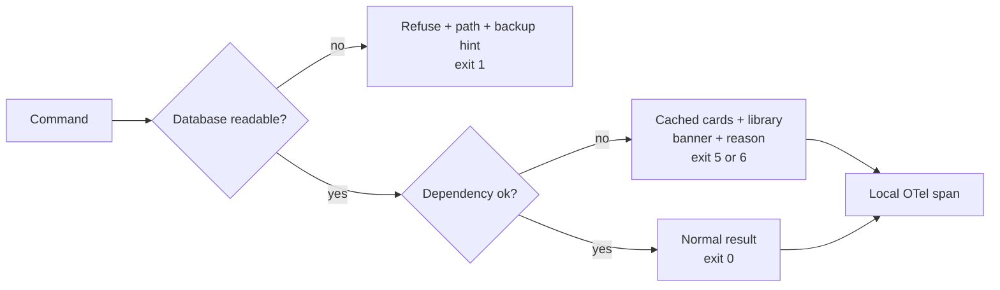

# ADR-0006: Degradation, public contracts and local traces

## Status

Accepted

## Date

2026-11-02

## Deciders

- Oleg K (product owner)

## Context

`ytfeed` depends on the network, YouTube, a local LLM, `yt-dlp` and the system player.
Any of them can fail. The owner still needs a usable feed and a clear explanation. The
product also publishes exit codes and a CLI contract. Those are public behaviour, not
implementation details.

The rules already require explicit degradation. `CLI-6` fixes the exit-code table.
`F24` requires cached cards and a visible reason. `D-11b` refuses a newer database.
`CLI-22` says the app starts if the database is readable. `R-24` and `L-15` require local
OTel traces with no collector. `OQ-01` still leaves the quota exit code open for the
cached-feed case.

The decision is how to express failure and observability without a remote service or a
second control plane.

## Driving factors

- **Must:** keep the app usable when the database is readable (`CLI-22`).
- **Must:** keep exit codes stable and documented (`CLI-6`).
- **Must:** show the cause and the next action for every degradation (`E-16`).
- **Must:** serve cached cards and the library when discovery is unavailable (`F24`).
- **Must:** keep traces local, with no network dependency (`R-24`).
- **Must:** never log secrets or transcript text (`L-10`).
- **Should:** degrade to the last completed batch rather than an empty feed.
- **Should:** make `doctor` the first debugging step and keep it offline (`F27`).
- **Should:** avoid retry storms against a failing dependency.

## Considered options

### Option 1: Fail hard on any dependency failure

Stop the command when a dependency fails.

**Pros:** simple and honest. No partial state.

**Cons:** the owner cannot use the library or cached cards. It contradicts `CLI-22` and
`F24`.

### Option 2: Silent fallback

Serve cached data and hide the failure.

**Pros:** the UI stays calm.

**Cons:** the owner cannot tell what is missing. It contradicts `E-16` and the product
promise of an explainable feed.

### Option 3: Explicit degradation with cached fallback and stable exit codes

Detect the failure, serve the best available data, show a banner with the reason and the
next action, and return the documented exit code.

**Pros:** the product stays usable. The owner sees the cause. The contract is testable. It
matches `F24`, `CLI-6` and `E-16`.

**Cons:** more states and a larger test matrix. The exit-code table becomes a public
contract.

### Option 4: Remote observability and a status service

Send traces and metrics to a hosted service.

**Pros:** dashboards and alerts.

**Cons:** a network dependency, a privacy surface and a second service. It contradicts the
local-first premise and `R-24`.

### Option 5: Local metrics database and a dashboard

Add a metrics store and a dashboard.

**Pros:** richer local reporting.

**Cons:** a second store and a UI. `stats` already reads persisted facts. It is more than
v1 needs.

## Decision

Adopt **Option 3** with these contracts:

- The app starts if the database is readable (`CLI-22`).
- Exit codes are the `CLI-6` table: `0`, `1`, `2`, `3`, `4`, `5`, `6` and `130`.
- A dependency failure has one user-visible outcome and one exit code.
- Discovery failure serves the last completed batch and the library.
- The banner names the cause and the next action.
- A failed analysis card stays visible with its state and reason (`F11`).
- Traces are local OpenTelemetry spans in `./data/traces/YYYY-MM-DD.jsonl`.
- There is no collector, exporter endpoint or metrics server.
- `doctor` reports the state of each integration and works offline.
- Retries are bounded. There is no retry storm.
- The quota exit code for a cached feed follows `OQ-01` until the owner decides.

## Rationale

The product promise is an explainable feed. A silent failure breaks that promise. A hard
failure breaks the daily loop. Explicit degradation is the only option that keeps both.
The exit-code table makes the behaviour scriptable and testable. The local trace file
gives the owner enough data to separate model latency from network latency without a
remote service.

The decision keeps the failure surface small. `doctor` is the single diagnostic entry
point. Traces are diagnostic only. The database remains the truth.

## Consequences

### Positive

- The owner can still browse cached cards and the library.
- Failure causes are visible and consistent.
- Exit codes are a stable public contract.
- Traces are local and private.
- `doctor` works offline and never prints secrets.

### Negative

- More states and tests than a fail-fast design.
- The exit-code table is hard to change.
- Cached data can be stale.
- Local trace files need rotation and retention.
- A degraded batch may show fewer cards.

### Risks and mitigations

| Risk | Mitigation |
|------|------------|
| Silent degradation | Every degradation emits a banner and an exit code. |
| Retry storm | One retry with backoff, then degrade. |
| Stale cache presented as fresh | The banner names the reason and the reset time. |
| Trace files grow without bound | Daily rotation, 7-day retention (`L-15`). |
| Trace content leaks | Spans carry identifiers and durations, never content. |
| Exit code drift | `CLI-6` is a public contract. A change needs a rules PR. |
| Quota ambiguity | `OQ-01` records the provisional choice. |
| Doctor needs the network | `doctor` renders offline and reports unreachable services. |

## Related decisions

- `ADR-0001` — single binary and client/server split.
- `ADR-0002` — SQLite and durability.
- `ADR-0004` — analysis failures and the model contract.
- `ADR-0005` — resumable pipeline and staging.
- `OQ-01` — quota exit code.
- `OQ-12` — yt-dlp absence.

## References

- PRD `F7`, `F11`, `F24`, `F27`, `F31`
- `02-architecture.md` `A-10a`, `A-11`
- `04-data-persistence.md` `D-11b`
- `06-logging-and-observability.md` `L-15`, `L-17`, `L-18`
- `08-cli-and-ux.md` `CLI-6`, `CLI-7`, `CLI-22`, `CLI-24`
- `flows/session-and-degradation.md`
