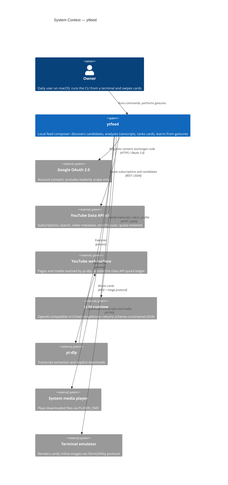

# C4 Level 1 — System context

## Metadata

| Field | Value |
|-------|-------|
| **System** | `ytfeed` — Personal YouTube Feed Composer |
| **Document** | C4 Level 1 (System Context) |
| **Version** | 0.1 (draft) |
| **Date** | 2026-11-02 |
| **Owner** | Oleg K (product owner, sole user in v1) |
| **Status** | Awaiting confirmation at gate `G1` |
| **Mode** | From scratch (`SD-1`) |
| **Sources** | [`prd-ytfeed.md`](../../10-product/prd-ytfeed.md), [`02-architecture.md`](../../00-rules/02-architecture.md), [`DECISIONS.md`](../../00-rules/DECISIONS.md) |
| **Next** | [`02-container-diagram.md`](02-container-diagram.md) (`ARCH-102`) |

## Purpose

`ytfeed` composes a daily video feed from the user's own subscription graph and a small
set of stated interests. It filters each candidate through a versioned rubric applied to
its transcript. It learns from the user's gestures. The result replaces YouTube's
engagement-optimized home feed with a feed that the user can explain.

## Level 1 diagram

## System context summary

**System:** `ytfeed`. One local instance per person.

**Purpose:** turn the user's own taste signals (subscriptions, interests and gestures)
into a ranked, explained, finite feed, without a hosted backend.

**Users:** exactly one human actor in v1, the **owner**. Friends run their own
independent instances. They are not drawn at Level 1 (`SD-7`) because the instances
share no runtime, data or administrative relationship (`Scalability NFR`: no shared
state).

**External dependencies:** seven, listed in the table below. The system reaches two of
them through a local process, not a network call (`yt-dlp`, `PLAYER_CMD`). One is a
presentation channel (`terminal`), not a data source.

**Compliance boundaries:** no payment data, no regulated personal data category and no
processor role. The only personal data is the Google account identity, the subscription
graph and locally derived behavioural signals. Google user-data limited-use obligations
apply to the `youtube.readonly` scope. See the trust boundary section.

## External systems

| System | Direction | Data exchanged | Protocol | Failure behaviour | Source |
|--------|-----------|----------------|----------|-------------------|--------|
| **Google OAuth 2.0** | Both | Consent grant → authorization code → refresh/access token | HTTPS, OAuth 2.0 + PKCE | Re-authentication prompt, exit `2` | PRD `F1` |
| **YouTube Data API v3** | In | Subscriptions, search results, video metadata, `mostPopular` | REST / JSON, quota-metered | Cached feed + banner + reset time | PRD `F6`, `F7`, `F24` |
| **LLM runtime** | Both | Transcript + rubric + profile out; analysis JSON in | HTTP, OpenAI-compatible `/v1/chat/completions` | Card `[unanalyzed: analysis slow]`; batch continues | PRD `F10`, `F11`, `F26`; `A-12a` |
| **yt-dlp** | Both | Video ID or URL out; transcript text or media file back | Local process, stdout / filesystem | No transcript → `[unanalyzed: no transcript]`; library download unavailable | PRD `F9`, `F17`, `F20`; `SD-6` |
| **YouTube web surface** | In (via yt-dlp) | Pages and media | HTTPS | Same as yt-dlp | PRD `R4` |
| **System media player** | Out | Absolute file path | Local process (`PLAYER_CMD`) | Printed error; the app keeps running | PRD `F20`; `CLI-23` |
| **Terminal emulator** | Out | Cards, banners, inline images | ANSI, iTerm2/Kitty image protocol | Text-only card, no reserved space | PRD `F15`; `CLI-15`, `CLI-16` |

### Notes on the dependency table

- **The LLM is external** (`SD-5`). `LLM_BASE_URL` accepts any OpenAI-compatible
  runtime, including one that is not on this machine. The architecture therefore does
  not claim that transcripts never leave the host. It claims only that `ytfeed` does not
  retain them beyond the analysis window. See `OQ-11`.
- **`yt-dlp` bypasses the quota ledger.** It talks to YouTube's web surface, not the Data
  API. Its traffic is not counted in the 10,000-unit daily budget. It is still subject
  to YouTube's own rate limiting and bot checks (`R4`).
- **The terminal is an output adapter, not a data source.** The diagram shows it because
  inline image capability changes what the card can show. The CLI contract
  (`CLI-8`…`CLI-16`) is also part of the system boundary.
- **opencode is not drawn as a separate node.** `Q2` is unresolved. Until the spike
  answers it, opencode is treated as one possible preset of the LLM runtime (`OQ-06`).

## Trust and privacy boundary

`ytfeed` runs entirely on the owner's machine. The boundary that matters at Level 1 is
between **local state** and **egress**.

**Inside the boundary (never leaves the host by design):**

- OAuth token, stored at `0600` in the data directory (`F1`, `C-17`, `A-10b`)
- SQLite database, backups, and the library under `./data` (`C-15`, `D-6`)
- Taste profile, signals, cold periods, sessions (`F4`, `F5`, `F19`)
- Local OTel traces written as JSONL, no collector (`R-24`)
- The API bearer token. `doctor` prints only its fingerprint (`A-10b`, `F27`)
- Staged transcripts, briefly: `./data/tmp/transcripts/`, `0700` directory, `0600` files,
  deleted when the analysis result commits (`OQ-05`, `ARCH-105a`)

**Crossing the boundary:**

- Transcript text and the structured profile go to `LLM_BASE_URL` (`F10`). With a
  loopback default, they stay on the host. With a non-loopback setting, they do not.
  A staged copy may exist briefly on disk before the analysis commits (`ARCH-105a`).
- `yt-dlp` fetches transcripts and media from YouTube's web surface.
- Nothing else is sent anywhere. There is no telemetry endpoint, no shared backend and
  no update check in v1.

**Deliberately absent:** hosted accounts, server-side sessions, cross-instance
aggregation, and any analytics that would require a third party (`PRD §3`).

## Scope boundary

| In scope for v1 | Deferred or excluded |
|-----------------|----------------------|
| Single local instance, one owner, CLI | Web UI, mobile client (`F35`, `F38`) |
| Google OAuth + subscription import | Hosted or shared backend (`F36`) |
| Interest seeding, discovery, dedupe | Live streams and Shorts (`PRD §3`) |
| Transcript-only analysis with a local LLM | Direct paid LLM API calls (`PRD §3`) |
| Card feed, gestures, cold periods, library | Curated third-party lists (`PRD §3`) |
| `doctor`, `stats`, weekly rating, degradation, resume | Multi-user concurrent sessions (`PRD §3`) |
| One UI connection at a time (`A-11`) | Full WCAG compliance (`PRD §3`) |

## Context-level invariants

These must hold at every level of the design. The container and component documents
check them again.

1. **One person, one instance.** No component depends on another instance
   (`NFR: Scalability`).
2. **Read-only toward Google.** The only scope is `youtube.readonly` (`F1`).
3. **Transcripts are never stored permanently.** They exist in memory and, between fetch
   and analysis commit, in a restricted staging directory. They never enter the
   database, logs, traces, or backups (`OQ-05`, `ARCH-105a`).
4. **All persistent state lives under one data directory** resolved from
   `YTFEED_DATA_DIR` → `./data` (`C-15`).
5. **The app starts if the database is readable.** Network failures degrade. They never
   block the UI (`CLI-22`).

## Open questions raised at this level

| ID | Relevance here |
|----|----------------|
| `OQ-11` | Off-host LLM egress; the privacy statement wording depends on the answer |
| `OQ-12` | yt-dlp absence during `onboard` and `feed` |
| `OQ-01`, `OQ-02` | Quota degradation is visible at the context boundary as a banner and an exit code |

## What is deliberately not shown

- Internal containers (CLI client, HTTP server, domain, repositories) — Level 2 (`ARCH-102`)
- The six bounded contexts — Level 3 (`ARCH-103`…`ARCH-106`) and DDD strategic (`ARCH-203`)
- The data directory as a node — it is internal storage, described in the trust boundary
- Friends' instances — one person, one system (`SD-7`)
- Code-level structure — forbidden at this stage (`no_code_level`)

## Next step

Confirm this diagram at gate `G1`. After confirmation, `ARCH-102` produces the Level 2
container view. That view is adapted for a single-binary, single-process system, as the
architecture backlog describes (finding `F3`).
