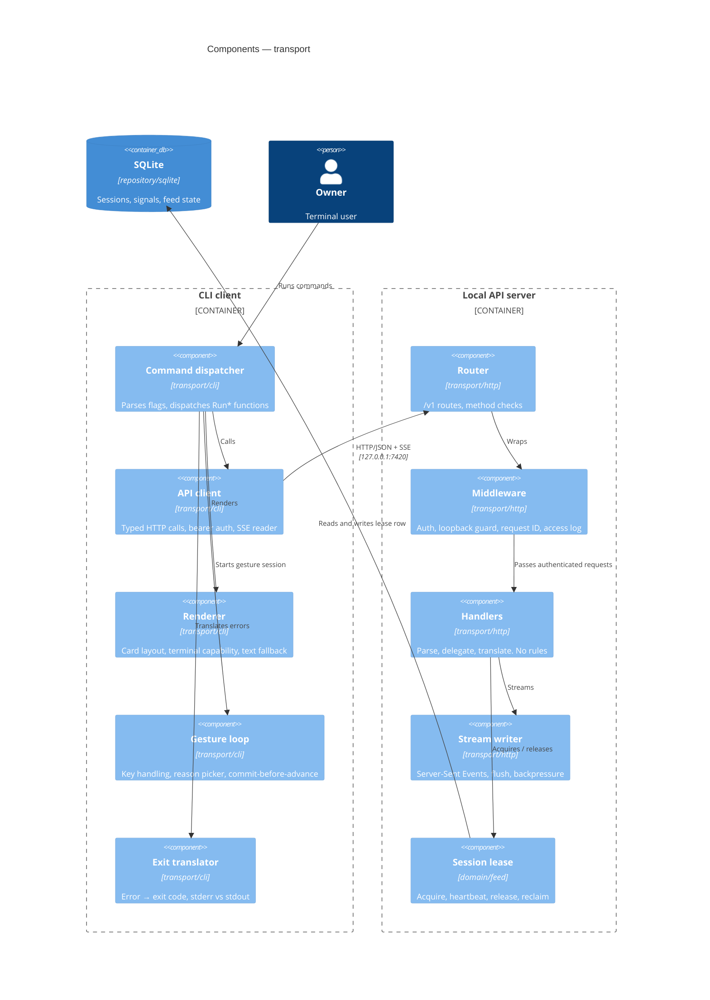

# Components — Transport (CLI client + local API server)

## Metadata

| Field | Value |
|-------|-------|
| **Container(s)** | CLI client, Local API server |
| **Version** | 0.1 (draft) |
| **Date** | 2026-11-02 |
| **Backlog** | `ARCH-103` |
| **Parent** | [`02-container-diagram.md`](../02-container-diagram.md) |
| **Status** | Awaiting gate `G3` |

## Scope

This document covers everything between the terminal and the domain. That includes command
parsing, the typed HTTP client, the router, authentication, the UI lease, the SSE stream
and error translation. **No product rules live here** (`A-2`, `H-7`). If a sentence
describes product behaviour, it belongs in a domain document.

## Component view

## Components

| Component | Responsibility | Explicitly not |
|-----------|----------------|----------------|
| **Command dispatcher** | Parse command, flags, resolve data dir, select `Run*` function | Decide whether a swipe mutes a channel |
| **API client** | Build requests, attach bearer, decode responses, read SSE, classify transport errors | Retry business operations |
| **Renderer** | Draw the card in `CLI-13` order, detect image support, degrade to text | Alter scores or reorder cards |
| **Gesture loop** | Read keys, show the reason picker, send the gesture, wait for acknowledgement | Choose the cold-period scope |
| **Exit translator** | Map domain errors to `CLI-6` codes, keep stdout clean (`CLI-9`) | Print stack traces by default (`E-11`) |
| **Router** | `/v1` surface, 404/405, version prefix | Know the schema |
| **Middleware** | Bearer check, loopback guard, request ID, panic recovery at the edge (`E-14`) | Authorize a user (there is one) |
| **Handlers** | Decode, call the service, encode, map errors (`E-10`) | Any `if` about product behaviour |
| **Stream writer** | Emit SSE events, flush per card, detect client disconnect | Buffer the whole batch |
| **Session lease** | One live UI session (`A-11`), heartbeat, stale reclaim (`OQ-13`) | Hold navigation history |

## Command surface

| Command | Endpoint group | Mutates state |
|---------|----------------|---------------|
| `ytfeed onboard [--reset]` | onboarding | Yes |
| `ytfeed auth login` / `auth status` | identity | Yes / No |
| `ytfeed feed [--size N] [--no-images] [--json]` | feed stream | Yes (session) |
| `ytfeed serve [--allow-remote]` | — (starts the server) | No |
| `ytfeed save <video-id>` | library | Yes |
| `ytfeed library` | library | No |
| `ytfeed mute <target> --for 24h` | taste | Yes |
| `ytfeed stats` | diagnostics | No |
| `ytfeed doctor` | diagnostics | No |
| `ytfeed rubric edit` | analysis | Yes (P1) |
| `ytfeed migrate up` | diagnostics | Yes |
| `ytfeed help` | — | No |

Every command supports `--help` and `--json` (`CLI-3`, `CLI-8`).

## Error and exit-code translation

| Domain error | HTTP | Exit | Note |
|--------------|------|------|------|
| `ErrInvalidInput` | 400 | 2 | |
| `ErrNotFound` | 404 | 3 | |
| `ErrConflict` (lease held, already saved) | 409 | 4 | |
| `ErrQuotaExhausted` | 429 | 5 | `OQ-01`: 6 when a cached feed is served and the command completes |
| `ErrDegraded` | 200 + banner | 6 | Completed with reduced functionality |
| `ErrUnauthorized` | 401 | 2 | Re-auth message |
| unexpected | 500 | 1 | Generic message + correlation ID (`E-11`) |
| `SIGINT` | — | 130 | Persisted state stays consistent (`CLI-7`) |

Translation happens exactly once, at the edge (`E-10`). Handlers return domain errors.
They never construct user-facing strings.

## Streaming contract

`GET /v1/feed` returns `text/event-stream`.

| Event | Payload | Client action |
|-------|---------|---------------|
| `batch.started` | `batch_id`, requested size | Show progress |
| `card.upsert` | full card, stable `position` | Insert or update in place |
| `card.analyzed` | `card_id`, analysis, new position | May move a card forward, never backwards |
| `batch.progress` | analyzed / total | Progress line on stderr (`CLI-24`) |
| `banner` | level, message | Render banner |
| `batch.done` | card count, degraded reason | Enable gestures, exit code hint |
| `error` | code, message, correlation ID | Translate to exit code |

Rules that the stream must enforce:

1. A card never moves backwards past the cursor (`F14`, `CLI-14a`, `OQ-15`).
2. Analyzed cards precede unanalyzed ones. Ties break by score, then discovery order.
3. Every event carries `batch_id`, so a reconnected client can reject stale events.
4. Disconnect is normal. The batch continues, and the lease survives until idle timeout.

`--json` does **not** use the stream. It buffers and prints one JSON array (`OQ-17`).

## Authentication and binding

- Token generated on first server start, `0600`, in `./data/api-token`.
- Every request carries `Authorization: Bearer <token>`. Comparison is constant-time.
- The CLI reads the token and never mints one (`DD-04`).
- Bind `127.0.0.1:7420` by default. A non-loopback bind requires `--allow-remote` and
  prints a warning (`A-10a`).
- The bearer token is never logged. `doctor` prints a fingerprint only (`A-10b`).
- A 401 is not retried. It means the token file and the server disagree.

## Session lease

| Step | Behaviour |
|------|-----------|
| Acquire | Insert or update the lease row for `user_id`; if `last_activity_at` is within `SESSION_IDLE_TIMEOUT`, return `409` (`A-11`, `US-E7`) |
| Heartbeat | Every interaction updates `last_activity_at`; no separate timer needed |
| Release | Clean CLI exit clears the lease |
| Reclaim | A lease older than `SESSION_IDLE_TIMEOUT` is claimable without manual cleanup (`OQ-13`) |
| Crash | No cleanup needed; the lease expires by the same rule |

## Terminal rendering

- Capability is detected once per process from `TERM_PROGRAM`, `KITTY_WINDOW_ID`, `TERM`,
  and the `--no-images` flag (`CLI-15`, `CLI-16`).
- Note: `CLI-15` says "cached in config", but `C-1` and `C-13` make config env-only and
  immutable. Interpretation: the value is memoized in-process and never persisted.
  Detection is cheap.
- Card order is fixed by `CLI-13`: image, title, channel/subs/views/duration/date, topic,
  TL;DR, similarity, why-this-card, state.
- Width is detected. 80 columns must remain readable (`CLI-12`).
- No meaning by colour alone (`CLI-11`).

## Failure modes

| Failure | Behaviour |
|---------|-----------|
| Server not running | CLI spawns `serve`, waits for `/v1/health` with a bounded timeout (`OQ-16`) |
| Port already in use | Explicit message naming the port and the process hint; exit `1` |
| `/v1/health` never becomes ready | Kill the child it started, print the log path, exit `1` |
| `409` lease conflict | "Another ytfeed UI is active (started <time>). Close it or wait for idle timeout." Exit `4` |
| SSE disconnect | CLI reports the correlation ID, keeps persisted state; next run resumes |
| Stale token | 401 → "Run `ytfeed auth login`", exit `2` |
| Terminal without image protocol | Text card, no reserved space (`CLI-16`) |
| Panic in a handler | Edge recovery, logs stack, 500 with correlation ID (`E-14`) |

## Invariants

1. Transport contains zero product rules (`A-2`, `H-7`).
2. Transport never imports `database/sql` or a repository package (`A-15`).
3. One live lease. A stale lease is reclaimable (`A-11`, `OQ-13`).
4. Every request is authenticated. The token never appears in logs or output.
5. `--json` writes exactly one JSON value to stdout and nothing else (`CLI-8`, `OQ-17`).
6. Exit codes are the public contract in `CLI-6`. A change to one needs a rules PR.
7. The stream never reorders a card backwards past the cursor (`CLI-14a`).

## Open questions

`OQ-01` (exit 5 vs 6), `OQ-13` (lease reclaim), `OQ-16` (server lifecycle),
`OQ-17` (`--json`), `OQ-03` (key bindings for save/remove).

## Next

`ARCH-104` — identity and taste components.
