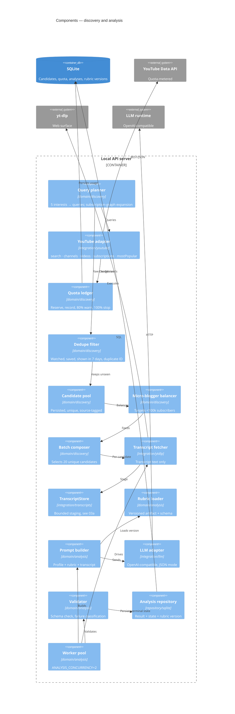

# Components — Discovery and analysis

## Metadata

| Field | Value |
|-------|-------|
| **Contexts** | `discovery`, `analysis` |
| **Version** | 0.1 (draft) |
| **Date** | 2026-11-02 |
| **Backlog** | `ARCH-105` |
| **Parent** | [`02-container-diagram.md`](../02-container-diagram.md) |
| **Sibling** | [`03a-transcript-staging.md`](03a-transcript-staging.md) |
| **Status** | Awaiting gate `G3` |

## Scope

This document covers the engine. It turns five interests and a subscription graph into
20 unique candidates. It then turns transcripts into schema-valid judgments. This is the
pipeline of `A-14`:

```
candidates → dedupe → transcript fetch → analysis → scoring → feed composition
```

Feed composition itself belongs to `ARCH-106`. This document ends at "a scored, analyzed
card exists".

## Component view



## Discovery components

| Component | Responsibility | Rules |
|-----------|----------------|-------|
| **Query planner** | Turn each interest into keyword queries. Expand through related channels from the subscription graph | `F6` |
| **YouTube adapter** | Wrap `search.list`, `channels.list`, `videos.list`, `subscriptions.list`, `videos.list?chart=mostPopular` | `F6`, `F2` |
| **Quota ledger** | Charge before the call, record actual usage, warn at 80%, refuse at 100%, persist per accounting day | `F7`, `OQ-02` |
| **Dedupe filter** | Exclude watched, saved, shown in the last 7 days, and duplicate `video_id` | `F8` |
| **Candidate pool** | Persist candidates with source tag (`search`, `graph`, `trending`) | `F6` |
| **Micro-blogger balancer** | Target ≥ 20% of candidates from channels < 100k subscribers. The threshold is configurable | `F6`, `Q4`, `OQ-09` |
| **Batch composer** | Select exactly 20 unique candidates or fewer with an explicit reason | `F13` |

### Quota costs

| Call | Units | Note |
|------|-------|------|
| `search.list` | 100 | The dominant cost. Five per batch is 500 units; 15 batches/day at 80% budget with metadata |
| `videos.list` | 1 | Metadata for up to 50 IDs |
| `channels.list` | 1 | Subscriber counts, topic tags |
| `subscriptions.list` | 1 | Import, paginated |
| `mostPopular` | 1 | Onboarding seed source |

The ledger refuses a call that would exceed the budget. It does not issue the call and
fail afterwards (`F7`). The 80% warning is printed once per day, not once per call.

## Analysis components

| Component | Responsibility | Rules |
|-----------|----------------|-------|
| **Transcript fetcher** | Obtain transcript text only. Never video or audio | `F9` |
| **`TranscriptStore`** | Bounded staging for crash-safe resume | `ARCH-105a`, `F25` |
| **Rubric loader** | Load the versioned artifact and its JSON schema. Record the version | `A-19`, `F12` |
| **Prompt builder** | Compose profile axes + examples + transcript. No hidden rules | `A-20` |
| **LLM adapter** | One OpenAI-compatible chat adapter. Runtime differences are presets | `A-12a`, `F26` |
| **Validator** | Schema validation and failure classification. Never coerce | `A-12b`, `F11` |
| **Analysis repository** | Persist result, state, reason, rubric version, model id | `F12` |
| **Worker pool** | Bound in-flight LLM requests to `ANALYSIS_CONCURRENCY` | `NFR` |

### Analysis result

| Field | Required | Failure behaviour |
|-------|----------|-------------------|
| `topic` | Yes | Missing → `invalid_model_output` |
| `tldr` | Yes | Missing → `invalid_model_output` |
| `axis_scores[]` | Yes | One per profile axis, each with a one-line justification (`A-20`) |
| `marketing_score` | Yes | `[0,1]` |
| `ai_slop_score` | Yes | `[0,1]` |
| `similarity` | Yes | "similar to X" or `new territory` |
| `new_territory` | Yes | Boolean |
| `why_this_card` | Yes | One sentence |
| `state` | Yes | `analyzed` \| `failed` |
| `reason` | On failure | `no_transcript` \| `analysis_slow` \| `invalid_model_output` |
| `rubric_version` | Yes | Bound at analysis time (`F12`) |
| `model_id` | Yes | Which runtime produced it |

No field is optional "because the model forgot". An incomplete object is a failure, not a
partial card (`E-12`).

## Failure classification

| Condition | State | Reason | Card shown |
|-----------|-------|--------|------------|
| No transcript | `failed` | `no_transcript` | Yes, as unanalyzed (`US-E1`) |
| LLM timeout | `failed` | `analysis_slow` | Yes |
| Schema-invalid JSON | `failed` | `invalid_model_output` | Yes, never coerced (`US-E2`) |
| Staging write fails | — | — | Analysis continues from memory (`03a` §13) |
| Quota exhausted before discovery | — | — | Cached feed, banner (`F24`) |

## Invariants

1. A candidate is unique by `video_id` (`D-19`).
2. A call is never issued if it would exceed the daily budget (`F7`).
3. At most `ANALYSIS_CONCURRENCY` LLM requests are in flight (`NFR`).
4. Transcripts are fetched only as text, never as media (`F9`).
5. Transcripts are staged only through `TranscriptStore` (`ARCH-105a`). No other
   component writes transcript bytes to disk.
6. An invalid model response becomes `failed: invalid_model_output`, never a plausible
   card (`A-12b`).
7. Every analysis row carries the rubric version that produced it (`F12`).
8. Analysis failure never stops the batch. The card is still shown (`F11`).
9. Discovery never waits for analysis to finish before the next candidate is fetched
   (`F14`).

## Failure modes

| Failure | Behaviour |
|---------|-----------|
| YouTube 403 quota | Stop search calls, serve cached feed, banner with reset time (`F7`, `F24`) |
| YouTube 5xx / offline | Retry once with backoff, then degrade (`F24`) |
| No candidates after dedupe | Explicit empty-feed explanation and next action (`US-E6`) |
| Micro-blogger floor not met | Banner naming the shortfall; never pad with mismatched channels (`OQ-09`) |
| yt-dlp missing | `feed` degrades, exit `6` (`SD-6`, `OQ-12`) |
| yt-dlp fails per video | Card `no_transcript`, batch continues |
| LLM unreachable | Cards `analysis_slow`, batch continues |
| LLM returns prose | `invalid_model_output`, visible state (`R2`) |
| Worker crash | Staged transcripts survive; resume without re-fetch (`F25`) |

## Open questions

`OQ-01`/`OQ-02` (quota semantics), `OQ-06` (opencode), `OQ-07` (rubric location),
`OQ-09` (micro-blogger floor), `OQ-12` (yt-dlp absence).

## Next

`ARCH-106` — feed and library components.
