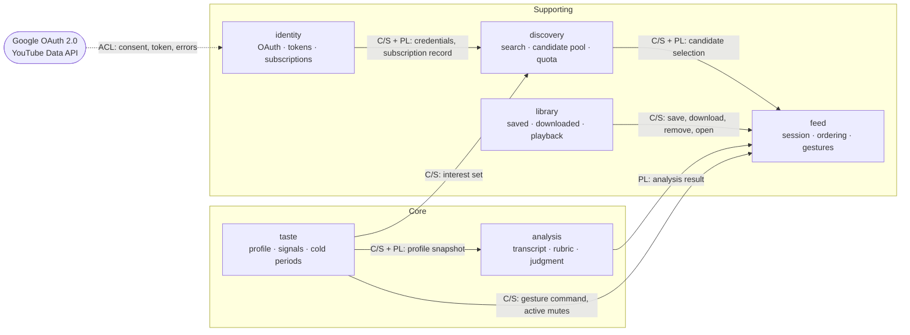

# DDD strategic — bounded context map

## Metadata

| Field | Value |
|-------|-------|
| **Domain** | `ytfeed` — personal YouTube feed composition |
| **Document** | DDD strategic design: viability check and context map |
| **Backlog** | `ARCH-201` (viability), `ARCH-203` (contexts and relationships) |
| **Version** | 1.0 |
| **Date** | 2026-11-03 |
| **Owner** | Oleg K |
| **Status** | Confirmed at gate `G4` (2026-11-03) |
| **Sources** | [`prd-ytfeed.md`](../../../10-product/prd-ytfeed.md), [`02-architecture.md`](../../../00-rules/02-architecture.md), [`04-data-persistence.md`](../../../00-rules/04-data-persistence.md), [`08-cli-and-ux.md`](../../../00-rules/08-cli-and-ux.md), [`DECISIONS.md`](../../../00-rules/DECISIONS.md), [`c4/`](../../c4/), [`flows/`](../../flows/), [`open-questions.md`](../../open-questions.md) |
| **Siblings** | [`subdomain-map.md`](subdomain-map.md), [`glossary.md`](glossary.md) |
| **Next** | `ARCH-301`…`ARCH-307` (tactical design) |

## 0. Scope, method, and how to read this document

This document does two things. It deliberately does not do a third:

1. It records the **DDD viability check** (`ARCH-201`), because a strategic vocabulary that
   is not justified is ceremony.
2. It records the **bounded context map, relationship patterns and `A-7` validation**
   (`ARCH-203`).
3. It does **not** model aggregates, invariants, entities or domain events. Those are
   Phase 3 (`ARCH-301`…`ARCH-307`). Pre-empting them here would turn a boundary document
   into a tactical draft.

The six contexts are fixed by `A-7` and `R-8`. This document **validates** that split. It
does not invent a new one. A different split needs an ADR and a rules-PR proposal. It would
also stop the task (`backlog.md`, `ARCH-203` note, `H-9`).

**Method.** Each subdomain was derived from the PRD capability table (`F1`…`F28`, §15.1
epics E1–E6). Each was tested against three questions. Does it create the differentiator?
Could a commodity component replace it without losing the product promise? Does it have a
distinct model, language and failure mode? The derivation is in
[`subdomain-map.md`](subdomain-map.md). The vocabulary is in [`glossary.md`](glossary.md).

**How to read the arrows.** Arrows point from the **upstream** context to the
**downstream** context. That is the direction of model influence, not the direction of the
HTTP call. `feed` initiates most calls, but it is the *customer* in all of them. The
supplier owns the contract it must satisfy (`A-7`, `A-14`).

### Template coverage

The DDD context-map template lists ten sections. This is where each one lives:

| Template section | Where it is |
|------------------|-------------|
| Business Domain | §2 |
| Ubiquitous Language | [`glossary.md`](glossary.md) |
| Bounded Contexts | §3 |
| Context Map | §4, §5 |
| Data Ownership | §7 |
| Aggregates | Phase 3 — `ARCH-301`…`ARCH-306` |
| Invariants | Phase 3 — `ARCH-301`…`ARCH-306` |
| Domain Events | Phase 3 — `ARCH-307` |
| Integration Events | §6 (contracts only; evented patterns are not adopted) |
| Open Boundaries | §9, §10 |

---

## 1. DDD viability check (`ARCH-201`)

### 1.1 The four questions

The questions are reproduced verbatim from the strategic-design prompt
(`preparation/docs/prompts/02-architecture/02-ddd-strategic-en.md`, step 1). Answers are
derived from the PRD and the frozen rules. The owner confirms them at `G4`.

| # | Question | Answer | Primary evidence |
|---|----------|--------|------------------|
| 1 | Are the business rules complex or frequently changing? | **Yes** | `F13`, `F14`, `CLI-14a`, `OQ-15` (ordering); `CLI-20a`, `R-17` (scope from reason); `F7`, `OQ-02` (quota); `F5`, `OQ-18` (profile update); `A-19`, `F12`, `BG-3` (rubric is versioned and edited) |
| 2 | Do multiple teams work on the system and risk conflicting models? | **No** | PRD §2 (one owner in v1); `SD-7` (friends run independent instances); `A-11` (one UI at a time); `R-10` (one binary) |
| 3 | Are integration contracts with other systems unstable or frequently revised? | **Yes** | `F26`, `A-12a` (any OpenAI-compatible runtime); `R1` (opencode API unknown); `R4` (`yt-dlp` fragility); `R6` (Ollama/MoE incompatibility); `SD-6` (yt-dlp optional for `library`) |
| 4 | Are auditability, explicit invariants, or regulatory compliance critical requirements? | **Yes** | `D-20` (signal committed before advance); `D-21`, `F19` (cold periods retained for audit); `F12`, `A-19` (rubric version per result); `A-20` (every score justified); `F21` (rating tied to feed IDs). No regulatory regime: C4 L1 trust boundary |

### 1.2 Why each answer holds

**Q1: yes. The "frequently changing" half is explicit.** The rule set is small but
interlocking. Several rules fail *silently* if the model is loose. Analyzed-first ordering
has a monotone cursor and late analysis (`F14`, `CLI-14a`, `OQ-15`). One cold period
follows each left-swipe, with scope from the reason (`CLI-20a`, `R-17`). The quota ledger
reserves before the call, warns once at 80% and stops at 100% (`F7`). The profile update
magnitude and clamping are a tunable, versioned rule (`F5`, `OQ-18`). The rubric is not
code. It is a versioned content artifact expected to be edited at least twice (`A-19`,
`BG-3`, `F32`). This is not enterprise workflow complexity. It is a small domain with
non-obvious invariants and one deliberately evolving rule set.

**Q2: no. That changes what the boundaries are for.** There is one owner, one agent and
one binary (`PRD §2`, `R-10`, `SD-7`). A bounded context here cannot be a team boundary. It
must justify itself by **failure isolation, change cadence and distinct language**. That is
how `A-7` frames it ("Failure mode it isolates"). This is the most important limitation of
the whole strategic exercise. The six contexts are technical isolation boundaries, not
organisational ones. The document should say so rather than imply a team topology that does
not exist.

**Q3: yes.** Two external surfaces are explicitly unstable. The LLM provider contract is
the design's highest technical risk (`R1`, `R2`, `R6`). It is deliberately reduced to one
OpenAI-compatible adapter with presets (`F26`, `A-12a`). `yt-dlp` reads an undocumented web
surface that changes without notice (`R4`) and is optional for `library` (`SD-6`). `A-12`
already requires every external dependency to be a port. DDD gives the same move a name,
an anti-corruption layer, and makes it a boundary rule rather than an implementation habit.

**Q4: yes on auditability and invariants. No on regulation.** The product's asset is the
signal history. Losing one loses the only thing the product accumulates (`D-20`. Component
`02` calls signals "the product's only asset"). Cold periods are records and are retained
after expiry (`D-21`, `F19`). Every analysis carries the rubric version that produced it
(`F12`, `A-19`). Every axis score carries a one-line justification so a rejection can
always be explained (`A-20`). There is no payment data, no regulated personal data category
and no processor role (C4 L1, "Compliance boundaries").

### 1.3 Score and recommendation

**Score: 3 of 4.** By the prompt's scale, 2–3 means *"DDD is appropriate. Continue with
strategic design."*

The recommendation is **to continue with strategic DDD**. The shape is already fixed by
`SD-3`:

| Layer of DDD | Decision | Source |
|--------------|----------|--------|
| Strategic | **Adopt**: six contexts, subdomain classes, context map with named patterns, ubiquitous-language glossary | `A-7`, `R-8`, this document, `ARCH-202`, `ARCH-204` |
| Tactical | **Adopt at two depths**: full for `taste`, `feed`, `discovery`, `analysis`; light for `identity`, `library` | `SD-3` |
| Evented (CQRS, event sourcing) | **Not implied by this score.** Assessed separately at `ARCH-307`, whose expected outcome is no CQRS, no event sourcing, one in-process process manager for batch resume | `backlog.md` `ARCH-307` |

This is neither the 0–1 "overkill" path nor the score-4 "full strategic + tactical +
evented" path. The distinction matters. A 3 buys the **language and the boundaries**, not a
licence to add event infrastructure. There is no queue, no broker and no worker binary
(`A-14`, C4 L2, "Containers deliberately absent").

**Why the score is not 4.** Q2 is a firm no. There is no multi-team model conflict to
resolve, and no regulatory driver. A 4 would recommend full evented design for a system
whose pipeline is deliberately in-process and database-checkpointed.

### 1.4 Sensitivity — the only contestable answer

Q1 is the only answer that a reasonable owner could flip. One could argue that the business
rules are *frozen* (`DECISIONS.md`: all 27 decisions closed) and that rubric edits are
content, not rules. If Q1 is answered **no**, the score is **2**. That is still inside the
"appropriate" band and produces the same recommendation.

The recommendation is therefore stable under the only contestable answer. Q2–Q4 are not
close. There is no team, the integrations are demonstrably unstable, and the invariants are
explicit in the rules.

### 1.5 What the viability check does not decide

- It does not confirm the six boundaries. That is gate `G4` (§10).
- It does not choose the subdomain classes. That is `ARCH-202` and §10.
- It does not adopt any evented pattern. That is `ARCH-307`.
- It does not authorize a fourth layer (`A-1`) or a `shared/` grab-bag (`A-8`).

---

## 2. Business domain

`ytfeed` turns three inputs into a finite, ranked, **explained** set of cards. The inputs
are the owner's subscription graph, a small set of stated interests, and the owner's
gestures. It judges each candidate's transcript against a versioned rubric and a structured
taste profile (`PRD` §1, §7). The domain is not "YouTube search" and not "file storage". It
is **judgment plus preference**. The system must say why a card is here and why a card was
rejected (`A-20`, `CLI-13`). It must also get better at that from use (`F5`, `D-20`).

That sentence drives every classification in this phase. Capabilities that produce the
judgment or the preference are core. Capabilities that feed them or deliver them are
supporting. What remains is plumbing, and this domain classifies none of its capabilities
that way.

---

## 3. Bounded contexts (`ARCH-203`)

The six contexts are fixed by `A-7`. The subdomain column comes from
[`subdomain-map.md`](subdomain-map.md). The mapping is one-to-one because each context is
also the isolation boundary for one failure mode (`A-7`).

| Context | Subdomain | Model focus | Owns (logical state) | Failure it isolates |
|---------|-----------|-------------|----------------------|---------------------|
| `identity` | Supporting | Credentials, consent, the subscription graph | Users, credential metadata, channels, subscriptions | Expired or revoked credentials |
| `taste` | Core | The durable preference: axes, interests, signals, cold periods | Profile, axes, interests, examples, signals, cold periods | Corrupted personalization |
| `discovery` | Supporting | Turning interests into a bounded candidate set | Normalized video metadata, candidate pool, quota ledger | API quota exhaustion |
| `analysis` | Core | Turning a transcript into an explicable judgment | Analyses, transcript staging state, rubric version binding | Model latency or garbage output |
| `feed` | Supporting | The daily loop: session, ordering, gestures, rating | Batches, sessions and lease, cards and positions, ratings | Nothing. It is pure orchestration (`A-7`). |
| `library` | Supporting | Saved and downloaded videos, local playback | Library entries, media metadata | Disk and player failures |

All six contexts are core or supporting. `identity` is **supporting** by the `G4-4` decision
on 2026-11-03. Its mechanics are commodity, but the imported subscription graph is treated
as a proprietary taste asset. The map therefore has no generic context, and no arrow in it
changes because of that classification.

**What a context is not.** A context is not a package folder (`A-9` is the physical
layout), not a container (C4 L2 has four containers), and not a layer (`A-1` has three). The
six contexts cut *across* the domain layer. Each has its own domain package, repository
interface, tables and tests (`A-7`).

### 3.1 The one-to-one mapping is a choice, not a law

DDD allows a subdomain to span several contexts and a context to host several subdomains.
Here the mapping is one-to-one because the `A-7` split is a **failure-isolation** split.
Failure isolation is most useful when the model boundary and the failure boundary coincide.
No subdomain was split to create a context. No context was merged to simplify the map.

---

## 4. Context map

`C/S` = Customer/Supplier. `PL` = Published Language. `ACL` = Anti-Corruption Layer.

**The shape is the finding.** Every runtime path **ends in `feed`**. The map is acyclic and
`feed` is its only sink. No context depends on a model owned by `feed`. That is the visual
proof of `A-7`'s claim that `feed` is pure orchestration. It also gives the tactical phase
a hard constraint: if a later design makes a context read `feed`'s internals, the boundary
has been broken.

`discovery` and `analysis` are drawn as separate contexts and are **not** connected to
each other. `feed` is the only caller between them (`A-14`). That is a conscious
`Separate Ways` relationship, not an omission.

---

## 5. Relationship patterns

### 5.1 Relationships that exist

| # | Upstream (supplier) | Downstream (customer) | Pattern | Contract | Why this pattern | Source |
|---|---------------------|-----------------------|---------|----------|------------------|--------|
| REL-1 | Google OAuth 2.0 / YouTube Data API | `identity` | **Anti-Corruption Layer** | OAuth adapter translates grants, refresh failures and API errors into the credential model | Protects the domain from Google's token and error shapes; the external model must never become a domain type | `F1`, `A-12` |
| REL-2 | `identity` | `discovery` | **Customer/Supplier** with a **Published Language** payload | Credential access as a service; `SubscriptionRecord {channel_id, title, subscriber_count, topic_tags}` | `discovery` is the only consumer today and can demand refresh semantics without `identity` knowing how search works | `F2`, `F6`, `A-12` |
| REL-3 | `taste` | `discovery` | **Customer/Supplier** | `InterestSet` (1–10, default 5) | `discovery` may report it cannot support an interest (`F3`), so the downstream has real influence on the contract | `F3`, `F6`, `OQ-08`, `OQ-19` |
| REL-4 | `taste` | `analysis` | **Customer/Supplier** with a **Published Language** payload | `ProfileSnapshot {axes, weights, examples, note, rubric_version}` | A change to the axis shape forces the prompt builder to change; `analysis` may require per-axis justification (`A-20`) | `F4`, `F10`, `A-20` |
| REL-5 | `discovery` | `feed` | **Customer/Supplier** with a **Published Language** payload | `CandidateSelection` — ≤ 20 ordered candidates, each with a metadata snapshot, source and subscriber count | `discovery` owns selection, quota and the micro-blogger rule; `feed` must not reimplement them | `F6`, `F7`, `F8`, `F13`, `OQ-09` |
| REL-6 | `analysis` | `feed` | **Published Language** | `AnalysisResult` — schema-constrained JSON, `state`, `reason`, `rubric_version`, `model_id` | This is the one true exchange document: versioned, validated, and never coerced (`A-12b`, `F11`, `F12`) | `F10`, `F11`, `F12`, `A-12b` |
| REL-7 | `taste` | `feed` | **Customer/Supplier** | `RecordGesture` command (keyed by `gesture_id`) and `ActiveColdPeriods` query | `feed` applies the gesture but `taste` owns the signal and the cold period; `taste` commits before `feed` advances (`D-20`) | `F5`, `F16`, `F19`, `D-20`, `CLI-20a` |
| REL-8 | `library` | `feed` | **Customer/Supplier** | `save`, `download`, `remove`, `open`; entry state `saved` / `downloaded` | Thin, local and failure-isolated: a dead player must not stop card navigation | `F17`, `F20`, `OQ-04` |

### 5.2 Relationships that are deliberately absent

| Pair | Pattern | Why |
|------|---------|-----|
| `discovery` ↔ `analysis` | **Separate Ways** | No direct call path. `feed`'s batch orchestrator is the only caller (`A-14`). A transcript is not a candidate, and a judgment is not a query. |
| `identity` ↔ `feed` | **Separate Ways** | A session needs the local API token, not a Google credential (`F18`, `A-10b`). |
| `identity` ↔ `library` | **Separate Ways** | Downloads use `yt-dlp`; no OAuth scope is involved (`SD-6`, `F20`). |
| `taste` ↔ `library` | **Separate Ways** | A save is a positive signal, but the signal is routed by `feed` through `taste`'s command. `library` never reads the profile. |
| `analysis` ↔ `library` | **Separate Ways** | No call path. |
| `discovery` ↔ `library` | **Separate Ways** | The saved set reaches `discovery` inside the `ExclusionSet` supplied by `feed` (§6.4). |

**Not in this table.** Onboarding (`identity` → `taste` / `discovery`) is a use-case
orchestration, not a context relationship. It is described in §9.1. Drawing it as an arrow
would create a false two-way edge between `identity` and `discovery`.

### 5.3 Patterns that do not appear, and why

| Pattern | Present? | Reason |
|---------|----------|--------|
| **Shared Kernel** | **No** | `A-8` forbids a grab-bag package, and the C4 consistency check left `shared/` empty on purpose. Identifiers are per-context value objects. `video_id` is a shared *key*, not a shared *type*. |
| **Conformist** | **No** | Every external model is translated behind a port (`A-12`). A domain that conforms to Google's or a model runtime's shape would leak an unstable contract into the core. |
| **Open Host Service** | **No, today** | Every upstream has exactly one consumer, so a stable multi-consumer API would be over-engineering. The first candidate is `identity`'s credential service if a second consumer arrives (e.g. a web UI, `F35`). |
| **Partnership** | **No** | The only candidate is `identity` ↔ `discovery` during onboarding. That is a use-case dependency, not a jointly owned model (§9.1). Declaring a partnership would add coordination cost for a supporting context whose model does not flow back. |

---

## 6. Integration contracts and boundary rules

### 6.1 Contracts

| Contract | Provider → consumer | Shape | Versioning / idempotency |
|----------|---------------------|-------|--------------------------|
| Credential access | `identity` → `discovery` | Service call returning a usable access token; the token never becomes a domain value, is never logged and is never persisted by the consumer | Refresh is single-flight; a revoked grant returns `ErrUnauthorized`, exit `2` (`F1`, `C-2`, `L-10`) |
| `SubscriptionRecord` | `identity` → `discovery` | `channel_id` (natural key), title, subscriber count, topic tags | Upsert by `channel_id`; import is idempotent (`F2`, `D-19`) |
| `InterestSet` | `taste` → `discovery` | 1–10 interests, default 5 | Validated at onboarding; a shortfall is reported, never padded (`F3`, `OQ-08`) |
| `ProfileSnapshot` | `taste` → `analysis` | Axes, weights, positive and negative examples, note, `rubric_version` | Bound at analysis time; the result records the rubric version (`F4`, `F12`, `A-20`) |
| `CandidateSelection` | `discovery` → `feed` | ≤ 20 unique candidates, ordered, with metadata snapshot, source and subscriber count | Idempotent by `video_id`; fewer than 20 needs an explicit reason (`F8`, `F13`, `D-19`) |
| `AnalysisResult` | `analysis` → `feed` | Schema-constrained JSON with `state`, `reason`, `rubric_version`, `model_id` | Validated before persistence; never coerced (`A-12b`, `F11`, `F12`) |
| `GestureCommand` | `feed` → `taste` | `gesture_id`, `card_id`, `video_id`, `channel_id`, `topic`, `gesture`, `reason`, scored axes (taste-owned value object), `rubric_version` | `gesture_id` is the idempotency key; a retry returns the original outcome (`CLI-18`) |
| `LibraryCommand` | `feed` → `library` | `video_id`, operation (`save`, `download`, `remove`, `open`) | Idempotent by `video_id`; removal is not destructive to the database (`CLI-19`) |

### 6.2 Boundary rule 1 — `feed` translates, contexts do not read each other's schema

`analysis` publishes `axis_scores` in its own document. `taste` needs a scored-axis value
in its gesture command. **`feed` performs the translation.** `taste` never imports the
analysis schema. `analysis` never imports the taste schema.

This keeps the map acyclic. `taste` depends on `analysis` only for supplying the profile
(REL-4). `analysis` does not depend on `taste` at all. A direct `taste → analysis` read of
scores would create a second, opposite dependency between the same two core contexts. That
is the most expensive cycle the design could have.

**Consequence:** if the analysis schema changes, the translator in `feed` changes. That is
one deliberate coupling point, and it is cheaper than a core-to-core cycle.

### 6.3 Boundary rule 2 — commit order is the contract, not a distributed transaction

The gesture path crosses a boundary. `feed` receives the gesture, `taste` commits the
signal and the cold period, and `feed` advances the cursor. The rules allow a transaction
handle when a caller composes writes (`D-16`, `D-17`). Sharing a transaction across a
context boundary would couple the two repository implementations and break `A-7`.

The contract is therefore **ordered commits**, not one transaction:

1. `taste` commits the signal, and for a left-swipe the cold period, atomically and
   returns `applied`.
2. `feed` advances the cursor only after that acknowledgement (`D-20`).
3. A crash between (1) and (2) leaves the signal stored and the card current. The retry is
   safe because `gesture_id` is the idempotency key (`CLI-18`).

`D-20` is satisfied without a cross-context transaction. The signal is durable before the
UI advances. The cursor is navigation state, not a fact that must commit with the signal.

### 6.4 Boundary rule 3 — dedupe data is supplied, the dedupe rule is owned

`F8` requires excluding videos already watched, saved, shown in the last 7 days, or
duplicated by ID. The *rule* belongs to `discovery` (it owns the candidate pool). The *data*
belongs to `feed` (shown history) and `library` (saved set).

`feed` assembles an `ExclusionSet` and passes it in the `CandidateSelection` request.
`discovery` never reads `feed` or `library`. This keeps the map acyclic and keeps
`discovery` testable with a plain input.

**Rejected alternative:** `discovery` querying `feed` and `library` directly. It would
create two back-edges into the orchestrator and make the pool depend on the daily loop.

---

## 7. Data ownership

Logical ownership only. Physical table names and columns are fixed in the tactical phase
and in `migrations/` (`D-9`…`D-12`).

| Context | Owns | Cross-context references it holds | Never owns |
|---------|------|-----------------------------------|------------|
| `identity` | Users, credential metadata, channels, subscriptions | `user_id` | Profile, signals, candidates, cards |
| `taste` | Profile, axes, interests, examples, signals, cold periods | `user_id`, `video_id`, `channel_id`, `card_id` | Rubric artifact, analyses, cards |
| `discovery` | Normalized video metadata, candidate pool, quota usage | `user_id`; interests supplied in the call | Analyses, cards, library entries |
| `analysis` | Analyses, transcript staging state, rubric version binding | `video_id`; profile supplied in the call | Profile, candidates, cards |
| `feed` | Batches, sessions and lease, cards and positions, weekly ratings | `user_id`, `video_id` | Profile, analyses, library entries |
| `library` | Library entries, media metadata and file references | `user_id`, `video_id` | Video discovery metadata, cards |

**Rules.**

1. **One writer.** Every row has exactly one owning context. A second writer is a boundary
   violation even if the SQL would work (`A-7`, `D-1`).
2. **No cross-context foreign key.** A reference is a value (`video_id`, `batch_id`), not a
   join. Integrity comes from the natural key plus the owning context (`D-19`). `D-18`
   applies to the foreign keys that exist *inside* a context. The tactical phase confirms
   this design decision. It is the schema-level expression of `A-7`.
3. **No shared table and no shared view.** A read model is a contract (§6.1), not a SQL view
   over another context's tables.
4. **`video_id` is a shared key, not a shared type.** Each context defines its own
   `VideoID` value object. This is the "no shared kernel" rule in practice.
5. **`user_id` on every row** (`D-22`), even though v1 has one user.
6. **`library` keeps its own display snapshot.** It does not read `discovery` to render a
   title, so a discovery failure cannot blank the library (`CLI-22`).

---

## 8. Does the model validate `A-7`?

### 8.1 Context-by-context check

| `A-7` context | Owns per `A-7` | Verdict | Drift found |
|---------------|----------------|---------|-------------|
| `identity` | OAuth, token refresh, imported subscriptions | **Confirmed** — supporting subdomain (`G4-4`) | Additive: the onboarding orchestrator and seed-source selection also live here (`ARCH-104`, `CLI-25`…`CLI-27`). See §9.1. |
| `taste` | Profile, signals, cold periods, rubric weights | **Confirmed** — core subdomain | `A-7`'s phrase "rubric weights" is ambiguous against `A-19` and `A-20`. Recorded as `OQ-20`. |
| `discovery` | YouTube search, candidate pool, quota accounting | **Confirmed** — supporting subdomain | Additive: the dedupe rule and the micro-blogger balance are pool rules (`F6`, `F8`), consistent with "candidate pool". |
| `analysis` | Transcript fetch, LLM calls, rubric application | **Confirmed** — core subdomain | Additive: transcript staging state (`ARCH-105a`, `F9`) is part of transcript fetch. |
| `feed` | Composition, sessions, card ordering, gestures | **Confirmed** — supporting subdomain | Additive: the weekly rating (`F21`) has no home in `A-7`'s "owns" list. It needs a context with session and feed identity. `feed` is the only candidate. Proposed as a rules-text annotation, **not applied** (`H-9`). |
| `library` | Saved videos, downloads, local playback | **Confirmed** — supporting subdomain | Additive: the `saved` state without a file (`OQ-04`) is still a "saved video", so the row stands. |

### 8.2 Verdict

- **Six contexts, none merged, none split, none added.**
- **No change to `A-7` is proposed.** No ADR and no rules PR are required for the split.
- Two additive ownership notes (`feed` / weekly rating, `analysis` / staging state) are
  recorded as findings, not rule edits (`H-9`, `SD-4`).
- One rule-wording ambiguity is escalated as `OQ-20` (what `A-7` means by "rubric weights").
- Technical capabilities are **not** contexts and must not become a seventh one. This
  includes transport, persistence, diagnostics and configuration. They are layers,
  containers and adapters (`A-1`, `A-9`, C4 L2).

---

## 9. Boundary risks

| # | Risk | Why it matters | Mitigation |
|---|------|----------------|------------|
| 1 | **`feed` is a coupling sink** | It is downstream of four contexts (`taste`, `discovery`, `analysis`, `library`), so its failure surface is the union of theirs. | Keep `feed`'s model thin (session, card, cursor, rating) and translate at every boundary. Full tactical depth for `feed` (`SD-3`) is justified by its invariants, not by model richness. |
| 2 | **`taste` and `analysis` share the rubric's axis vocabulary** | A rubric version bump can change the axis set. The stored profile may no longer match the loaded rubric (`F4`, `F12`, `A-19`, `A-20`). | `ProfileSnapshot` carries `rubric_version`. `analysis` records the mismatch instead of silently scoring missing axes. Tactical rule for `ARCH-301` and `ARCH-304`. |
| 3 | **Onboarding orchestration sits in `identity`** | It calls `taste` and `discovery`. A naive reading makes `identity` depend on both, creating a two-way edge with `discovery`. | Treat it as an application-service use case, not a model dependency (§9.1). Confirmed at `G4`. If it grows, move it to `feed`, which `A-7` already declares the orchestrator, through an ADR. |
| 4 | **`identity` can drift into `taste`'s model** | It is supporting since `G4-4` because the subscription graph is a taste asset. That framing invites storing interests, profile hints or axes here "because the graph is taste". | `identity` supplies channels, subscriptions and topic tags only. Interests, axes, signals and cold periods stay in `taste` (§7). `identity` never writes profile state. |
| 5 | **Dedupe crosses two contexts** | `F8` needs feed history and the saved set, owned by `feed` and `library`. | `feed` supplies an `ExclusionSet`. `discovery` owns the rule (§6.4). Confirmed at `G4`. |

### 9.1 Onboarding — a use case, not a context relationship

`ARCH-104` places the two-step onboarding orchestrator in `domain/identity` because `A-1`
allows no application layer. It calls `taste` to store interests and `discovery` to propose
them (`CLI-25`…`CLI-27`, `F3`).

Read as a *model* dependency, that would make `identity` a customer of both `taste` and
`discovery`. But `identity` is already the supplier of credentials and subscriptions to
`discovery`. That creates a two-way edge with a supporting context. The reading overstates
the coupling. No domain model flows from `discovery` back into `identity`. Onboarding is a
**use-case coordinator** that calls published interfaces and stores the result through
`taste`.

The map therefore does **not** draw it as a context arrow. The placement is a `G4`
confirmation item. The alternatives are (a) keep it in `identity` as a use case, and (b)
move it to `feed` in a later ADR. Option (a) is the default because it avoids reopening
confirmed Level 3 artifacts (`c4/03-components/02-identity-taste.md`).

---

## 10. Decisions confirmed at `G4`

All nine rows were confirmed by the owner on 2026-11-03. The Resolution column is the
decision of record. The Consequence column states what a later change would cost. Changing
any of them now requires a new decision. A boundary change requires an ADR plus a rules-PR
proposal (`H-9`).

| # | Decision | Resolution | Consequence if changed |
|---|----------|------------|------------------------|
| G4-1 | Confirm the six contexts and the one-to-one subdomain mapping | As in §3 | A different split needs an ADR plus a rules-PR proposal (`ARCH-203` note) |
| G4-2 | Confirm the subdomain classes | Core: `taste`, `analysis`. Supporting: `discovery`, `feed`, `library`, `identity`. Generic: none | Changes where tactical depth is invested (`SD-3`) and what `ARCH-601` sequences first |
| G4-3 | Confirm the relationship patterns and directions | Every runtime path ends in `feed`; `feed` is the only sink; no shared kernel, no conformist, no OHS | A different direction implies a different orchestrator and a different contract owner |
| G4-4 | `identity`'s subdomain class | **Supporting** — the subscription graph is a proprietary taste asset. Tactical depth stays light per `SD-3` | Supporting framing risks drift into `taste`'s model; guarded by §9 risk 4. Depth is unchanged unless `SD-3` is reopened |
| G4-5 | Confirm that `feed` supplies the `ExclusionSet` and `discovery` owns the dedupe rule | As in §6.4 | The alternative creates back-edges from `discovery` into `feed` and `library` |
| G4-6 | Confirm onboarding stays in `identity` as a use-case coordinator | **Keep**; no C4 edit | Moving it to `feed` requires an ADR and a Level 3 revision |
| G4-7 | Resolve or accept `OQ-19` (interests, topics, axes) | Four concepts; interests and topics share a slug namespace; topic tags are separate metadata; axes are independent | Affects `ARCH-301`, `ARCH-303`, `ARCH-304` and the glossary |
| G4-8 | Resolve or accept `OQ-20` ("rubric weights" in `A-7`) | `taste` owns profile axis weights; `analysis` owns the rubric artifact | Affects `ARCH-301`, `ARCH-304`, `ADR-0004` |
| G4-9 | Confirm that transport, persistence and diagnostics are not contexts | Confirmed as layers/containers (`A-1`, `A-9`) | A seventh context would contradict `A-7` and need an ADR |

**Gate `G4` passed 2026-11-03.** `ARCH-201`…`ARCH-205` are `DONE`. The six boundaries are
frozen for this design. `OQ-19` and `OQ-20` are resolved.

---

## 11. Deferred to tactical design

| Topic | Task | Note |
|-------|------|------|
| Aggregates, invariants, value objects per context | `ARCH-301`…`ARCH-306` | Depth per `SD-3` |
| Domain events and the evented-pattern assessment | `ARCH-307` | Expected: no CQRS, no event sourcing, one in-process process manager for batch resume |
| Repository transaction boundaries | `ARCH-301`…`ARCH-306` | `D-16`/`D-17`; no cross-context transaction (§6.3) |
| Identifier types | `ARCH-301`…`ARCH-306` | Per-context `VideoID`, `CardID`, …; no shared kernel |
| Rubric/profile compatibility rule | `ARCH-301`, `ARCH-304` | §9 risk 2 |
| Physical schema and FKs | `ARCH-302`, `ARCH-306`; migrations | §7 rule 2 |

---

## 12. Open questions

`OQ-19` and `OQ-20` were resolved at gate `G4` on 2026-11-03 (§10). The entries below remain
open and constrain the tactical phase.

| ID | Relevance |
|----|-----------|
| `OQ-04` | `saved` vs `downloaded`; the `library` model (§7) |
| `OQ-08` | Interest count: default 5, range 1–10 (REL-3) |
| `OQ-09` | Micro-blogger floor is a target, not a gate (REL-5) |
| `OQ-15` | Late analysis stays in place (ordering) |
| `OQ-18` | Weight update rule is versioned with the rubric (REL-4, REL-7) |

---

## 13. Next step

Gate `G4` passed on 2026-11-03. All nine decisions in §10 are confirmed,
`ARCH-201`…`ARCH-205` are `DONE`, and the six boundaries are frozen for this design. Phase 3
(`ARCH-301`…) starts with `taste` and `feed`, then moves to the `taste`↔`analysis` contract
that carries the product.
