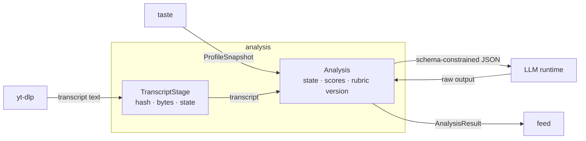

# DDD tactical — `analysis`

## Metadata

| Field | Value |
|-------|-------|
| **Context** | `analysis` |
| **Document** | Tactical model: analysis result, failure states, transcript staging and rubric binding |
| **Backlog** | `ARCH-304` |
| **Version** | 0.1 (draft) |
| **Date** | 2026-11-03 |
| **Owner** | Oleg K |
| **Status** | Confirmed at gate `G5` (2026-11-04) |
| **Sources** | [`prd-ytfeed.md`](../../../../10-product/prd-ytfeed.md), [`context-map.md`](../../strategic/context-map.md), [`glossary.md`](../../strategic/glossary.md), [`02-architecture.md`](../../../../00-rules/02-architecture.md), [`04-data-persistence.md`](../../../../00-rules/04-data-persistence.md), [`03-discovery-analysis.md`](../../../c4/03-components/03-discovery-analysis.md), [`03a-transcript-staging.md`](../../../c4/03-components/03a-transcript-staging.md) |
| **Siblings** | [`aggregates.md`](aggregates.md), [`events.md`](events.md), [`repository.md`](repository.md) |
| **Next** | `ARCH-305` (`identity`, light) |

## 1. Scope

`analysis` turns a transcript into a schema-valid, per-axis judgment under a versioned
rubric and a profile snapshot. It owns the analysis result, the transcript staging state
and the rubric-version binding. It does not own the rubric content, the profile or the
cards.

This is a full-depth model because `analysis` is core and carries the highest technical
risk (`SD-3`, `R1`, `R2`). The model must make failure explicit. It must never coerce a
bad model response into a plausible card (`A-12b`, `F11`).

## 2. Model at a glance

The LLM and `yt-dlp` are external systems behind ports (`A-12`). `feed` is the customer.

## 3. Aggregate boundaries

| Aggregate | Root identity | Consistency boundary | Why this boundary |
|-----------|---------------|----------------------|-------------------|
| **Analysis** | `AnalysisID` | One terminal judgment for one video, rubric version and profile version | `F12` binds the rubric version to the result. A profile change must be visible in the key. |
| **TranscriptStage** | `(UserID, VideoID)` | Staged file metadata, hash and lifetime | The stage is a crash-safe checkpoint with its own lifecycle (`ARCH-105a`). |

`AxisScore` and the other result fields are value objects inside `Analysis`. They are not
independent aggregates.

## 4. Tactical decisions

| # | Decision | Rationale | Alternative rejected |
|---|----------|-----------|----------------------|
| `D-330` | Two aggregates: `Analysis` and `TranscriptStage` | The result is terminal. The stage is a transient checkpoint. | One aggregate. It would tie a durable result to an ephemeral file. |
| `D-331` | One terminal `Analysis` per `(user_id, video_id, rubric_version)`. `profile_version` is recorded but is not part of the key | Matches the confirmed flow key and `F12`. A profile change stays visible in the row without rewriting the analysis history. | Keying by profile version. It would contradict the flow document and hide the idempotency rule. |
| `D-332` | The model output is schema-constrained JSON. Validation runs before persistence | `A-12b` and `F11` require explicit failure. | Free-text parsing. It would accept confident prose as data. |
| `D-333` | Failure states are `no_transcript`, `analysis_slow` and `invalid_model_output` | `F11` names the three states. A partial object is a failure. | A best-effort object with missing fields. |
| `D-334` | Staging is best-effort. A staging failure never fails a card | `ARCH-105a` and `D-20` keep the pipeline moving. The transcript can be held in memory. | Failing the card when the disk is full. |
| `D-335` | One OpenAI-compatible chat adapter. Provider differences are presets | `A-12a`, `F26` and `OQ-06`. | A code branch per runtime. |
| `D-336` | Bound in-flight LLM calls to `ANALYSIS_CONCURRENCY` (default 2) | `NFR: Performance` and local model limits. | One goroutine per video. |
| `D-337` | The rubric artifact is external. `analysis` stores only its version | `A-19` and `G4-8`. | Copying the rubric into each result. |
| `D-338` | Bind the profile snapshot and the rubric version at request time | The result must state which inputs produced it (`A-20`, `F12`). | Reading the profile again after the call. |
| `D-339` | Transcript text never enters the database, logs, traces or backups | `F9`, `OQ-05`, `L-10`. | A transcript column for debugging. |

## 5. Cross-context contracts

| Contract | Direction | Shape | Reference |
|----------|-----------|-------|-----------|
| `ProfileSnapshot` | `taste` → `analysis` | Axes, weights, examples, note, `rubric_version` | [`context-map.md`](../../strategic/context-map.md) §6.1 |
| `AnalysisResult` | `analysis` → `feed` | Schema-constrained result with state, reason, scores and presentation fields | [`context-map.md`](../../strategic/context-map.md) §6.1 |
| `TranscriptStore` | `analysis` → `integration/transcripts` | Put, get, delete and sweep | [`03a-transcript-staging.md`](../../../c4/03-components/03a-transcript-staging.md) §5 |
| LLM adapter | `analysis` → `integration/llm` | OpenAI-compatible chat with JSON mode | `A-12a`, `F26` |
| Transcript fetcher | `analysis` → `integration/ytdlp` | Transcript text only | `F9` |

## 6. What is deliberately not here

- The rubric content and its JSON schema (`A-19`, `OQ-07`).
- The profile axes and weights (`taste`).
- Card positions, decisions and the cursor (`feed`).
- A queue, a broker or event sourcing (`ARCH-307`).
- A transcript archive. Only a bounded staging file exists (`OQ-05`).

## 7. Open questions

| ID | Effect on this model |
|----|----------------------|
| `OQ-05` | Resolved. Bounded staging is accepted. |
| `OQ-06` | opencode is a preset. `D-335` follows it. |
| `OQ-07` | Rubric location is still open. `analysis` loads the artifact from the configured source. |
| `OQ-18` | The weight-update rule is `taste`'s. `analysis` only scores the axes. |

## 8. Reading order and acceptance

1. [`aggregates.md`](aggregates.md) — result, stage, invariants and value objects.
2. [`events.md`](events.md) — domain events and payloads.
3. [`repository.md`](repository.md) — persistence, transactions and use cases.

| Backlog acceptance criterion | Where it is met |
|------------------------------|-----------------|
| Every aggregate has at least one stated invariant | [`aggregates.md`](aggregates.md) §1.5, §2.4 |
| Value objects have validation rules | [`aggregates.md`](aggregates.md) §3 |
| Domain events are past-tense facts with payloads | [`events.md`](events.md) §1–§2 |
| Repository contracts state transaction boundaries | [`repository.md`](repository.md) §2–§3 |
| No evented pattern is adopted without justification | `README.md` §6 and [`events.md`](events.md) §4 |

The tactical model is confirmed at gate `G5`, after `ARCH-307`.
