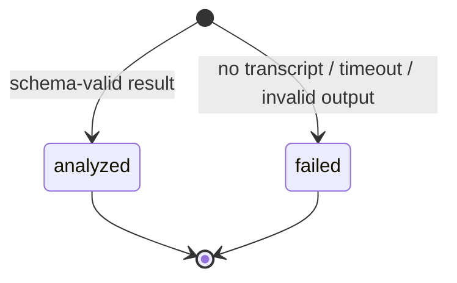
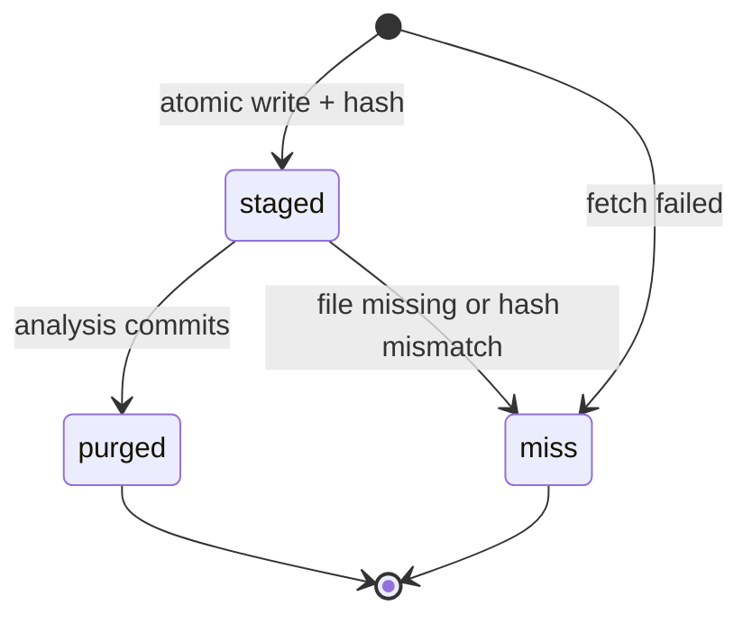

# `analysis` — aggregates, invariants and value objects

## Metadata

| Field | Value |
|-------|-------|
| **Context** | `analysis` |
| **Backlog** | `ARCH-304` |
| **Status** | Confirmed at gate `G5` (2026-11-04) |
| **Parent** | [`README.md`](README.md) |
| **Sources** | `F9`, `F10`, `F11`, `F12`, `A-12a`, `A-12b`, `A-19`, `A-20`, `OQ-05`, `OQ-06`, `OQ-07` |

## 1. `Analysis` aggregate

### 1.1 State

| Field | Type | Rule |
|-------|------|------|
| `analysis_id` | `AnalysisID` | Aggregate identity. |
| `user_id` | `UserID` | Owner. |
| `video_id` | `VideoID` | Analyzed video. |
| `profile_version` | `ProfileVersion` | The profile version used for the prompt. |
| `rubric_version` | `RubricVersion` | The rubric version used for the judgment. |
| `model_id` | `ModelID` | The runtime and model that produced the result. |
| `state` | `AnalysisState` | `analyzed` or `failed`. Terminal. |
| `reason` | `AnalysisReason` | Present only when `failed`. |
| `topic` | `TopicSlug` | Present when `analyzed`. |
| `tldr` | `TLDR` | Present when `analyzed`. |
| `axis_scores` | list of `AxisScore` | One per profile axis when `analyzed`. |
| `marketing_score` | `MarketingScore` | Present when `analyzed`. |
| `ai_slop_score` | `AiSlopScore` | Present when `analyzed`. |
| `similarity` | `Similarity` | Present when `analyzed`. |
| `new_territory` | boolean | Present when `analyzed`. |
| `why_this_card` | `WhyThisCard` | Present when `analyzed`. |
| `transcript_sha256` | `TranscriptHash` | The staged transcript that was read. |
| `transcript_bytes` | `TranscriptBytes` | The staged size. |
| `created_at` | timestamp | UTC. Set once. |
| `completed_at` | timestamp | UTC. Set once. |

### 1.2 Keys and identity

The natural key is `(user_id, video_id, rubric_version)`. The profile version is
recorded with the result but is not part of the key. This matches the flow document. A
new rubric version produces a new row. Old rows keep their version (`F12`, `A-20`).

### 1.3 Failure classification

| Condition | State | Reason | Result fields |
|-----------|-------|--------|---------------|
| No transcript | `failed` | `no_transcript` | No scores or presentation. |
| LLM timeout | `failed` | `analysis_slow` | No scores or presentation. |
| Schema-invalid output | `failed` | `invalid_model_output` | No scores or presentation. |
| Valid output | `analyzed` | none | All required fields. |

A partial object is a failure. The model response is never coerced (`A-12b`).

### 1.4 Required result fields

| Field | Type | Validation |
|-------|------|------------|
| `topic` | `TopicSlug` | Normalized slug, 1–64 characters. |
| `tldr` | `TLDR` | Trimmed, 1–500 characters. |
| `axis_scores` | list of `AxisScore` | One per profile axis. Score in `[0,1]`. Justification 1–300 characters. |
| `marketing_score` | `MarketingScore` | `[0,1]`. |
| `ai_slop_score` | `AiSlopScore` | `[0,1]`. |
| `similarity` | `Similarity` | "similar to: X" or "new territory", at most 200 characters. |
| `new_territory` | boolean | True only when the analysis says so. |
| `why_this_card` | `WhyThisCard` | Trimmed, 1–500 characters. |

### 1.5 Invariants

| ID | Invariant | Source |
|----|-----------|--------|
| `I-A1` | One terminal analysis per `(user_id, video_id, rubric_version)`. | `F12`, `D-331` |
| `I-A2` | An `analyzed` result has every required field and one score per profile axis. | `F10`, `A-20` |
| `I-A3` | Every axis score has a non-empty justification. | `A-20` |
| `I-A4` | A `failed` result has exactly one reason and no fabricated scores. | `F11` |
| `I-A5` | `rubric_version` and `model_id` are always present. | `F12`, `A-19` |
| `I-A6` | `profile_version` is recorded and matches the snapshot used for the prompt. | `A-20` |
| `I-A7` | A terminal analysis is immutable. | `F12` |
| `I-A8` | No transcript text is stored in the row. | `F9`, `OQ-05` |

### 1.6 Lifecycle

The row is created when the pipeline reaches a terminal state. A card stays `pending` in
`feed` until that row exists.

## 2. `TranscriptStage` aggregate

### 2.1 State

| Field | Type | Rule |
|-------|------|------|
| `user_id` | `UserID` | Owner. |
| `video_id` | `VideoID` | Staged video. |
| `state` | `StageState` | `staged`, `miss` or `purged`. |
| `sha256` | `TranscriptHash` | Present when `staged`. |
| `bytes` | `TranscriptBytes` | Present when `staged`. Positive. |
| `staged_at` | timestamp | UTC. |
| `expires_at` | timestamp | UTC. Later than `staged_at`. |
| `updated_at` | timestamp | UTC. |

### 2.2 Invariants

| ID | Invariant | Source |
|----|-----------|--------|
| `I-T1` | One stage row per `(user_id, video_id)`. | `ARCH-105a` |
| `I-T2` | `staged` implies a readable file with a matching hash and size. | `ARCH-105a` `I-1` |
| `I-T3` | A stage has a bounded lifetime. `expires_at` is later than `staged_at`. | `ARCH-105a` `I-5` |
| `I-T4` | A stage is purged only after the analysis row commits. | `ARCH-105a` `I-4` |
| `I-T5` | A hash mismatch is a miss. The bytes are never analyzed. | `ARCH-105a` §7 |
| `I-T6` | The row never stores transcript content. | `OQ-05`, `L-10` |

### 2.3 Lifecycle

`miss` means "re-fetch once". It never means "fail the card"
([`03a-transcript-staging.md`](../../../c4/03-components/03a-transcript-staging.md) §13).

## 3. Value objects

| Object | Fields | Validation | Notes |
|--------|--------|------------|-------|
| `AnalysisID` | `value` | Non-empty, at most 128 characters | Identity. |
| `ModelID` | `value` | Non-empty, at most 200 characters | Runtime and model name. |
| `RubricVersion` | `value` | Non-empty, at most 64 characters | Reference only. |
| `ProfileVersion` | `value` | Positive integer | From `taste`. |
| `TopicSlug` | `value` | Normalized slug, 1–64 characters | Shared namespace with interests (`G4-7`). |
| `TLDR` | `value` | Trimmed, 1–500 characters | One line. |
| `AxisScore` | `axis`, `score`, `justification` | Axis is a slug. Score in `[0,1]`. Justification 1–300 characters. | One per profile axis. |
| `MarketingScore` | `value` | `[0,1]`, at most 4 decimals | Not a rejection reason. |
| `AiSlopScore` | `value` | `[0,1]`, at most 4 decimals | Not the `ai-slop` reason. |
| `Similarity` | `value` | "similar to: X" or "new territory", at most 200 characters | Display text. |
| `WhyThisCard` | `value` | Trimmed, 1–500 characters | One sentence. |
| `TranscriptHash` | `value` | 64 lowercase hexadecimal characters | SHA-256. |
| `TranscriptBytes` | `value` | Positive integer, at most 8 MiB | Size cap from `ARCH-105a`. |
| `StageState` | `value` | `staged`, `miss`, `purged` | One state at a time. |
| `AnalysisState` | `value` | `analyzed`, `failed` | Terminal. |
| `AnalysisReason` | `value` | `no_transcript`, `analysis_slow`, `invalid_model_output` | Exactly one when failed. |

### 3.1 Shared rules

- Every timestamp is UTC (`D-13`).
- No value object carries transcript text or a token.
- The axis set comes from the profile snapshot. A missing axis is a validation failure.
- The rubric content is not copied. Only `RubricVersion` is stored.
