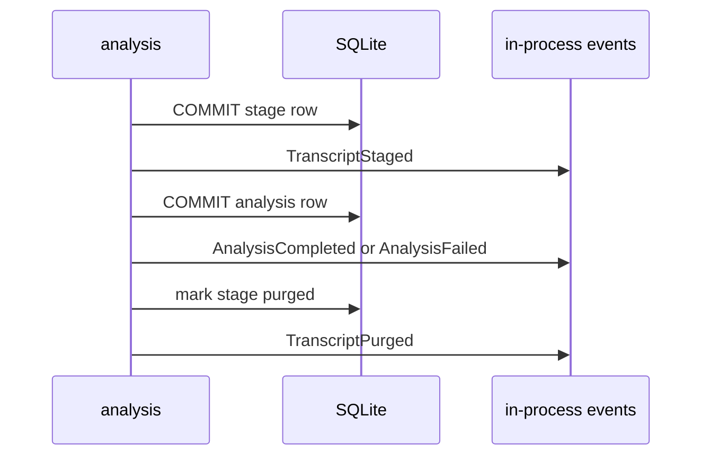

# `analysis` — domain events

## Metadata

| Field | Value |
|-------|-------|
| **Context** | `analysis` |
| **Backlog** | `ARCH-304` |
| **Status** | Confirmed at gate `G5` (2026-11-04) |
| **Parent** | [`README.md`](README.md) |
| **Sources** | `F9`, `F10`, `F11`, `F12`, `A-12b`, `A-19`, `OQ-05` |

A domain event is a past-tense fact about `analysis`. It is immutable. It is emitted after
the transaction commits. The database remains the source of truth.

These are **not** integration events. The cross-context contract is `AnalysisResult`
(`context-map.md` §6.1). No queue, broker or event store is introduced. `ARCH-307` records
the evented-pattern decision.

## 1. Event catalogue

| Event | Trigger | Payload | Emitted when |
|-------|---------|---------|--------------|
| `TranscriptStaged` | `StageTranscript` | `user_id`, `video_id`, `sha256`, `bytes`, `expires_at`, `occurred_at` | A staged file and its row commit. |
| `TranscriptStageMissed` | `StageTranscript` or `LoadTranscript` | `user_id`, `video_id`, `reason`, `occurred_at` | The stage is missing, unreadable or mismatched. |
| `TranscriptPurged` | `PurgeTranscript` | `user_id`, `video_id`, `occurred_at` | The stage is deleted after the analysis commit. |
| `AnalysisCompleted` | `AnalyzeCandidate` | `analysis_id`, `user_id`, `video_id`, `rubric_version`, `profile_version`, `model_id`, `score_count`, `occurred_at` | A valid result commits. |
| `AnalysisFailed` | `AnalyzeCandidate` | `analysis_id`, `user_id`, `video_id`, `reason`, `rubric_version`, `model_id`, `occurred_at` | A terminal failure commits. |
| `ModelOutputRejected` | `AnalyzeCandidate` | `user_id`, `video_id`, `schema_error`, `occurred_at` | Schema validation rejects the raw output. |

## 2. Payload rules

| Rule | Detail |
|------|--------|
| Past tense | Every name describes a fact that already happened. |
| Immutable | A payload is never edited. A correction is a new analysis row. |
| Identifiers | Every payload names the video and the analysis it concerns. |
| No content | A payload never carries transcript text, a prompt or raw model output. |
| UTC | Every timestamp is UTC (`D-13`). |
| No secrets | The payload follows `C-2`, `L-10` and `E-17`. |

### 2.1 `AnalysisCompleted`

| Field | Type | Note |
|-------|------|------|
| `analysis_id` | `AnalysisID` | New result. |
| `user_id` | `UserID` | Owner. |
| `video_id` | `VideoID` | Analyzed video. |
| `rubric_version` | `RubricVersion` | Rubric used. |
| `profile_version` | `ProfileVersion` | Profile snapshot used. |
| `model_id` | `ModelID` | Runtime and model. |
| `score_count` | integer | Number of axis scores. |
| `occurred_at` | timestamp | Commit time, UTC. |

### 2.2 `AnalysisFailed`

| Field | Type | Note |
|-------|------|------|
| `analysis_id` | `AnalysisID` | Terminal failure row. |
| `user_id` | `UserID` | Owner. |
| `video_id` | `VideoID` | Video. |
| `reason` | `AnalysisReason` | `no_transcript`, `analysis_slow` or `invalid_model_output`. |
| `rubric_version` | `RubricVersion` | Rubric attempted. |
| `model_id` | `ModelID` | Runtime attempted. |
| `occurred_at` | timestamp | Commit time, UTC. |

## 3. Ordering

A staging failure emits `TranscriptStageMissed` and the pipeline continues from memory
(`D-334`). A purged stage is never read again.

## 4. Delivery and failure

| Property | Decision |
|----------|----------|
| Transport | In-process function calls. No bus and no queue. |
| Durability | Not durable. The database is the truth. |
| Emission point | After the transaction commits. |
| Lost event | Possible after a crash. No durable state is lost. |
| Duplicate event | Possible on retry. Consumers must be idempotent. |
| Consumers in v1 | Logging and diagnostics only. |
| Cross-context use | None. Use `AnalysisResult`. |

## 5. Naming

| Rule | Example |
|------|---------|
| Past tense | `AnalysisCompleted`, not `CompleteAnalysis` |
| Domain language | `TranscriptStaged`, not `FileWritten` |
| One fact per event | `AnalysisCompleted` does not also report the purge |
| No transport verbs | `TranscriptPurged`, not `FileDeleted` |
