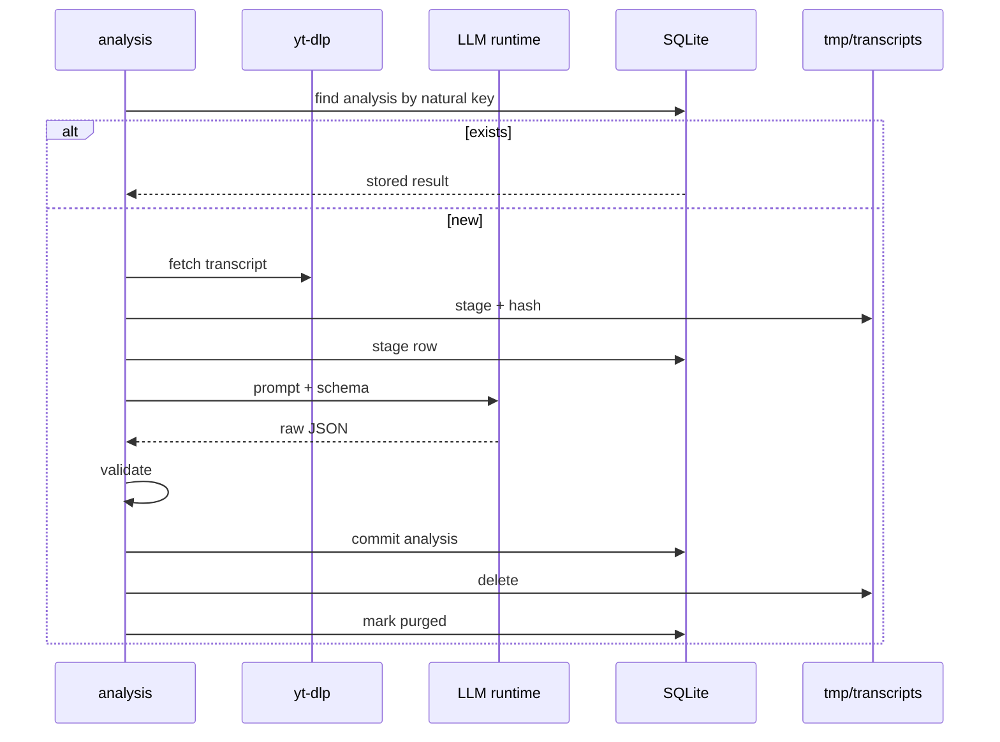

# `analysis` — repositories, persistence and use cases

## Metadata

| Field | Value |
|-------|-------|
| **Context** | `analysis` |
| **Backlog** | `ARCH-304` |
| **Status** | Confirmed at gate `G5` (2026-11-04) |
| **Parent** | [`README.md`](README.md) |
| **Sources** | `F9`, `F10`, `F11`, `F12`, `A-12b`, `A-19`, `D-1`, `D-8`, `D-16`, `D-17`, `D-18`, `D-19`, `OQ-05` |

## 1. Repository contracts

| Repository | Operation | Input | Output | Notes |
|------------|-----------|-------|--------|-------|
| `AnalysisRepository` | `Save` | `Analysis` | stored `AnalysisID` or `ErrAnalysisExists` | One terminal row per natural key. |
| `AnalysisRepository` | `FindByKey` | user, video, rubric version, profile version | `Analysis` or `ErrAnalysisNotFound` | Idempotent replay. |
| `AnalysisRepository` | `Get` | `AnalysisID` | `Analysis` | Read for `feed`. |
| `AnalysisRepository` | `ListForVideo` | `VideoID` | analyses | Audit and version comparison. |
| `TranscriptStageRepository` | `Put` | `TranscriptStage` | stored stage | After the atomic file write. |
| `TranscriptStageRepository` | `Get` | user, video | `TranscriptStage` or `ErrStageMiss` | Includes hash and size. |
| `TranscriptStageRepository` | `MarkMiss` | user, video, reason | updated stage | Missing, unreadable or mismatched. |
| `TranscriptStageRepository` | `MarkPurged` | user, video | updated stage | After the analysis commit. |
| `TranscriptStageRepository` | `Sweep` | instant | purged count | TTL backstop. |

The transcript file operations belong to the `TranscriptStore` port
([`03a-transcript-staging.md`](../../../c4/03-components/03a-transcript-staging.md) §5).
The repository stores metadata only.

## 2. Transaction boundaries

| Use case | Transaction scope | Why |
|----------|-------------------|-----|
| `StageTranscript` | Stage row after the file write | A row must not claim a file that was not written. |
| `AnalyzeCandidate` | One terminal analysis row and its axis scores | A result is atomic. |
| `PurgeTranscript` | Stage state only | The analysis row already committed. |
| `SweepStages` | Stage rows and file deletions | Best effort. The TTL is the backstop. |
| `GetAnalysis` | Read-only | One terminal result. |

The analysis row and the transcript file are not one transaction. The file is written
first. The row commits after validation. The file is deleted after the row commits
(`ARCH-105a` §7).

## 3. Idempotency

| Mechanism | Rule |
|-----------|------|
| Unique `analyses(user_id, video_id, rubric_version)` | A second terminal result for the same inputs is rejected. |
| `FindByKey` before analysis | A retried job returns the stored result. |
| Unique `transcript_stages(user_id, video_id)` | One stage per video. |
| Stage hash | A read verifies the hash before analysis. |
| Purge | Deleting a missing file is not an error. |

## 4. Logical schema

| Table | Key | Main columns | Constraints |
|-------|-----|--------------|-------------|
| `analyses` | `analysis_id` | `user_id`, `video_id`, `profile_version`, `rubric_version`, `model_id`, `state`, `reason`, `topic`, `tldr`, `marketing_score`, `ai_slop_score`, `similarity`, `new_territory`, `why_this_card`, `transcript_sha256`, `transcript_bytes`, `created_at`, `completed_at` | Unique natural key. State and reason agree. |
| `analysis_axis_scores` | `(analysis_id, axis_name)` | `score`, `justification` | `score` in `[0,1]`. Justification non-empty. Internal FK. |
| `transcript_stages` | `(user_id, video_id)` | `state`, `sha256`, `bytes`, `staged_at`, `expires_at`, `updated_at` | `bytes > 0`. `expires_at > staged_at`. |

### 4.1 References

- `video_id` is a value. It is not a foreign key to `discovery` or `feed`.
- The stage row references a file through the `TranscriptStore` port. The path is derived,
  not stored.
- No table outside `analysis` writes these rows (`A-7`, `D-1`).

### 4.2 Indexes

| Index | Purpose |
|-------|---------|
| `analyses(user_id, video_id, rubric_version)` | Natural key. Unique. |
| `analyses(video_id, completed_at)` | Audit and version history. |
| `transcript_stages(state, expires_at)` | TTL sweep. |

## 5. Use cases

### 5.1 `AnalyzeCandidate`

**Preconditions:** the candidate is pending in `feed`. A profile snapshot and a rubric
version are available.

**Steps:**

1. Look up an existing analysis by the natural key. If it exists, return it.
2. Fetch the transcript through `TranscriptFetcher`.
3. Stage the transcript through `TranscriptStore`. If staging fails, keep the text in
   memory and continue (`D-334`).
4. Load the rubric artifact and the profile snapshot. Bind both versions.
5. Build the prompt from axes, examples, note and transcript.
6. Call the LLM adapter with a JSON schema.
7. Validate the response against the schema.
8. On success, create `analyzed` with all required fields.
9. On failure, create `failed` with one reason.
10. Commit the analysis row and its axis scores.
11. Delete the staged file and mark it `purged`.
12. Return the `AnalysisResult`.

**Failure:** no transcript, timeout or invalid JSON produces a `failed` row. The card
stays visible (`F11`). A staging failure does not fail the card.

### 5.2 `StageTranscript`

**Preconditions:** transcript text is available. The size is within the cap.

**Steps:**

1. Validate the video ID.
2. Write the file atomically with `0600`.
3. Compute SHA-256 and size.
4. Commit the `staged` row.
5. Emit `TranscriptStaged`.

**Failure:** an unwritable directory returns a warning. The caller uses memory. The stage
row is not created.

### 5.3 `PurgeTranscript`

**Preconditions:** the analysis row is terminal.

**Steps:**

1. Delete the file. A missing file is not an error.
2. Mark the stage `purged`.
3. Emit `TranscriptPurged`.

**Failure:** a failed delete leaves the row `staged`. The TTL sweep retries.

### 5.4 `SweepStages`

**Preconditions:** the server starts or a batch ends.

**Steps:**

1. Find stage rows older than the TTL.
2. Delete the files.
3. Mark the rows `purged`.
4. Emit `TranscriptPurged` for each.

## 6. Failure modes

| Failure | Result | Recovery |
|---------|--------|----------|
| No transcript | `failed: no_transcript` | Card shown as unanalyzed. |
| LLM timeout | `failed: analysis_slow` | Batch continues. |
| Invalid JSON | `failed: invalid_model_output` | Never coerced. |
| Duplicate natural key | Stored analysis | Return the stored result. |
| Stage miss | `TranscriptStageMissed` | Re-fetch once. |
| Hash mismatch | Stage miss | Delete the bad file, re-fetch once. |
| Stage write failure | Warning | Analyze from memory. |
| Purge failure | Stage remains `staged` | TTL sweep retries. |
