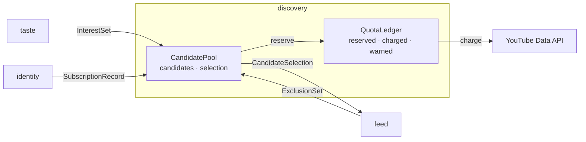

# DDD tactical — `discovery`

## Metadata

| Field | Value |
|-------|-------|
| **Context** | `discovery` |
| **Document** | Tactical model: candidate pool, selection, quota ledger and micro-blogger balance |
| **Backlog** | `ARCH-303` |
| **Version** | 0.1 (draft) |
| **Date** | 2026-11-03 |
| **Owner** | Oleg K |
| **Status** | Confirmed at gate `G5` (2026-11-04) |
| **Sources** | [`prd-ytfeed.md`](../../../../10-product/prd-ytfeed.md), [`context-map.md`](../../strategic/context-map.md), [`glossary.md`](../../strategic/glossary.md), [`02-architecture.md`](../../../../00-rules/02-architecture.md), [`04-data-persistence.md`](../../../../00-rules/04-data-persistence.md), [`03-discovery-analysis.md`](../../../c4/03-components/03-discovery-analysis.md) |
| **Siblings** | [`aggregates.md`](aggregates.md), [`events.md`](events.md), [`repository.md`](repository.md) |
| **Next** | `ARCH-304` (`analysis`) |

## 1. Scope

`discovery` turns interests and the subscription graph into a bounded candidate set. It
owns the candidate pool, the selection rule and the quota ledger. It does not own
subscriptions, credentials or analysis. Those belong to `identity` and `analysis`.

This is a full-depth model because `discovery` is a supporting subdomain with hard
invariants. Quota is charged before a call. Dedupe is exact. The micro-blogger target is
real (`SD-3`, `F6`, `F7`, `F8`).

## 2. Model at a glance

`feed` is the customer. `discovery` owns the selection and quota rules, and `feed` must
not reimplement them (`context-map.md` REL-5).

## 3. Aggregate boundaries

| Aggregate | Root identity | Consistency boundary | Why this boundary |
|-----------|---------------|----------------------|-------------------|
| **CandidatePool** | `BatchID` | Candidates, their source, rank and selection state | Selection is a property of the whole pool. The 20-card limit and the micro-blogger share are pool rules. |
| **QuotaLedger** | `(UserID, AccountingDay)` | Reserved and charged units for one day | The budget is a daily invariant. A reservation must be visible before the next call. |

`Candidate` is an entity inside `CandidatePool`. It is not an aggregate root. Metadata is
a snapshot from YouTube and is not edited by the owner.

## 4. Tactical decisions

| # | Decision | Rationale | Alternative rejected |
|---|----------|-----------|----------------------|
| `D-320` | Two aggregates: `CandidatePool` and `QuotaLedger` | Pool consistency and budget consistency have different lifetimes. | One aggregate. It would couple a batch to the whole day. |
| `D-321` | A pool is scoped to one batch. Candidate metadata is immutable inside the pool | `F6` and `F8` are per batch. A later batch re-reads metadata. | A global candidate table. It would make "unseen in this batch" ambiguous. |
| `D-322` | `discovery` owns the dedupe rule. `feed` supplies the `ExclusionSet` | Keeps the map acyclic (`context-map.md` §6.4). | `discovery` reading `feed` and `library`. It would add two back-edges. |
| `D-323` | The micro-blogger floor is a 20% target, not a hard gate. A shortfall is recorded and shown | `F13` allows fewer cards with an explanation (`OQ-09`). | Padding with mismatched channels. It would break relevance. |
| `D-324` | Reserve quota before a call. Charge on success. Release a reservation only when the request was not sent | `F7` requires the ledger to refuse before the budget is exceeded. | Charging after the call. It can overspend. |
| `D-325` | The accounting day is UTC | `F7` says UTC (`OQ-02`). The user-facing reset time comes from the API error when available. | Pacific midnight. It would contradict `F7`. |
| `D-326` | One ledger row per user and accounting day | The daily budget is a single counter. | A ledger per batch. It would double-count. |
| `D-327` | Selection order is deterministic: graph candidates first, then search, then trending. Within a source, keep discovery rank | `CandidateSelection` must be ordered and stable (`F13`, `REL-5`). | Random selection. It would make tests and review impossible. |
| `D-328` | A shortfall is never padded. The pool returns fewer than 20 with a reason | `F13` and `F8` require an explicit explanation. | Filling the batch with low-relevance videos. |
| `D-329` | The pool stores a metadata snapshot. It never joins to another context's tables | `A-7`, `context-map.md` §7. | A cross-context foreign key. |

## 5. Cross-context contracts

| Contract | Direction | Shape | Reference |
|----------|-----------|-------|-----------|
| `InterestSet` | `taste` → `discovery` | 1–10 interests, default 5 | [`context-map.md`](../../strategic/context-map.md) §6.1 |
| Credential access | `identity` → `discovery` | Usable access token, never persisted by the consumer | [`context-map.md`](../../strategic/context-map.md) §6.1 |
| `SubscriptionRecord` | `identity` → `discovery` | Channel ID, title, subscriber count, topic tags | [`context-map.md`](../../strategic/context-map.md) §6.1 |
| `ExclusionSet` | `feed` → `discovery` | Watched, saved and recently shown IDs | [`context-map.md`](../../strategic/context-map.md) §6.4 |
| `CandidateSelection` | `discovery` → `feed` | ≤ 20 ordered candidates with metadata, source and subscriber count | [`context-map.md`](../../strategic/context-map.md) §6.1 |

## 6. What is deliberately not here

- OAuth tokens and subscription storage (`identity`).
- Transcripts, LLM calls and rubric application (`analysis`).
- Card positions, the cursor and gestures (`feed`).
- Library files (`library`).
- Price estimation beyond the fixed unit table. The table is in [`aggregates.md`](aggregates.md) §2.4.
- An event bus, a queue or event sourcing (`ARCH-307`).

## 7. Open questions

| ID | Effect on this model |
|----|----------------------|
| `OQ-01` | Quota exit code: `5` or `6` when a cached feed is served. |
| `OQ-02` | Accounting day is UTC. The reset time is reported from the API error. |
| `OQ-09` | The 20% micro-blogger share is a target, not a gate. |
| `OQ-06` | opencode is a preset, not a second adapter. It does not affect `discovery`. |
| `OQ-19` | Interests and topics share a slug namespace. The pool uses the interest set as-is. |

## 8. Reading order and acceptance

1. [`aggregates.md`](aggregates.md) — pool, ledger, invariants and value objects.
2. [`events.md`](events.md) — domain events and payloads.
3. [`repository.md`](repository.md) — persistence, transaction boundaries and use cases.

| Backlog acceptance criterion | Where it is met |
|------------------------------|-----------------|
| Every aggregate has at least one stated invariant | [`aggregates.md`](aggregates.md) §1.4, §2.5 |
| Value objects have validation rules | [`aggregates.md`](aggregates.md) §3 |
| Domain events are past-tense facts with payloads | [`events.md`](events.md) §1–§2 |
| Repository contracts state transaction boundaries | [`repository.md`](repository.md) §2–§3 |
| No evented pattern is adopted without justification | `README.md` §6 and [`events.md`](events.md) §4 |

The tactical model is confirmed at gate `G5`, after `ARCH-307`.
