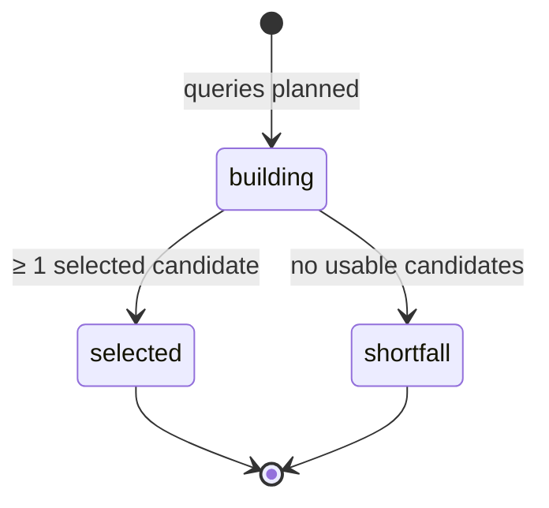

# `discovery` — aggregates, invariants and value objects

## Metadata

| Field | Value |
|-------|-------|
| **Context** | `discovery` |
| **Backlog** | `ARCH-303` |
| **Status** | Confirmed at gate `G5` (2026-11-04) |
| **Parent** | [`README.md`](README.md) |
| **Sources** | `F6`, `F7`, `F8`, `F13`, `OQ-02`, `OQ-09`, `D-19`, `D-22` |

## 1. `CandidatePool` aggregate

### 1.1 State

| Field | Type | Rule |
|-------|------|------|
| `batch_id` | `BatchID` | Aggregate identity. One pool per batch. |
| `user_id` | `UserID` | Owner. |
| `size` | integer | Requested size. 1–20 (`F13`). |
| `state` | `PoolState` | `building`, `selected` or `shortfall`. |
| `shortfall_reason` | `ShortfallReason` | Present only in `shortfall`. |
| `created_at` | timestamp | UTC. Set once. |
| `selected_at` | timestamp | UTC. Set when selection commits. |
| `version` | integer | Optimistic token for pool changes. |

### 1.2 `Candidate` entity

| Field | Type | Rule |
|-------|------|------|
| `video_id` | `VideoID` | Unique inside the pool. |
| `channel_id` | `ChannelID` | The channel behind the video. |
| `title` | text | Trimmed, 1–500 characters. |
| `subscriber_count` | `SubscriberCount` | Non-negative integer. |
| `topic_tags` | list of text | Snapshot from YouTube. May be empty. |
| `source` | `CandidateSource` | `graph`, `search` or `trending`. |
| `discovery_rank` | `DiscoveryRank` | Stable rank inside its source. |
| `excluded` | boolean | True when the `ExclusionSet` removed it. |
| `exclusion_reason` | `ExclusionReason` | Present only when excluded. |
| `selected` | boolean | True when it enters `CandidateSelection`. |
| `position` | `Position` | Dense and unique among selected candidates. |

### 1.3 Selection algorithm

1. Merge the three sources: subscription graph, search, trending.
2. Apply the `ExclusionSet`: watched, saved, shown in the last 7 days, duplicate ID.
3. Deduplicate by `video_id`. Keep the first occurrence.
4. Mark the micro-blogger candidates: channels with fewer than 100k subscribers.
5. Sort by source priority (`graph`, `search`, `trending`), then by `discovery_rank`.
6. Take up to `size` candidates. Aim for at least 20% micro-bloggers. The target shapes
   inclusion, not the final display order.
7. If the target or the size cannot be met, record one shortfall reason. Never pad.

### 1.4 Invariants

| ID | Invariant | Source |
|----|-----------|--------|
| `I-CP1` | `video_id` is unique inside the pool. | `F8`, `D-19` |
| `I-CP2` | Selected candidates number at most `size` and at most 20. | `F13` |
| `I-CP3` | An excluded candidate is never selected. | `F8` |
| `I-CP4` | The micro-blogger share is a target. A shortfall is recorded, not hidden. | `F6`, `OQ-09` |
| `I-CP5` | Selection is deterministic for the same input. | `F13` |
| `I-CP6` | A selected candidate has metadata, a source and a non-negative subscriber count. | `F6`, `F8` |
| `I-CP7` | Selected positions are dense, unique and zero-based. | `F13` |
| `I-CP8` | The pool never contains a candidate from another user's batch. | `D-22` |

### 1.5 Lifecycle

A `shortfall` pool is still a valid result. It carries a reason and a card count. `feed`
shows the explanation (`F13`).

## 2. `QuotaLedger` aggregate

### 2.1 State

| Field | Type | Rule |
|-------|------|------|
| `user_id` | `UserID` | Owner. |
| `accounting_day` | `AccountingDay` | UTC date (`OQ-02`). |
| `budget` | `QuotaUnits` | 10,000 units per day. |
| `reserved` | `QuotaUnits` | Units held by open reservations. |
| `charged` | `QuotaUnits` | Units actually consumed. |
| `warned_at_80` | boolean | True after the single 80% warning. |
| `exhausted` | boolean | True when `reserved + charged` reaches the budget. |
| `version` | integer | Optimistic token. |
| `updated_at` | timestamp | UTC. |

### 2.2 `QuotaReservation` entity

| Field | Type | Rule |
|-------|------|------|
| `reservation_id` | `ReservationID` | Identity. |
| `units` | `QuotaUnits` | Positive. |
| `state` | `ReservationState` | `reserved`, `charged` or `released`. |
| `created_at` | timestamp | UTC. |
| `expires_at` | timestamp | UTC. Default TTL 10 minutes. |
| `call` | `QuotaCall` | The API call the reservation covers. |

### 2.3 Unit costs

| Call | Units |
|------|-------|
| `search.list` | 100 |
| `videos.list` | 1 |
| `channels.list` | 1 |
| `subscriptions.list` | 1 |
| `mostPopular` | 1 |

### 2.4 Reserve, charge, release

1. **Reserve.** Refuse if `reserved + charged + units` would exceed `budget`.
   Otherwise add a reservation and increase `reserved`.
2. **Charge.** On a successful call, mark the reservation `charged`, decrease `reserved`
   and increase `charged`.
3. **Release.** If the request was never sent, mark the reservation `released` and
   decrease `reserved`.
4. **Failure after send.** Charge the reserved units. A failed request may still consume
   quota.
5. **Stale reservation.** A reservation older than its TTL is released on the next
   ledger read. The request was not confirmed.

### 2.5 Invariants

| ID | Invariant | Source |
|----|-----------|--------|
| `I-QL1` | One ledger row per `(user_id, accounting_day)`. | `F7`, `D-326` |
| `I-QL2` | `reserved + charged` never exceeds `budget`. | `F7` |
| `I-QL3` | Units are non-negative. | `F7` |
| `I-QL4` | The 80% warning is issued at most once per day. | `F7` |
| `I-QL5` | A reservation is `reserved`, `charged` or `released`, never two at once. | `F7` |
| `I-QL6` | A stale reservation is released, not charged. | `D-324` |
| `I-QL7` | `exhausted` is true exactly when `reserved + charged` equals `budget`. | `F7` |

## 3. Value objects

| Object | Fields | Validation | Notes |
|--------|--------|------------|-------|
| `BatchID` | `value` | Non-empty, at most 128 characters | Reference from `feed`. |
| `VideoID` | `value` | 1–64 characters, `[A-Za-z0-9_-]` | Opaque YouTube ID. |
| `ChannelID` | `value` | 1–64 characters, `[A-Za-z0-9_-]` | Opaque YouTube ID. |
| `SubscriberCount` | `value` | Non-negative integer | Used for the 100k threshold. |
| `DiscoveryRank` | `value` | Non-negative integer | Stable per source. |
| `Position` | `value` | Non-negative integer | Dense among selected. |
| `CandidateSource` | `value` | `graph`, `search` or `trending` | Source tag. |
| `ExclusionReason` | `value` | `watched`, `saved`, `shown_7d`, `duplicate` | Why a candidate was removed. |
| `ShortfallReason` | `value` | `no_candidates`, `micro_blogger_shortfall`, `quota`, `dedupe` | One reason per shortfall. |
| `QuotaUnits` | `value` | Non-negative integer | Unit count. |
| `AccountingDay` | `value` | UTC calendar date | `OQ-02`. |
| `ReservationID` | `value` | Non-empty, at most 128 characters | Reservation identity. |
| `ReservationState` | `value` | `reserved`, `charged`, `released` | One state at a time. |
| `QuotaCall` | `value` | `search`, `videos`, `channels`, `subscriptions`, `most_popular` | Maps to the unit table. |

### 3.1 Input objects

| Object | Fields | Validation |
|--------|--------|------------|
| `InterestSet` | `slugs` | 1–10 normalized slugs. |
| `ExclusionSet` | `video_ids`, `channel_ids` | Unique values. Supplied by `feed`. |
| `CandidateMetadata` | `title`, `subscriber_count`, `topic_tags` | Title 1–500 characters. Count non-negative. |

### 3.2 Shared rules

- Every timestamp is UTC (`D-13`).
- Every identifier is opaque and contains no path separator.
- No token, transcript or API key appears in a value object (`C-2`, `L-10`).
- The pool stores a snapshot. It does not store a foreign key to another context.
