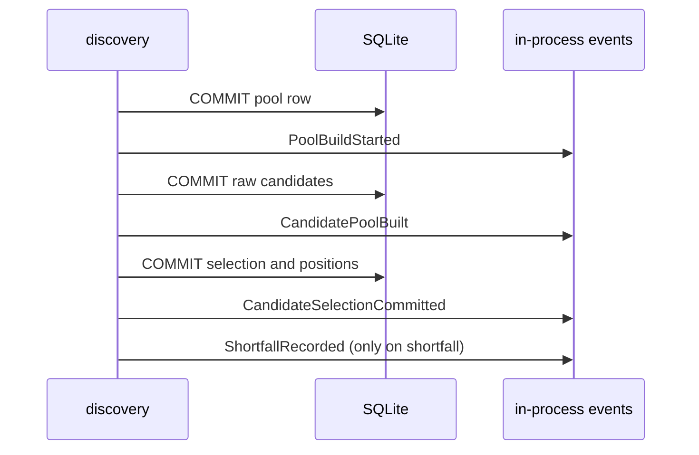

# `discovery` — domain events

## Metadata

| Field | Value |
|-------|-------|
| **Context** | `discovery` |
| **Backlog** | `ARCH-303` |
| **Status** | Confirmed at gate `G5` (2026-11-04) |
| **Parent** | [`README.md`](README.md) |
| **Sources** | `F6`, `F7`, `F8`, `F13`, `OQ-02`, `OQ-09` |

A domain event is a past-tense fact about `discovery`. It is immutable. It is emitted after
the transaction commits. The database remains the source of truth.

These are **not** integration events. The cross-context contract is
`CandidateSelection` (`context-map.md` §6.1). No queue, broker or event store is
introduced. `ARCH-307` records the evented-pattern decision.

## 1. Event catalogue

| Event | Trigger | Payload | Emitted when |
|-------|---------|---------|--------------|
| `PoolBuildStarted` | `BuildCandidatePool` | `batch_id`, `user_id`, `size`, `occurred_at` | The pool row is created. |
| `CandidatePoolBuilt` | `BuildCandidatePool` | `batch_id`, `candidate_count`, `source_counts`, `occurred_at` | Raw candidates are persisted. |
| `CandidateSelectionCommitted` | `SelectCandidates` | `batch_id`, `selected`, `micro_blogger_share`, `occurred_at` | The selected set and positions commit. |
| `ShortfallRecorded` | `SelectCandidates` | `batch_id`, `reason`, `requested`, `selected`, `occurred_at` | The pool cannot meet size or the micro-blogger target. |
| `QuotaReserved` | `ReserveQuota` | `reservation_id`, `user_id`, `accounting_day`, `units`, `call`, `occurred_at` | A reservation commits. |
| `QuotaCharged` | `ChargeQuota` | `reservation_id`, `units`, `charged_total`, `occurred_at` | A successful call is charged. |
| `QuotaReservationReleased` | `ReleaseQuota` | `reservation_id`, `units`, `reason`, `occurred_at` | A reservation is released or expires. |
| `QuotaWarningIssued` | `ChargeQuota` | `accounting_day`, `charged_total`, `budget`, `occurred_at` | Usage first crosses 80%. |
| `QuotaExhausted` | `ChargeQuota` or `ReserveQuota` | `accounting_day`, `charged_total`, `reserved_total`, `budget`, `occurred_at` | The budget is fully held or consumed. |

## 2. Payload rules

| Rule | Detail |
|------|--------|
| Past tense | Every name describes a fact that already happened. |
| Immutable | A payload is never edited. A correction is a new event. |
| Identifiers | Every payload names the pool or reservation it concerns. |
| No content | A payload never carries a token, a transcript or a raw API body. |
| UTC | Every timestamp and accounting day is UTC (`D-13`, `OQ-02`). |

### 2.1 `CandidateSelectionCommitted`

| Field | Type | Note |
|-------|------|------|
| `batch_id` | `BatchID` | Pool identity. |
| `selected` | list | Each item has `video_id`, `channel_id`, `source`, `position` and `subscriber_count`. |
| `micro_blogger_share` | decimal | Selected micro-bloggers divided by selected candidates. |
| `occurred_at` | timestamp | Commit time, UTC. |

### 2.2 `QuotaReserved`

| Field | Type | Note |
|-------|------|------|
| `reservation_id` | `ReservationID` | New reservation. |
| `user_id` | `UserID` | Owner. |
| `accounting_day` | `AccountingDay` | UTC date. |
| `units` | `QuotaUnits` | Reserved units. |
| `call` | `QuotaCall` | The call the reservation covers. |
| `occurred_at` | timestamp | Commit time, UTC. |

## 3. Ordering

For a pool:

For a quota call, the order is `QuotaReserved`, then `QuotaCharged` or
`QuotaReservationReleased`. The 80% warning follows the charge that crosses the threshold.
`QuotaExhausted` follows the charge or reservation that fills the budget.

## 4. Delivery and failure

| Property | Decision |
|----------|----------|
| Transport | In-process function calls. No bus and no queue. |
| Durability | Not durable. The database is the truth. |
| Emission point | After the transaction commits. |
| Lost event | Possible after a crash. No durable state is lost. |
| Duplicate event | Possible on retry. Consumers must be idempotent. |
| Consumers in v1 | Logging and diagnostics only. |
| Cross-context use | None. Use `CandidateSelection`. |

## 5. Naming

| Rule | Example |
|------|---------|
| Past tense | `QuotaReserved`, not `ReserveQuota` |
| Domain language | `ShortfallRecorded`, not `ErrorCreated` |
| One fact per event | `QuotaCharged` does not also report the warning |
| No transport verbs | `CandidatePoolBuilt`, not `PoolPosted` |
