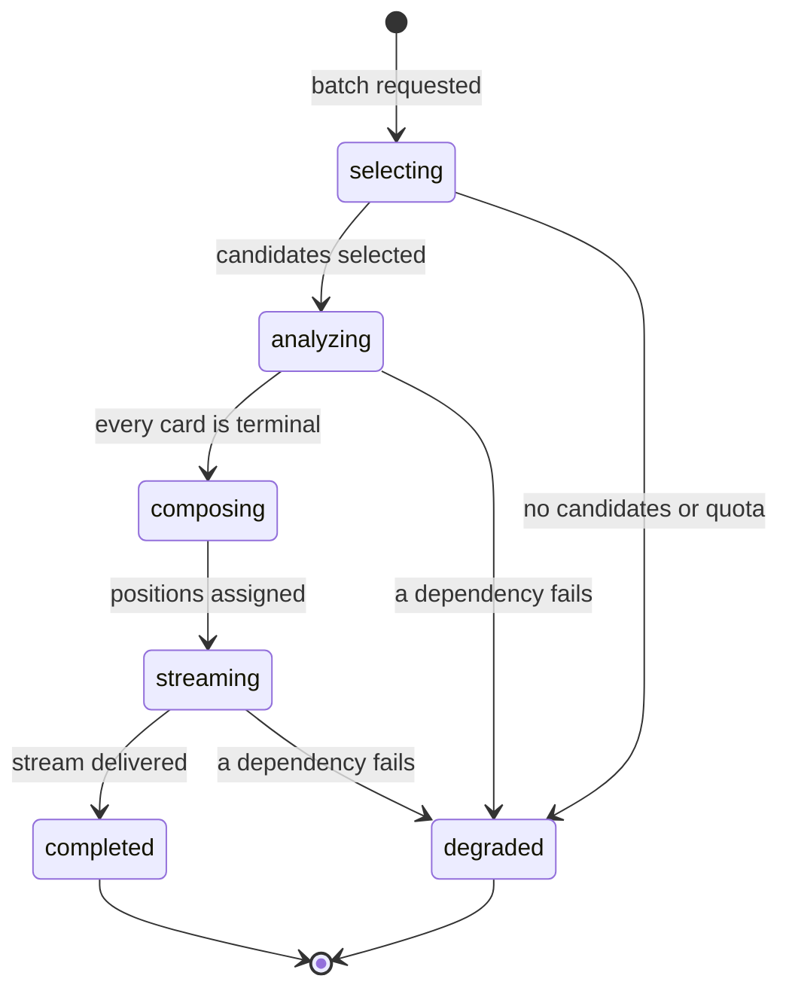

# Evented pattern assessment

## Metadata

| Field | Value |
|-------|-------|
| **Context** | All six contexts, with `feed` as the orchestrator |
| **Document** | Assessment of CQRS, event sourcing, integration events and process management |
| **Backlog** | `ARCH-307` |
| **Version** | 0.1 (draft) |
| **Date** | 2026-11-03 |
| **Owner** | Oleg K |
| **Status** | Confirmed at gate `G5` (2026-11-04) |
| **Sources** | [`context-map.md`](../strategic/context-map.md), [`taste/README.md`](taste/README.md), [`feed/README.md`](feed/README.md), [`discovery/README.md`](discovery/README.md), [`analysis/README.md`](analysis/README.md), [`identity/README.md`](identity/README.md), [`library/README.md`](library/README.md), `A-14`, `D-8`, `D-20` |

## 1. Purpose

This document answers one question: **which evented patterns does `ytfeed` adopt?**

It assesses CQRS, event sourcing, integration events, sagas, outbox and process
management. It records a decision for each. It does not add infrastructure that the
product does not need.

The expected outcome from the backlog is: no CQRS, no event sourcing, and one in-process
process manager for batch resume. This document tests that expectation against the model.

## 2. Facts that constrain the decision

| Fact | Source |
|------|--------|
| One binary, one process role for the server, one writer | `A-9`, `A-10`, `D-8` |
| The pipeline is in-process and database-checkpointed | `A-14`, `F25` |
| The six contexts run in one process and share one SQLite database | C4 L2 |
| Commit order replaces a distributed transaction on the gesture path | `context-map.md` §6.3 |
| Domain events are in-process notifications, not durable records | [`taste/events.md`](taste/events.md), [`feed/events.md`](feed/events.md) |
| The product has one owner in v1 and no external consumers | `SD-7`, PRD §2 |
| Resume must survive a crash without a re-fetch | `F25`, `ARCH-105a` |

## 3. Options considered

| Option | Fit with the facts | Cost | Decision |
|--------|--------------------|------|----------|
| **No evented pattern beyond in-process events** | High. The database is the state. The pipeline resumes from rows. | Low. No new component. | **Adopt** |
| **CQRS with a separate read store** | Low. There is one writer, one user and low read volume. SQLite queries are enough. | Medium. A second store must be kept consistent. | Reject |
| **Event sourcing as the source of truth** | Low. The state is small and relational. Replay is not a product requirement. | High. Event schema, snapshots, replay and migration. | Reject |
| **Durable integration events with an outbox** | Low. No external consumer and no broker. | Medium. Outbox table, dispatcher and retry policy. | Reject |
| **Saga or distributed transaction** | Low. The gesture path uses ordered commits. A saga would add compensation for a local system. | High. More states and failure modes. | Reject |
| **One in-process process manager for batch resume** | High. The pipeline has stages and checkpoints. | Low. A coordinator over existing rows. | **Adopt** |

## 4. Decision

| # | Decision | Rationale |
|---|----------|-----------|
| `D-360` | Do not adopt CQRS. Commands and queries use the same SQLite model. | One writer, one user and small read volume. A separate read store would add consistency work without a product benefit. |
| `D-361` | Do not adopt event sourcing. Relational rows are the source of truth. | The product needs current state and an audit trail, not a replayable event log. Signals are append-only, but the profile is derived state (`D-302`). |
| `D-362` | Do not adopt integration events, an outbox or a broker. | All contexts run in one process. Cross-context calls are synchronous contracts (`context-map.md` §6.1). Ordered commits handle the gesture path. |
| `D-363` | Do not adopt a saga or a distributed transaction. | There is no distributed resource. A local transaction or ordered commits are enough (`D-16`, `D-17`, `D-20`). |
| `D-364` | Adopt one in-process process manager for batch resume. | `F25` needs stage recovery. The manager reads persisted checkpoints and continues. It is not a service or a binary. |
| `D-365` | Keep domain events as in-process notifications. They are not the source of truth. | The tactical models already use this rule. A lost notification loses no durable state. |
| `D-366` | Revisit this decision only with an ADR and a new product requirement, such as a multi-user server or an external consumer. | The current facts are local and single-user. A future requirement can change them. |

## 5. The batch process manager

The process manager is an application service in `feed`. It coordinates the stages of one
batch. It owns no domain rules. It reads and writes the rows that the contexts already
own.

### 5.1 State and checkpoints

| Stage | Durable checkpoint | Owner |
|-------|--------------------|-------|
| Selection | `candidate_pools` and `candidates` | `discovery` |
| Transcript | `transcript_stages` | `analysis` |
| Analysis | `analyses` and card state | `analysis`, `feed` |
| Composition | `cards` and positions | `feed` |
| Stream | `batches` state and card positions | `feed` |

The manager reads these rows. It does not keep a private event log.

### 5.2 Resume

1. On server start and on session open, find batches in a non-terminal state.
2. Read the last checkpoint for each batch.
3. Continue from the next incomplete stage.
4. Use natural keys and idempotency keys to avoid duplicate work.
5. Mark the batch `completed` or `degraded` when it reaches a terminal state.

The resume test is simple: kill the server after `transcript_staged` and before the LLM
call. On restart, the batch must re-analyze with zero fetch calls
([`03a-transcript-staging.md`](../../c4/03-components/03a-transcript-staging.md) §17).

### 5.3 Concurrency

| Concern | Control |
|---------|---------|
| Two managers for one batch | One manager per batch in the server process. The batch row state is the guard. |
| LLM calls | `ANALYSIS_CONCURRENCY`, default 2. |
| Gesture and analysis race | The card `version` and the session `version` guard writes. |
| Duplicate resume | Natural keys and `gesture_id` prevent duplicate facts. |
| Multiple server processes | Not supported in v1. The UI lease and the loopback design assume one server (`A-11`). |

## 6. Why the rejected patterns do not fit

### 6.1 CQRS

The product reads a small number of rows for one user. `ProfileSnapshot`,
`CandidateSelection` and `AnalysisResult` are contracts, not read models. `stats` is a
read-only projection over rows, not a separate store. A second store would add a
consistency problem to a local single-writer system.

### 6.2 Event sourcing

Signals are append-only facts (`D-20`). That does not make the system event-sourced. The
current profile, card and session are relational state. Rebuilding them from events would
require an event schema, snapshots and replay. The product does not need replay. The audit
trail already exists in the rows.

### 6.3 Integration events and outbox

There is no external consumer. The web UI does not exist in v1. Contexts call each other
through published interfaces in one process. The gesture path uses ordered commits, not
an outbox. An outbox would add a dispatcher, retries and a second source of truth.

### 6.4 Saga

A saga is for a transaction across services. `ytfeed` has one database and one server. The
only cross-context write path is the gesture. It uses ordered commits and an idempotency
key (`context-map.md` §6.3). A saga would add compensation states for no benefit.

## 7. Risks and mitigations

| Risk | Why it matters | Mitigation |
|------|----------------|------------|
| The process manager becomes a god object | It could absorb domain rules from `discovery`, `analysis` and `feed`. | Keep it a coordinator. Each stage calls the owning context. No SQL in the manager. |
| Resume duplicates work | A crash can restart a stage. | Natural keys, `gesture_id`, transcript hash and card version. |
| A lost domain event hides a problem | Events are not durable. | The database is the truth. `doctor` and `stats` read rows. |
| Event names drift into a contract | Other contexts might depend on an event. | Events are not integration contracts. Use the contracts in `context-map.md` §6.1. |
| A future web UI needs read models | The current query shape may not fit. | Add a read model with an ADR when the requirement exists. Do not pre-build it. |

## 8. Consequences

- No new container, binary, broker, queue or cache server (`A-14`, C4 L2).
- No outbox table and no dispatcher.
- Domain events stay in-process and non-durable.
- Batch resume depends on persisted checkpoints, not on a replay log.
- `ADR-0005` records the pipeline and transcript staging. `ADR-0006` records degradation
  and the public contracts. This assessment feeds both.
- A future change to these decisions requires an ADR and a product requirement.

## 9. Acceptance check

| Backlog acceptance criterion | Where it is met |
|------------------------------|-----------------|
| Assess CQRS | §3, §6.1, `D-360` |
| Assess event sourcing | §3, §6.2, `D-361` |
| Assess integration events and outbox | §3, §6.3, `D-362` |
| Assess saga and distributed transaction | §3, §6.4, `D-363` |
| Define the process manager | §5, `D-364` |
| Record the expected outcome | §4: no CQRS, no event sourcing, one in-process process manager |
| State the cost of a future change | §7, §8, `D-366` |

## 10. Open questions

| ID | Effect on this decision |
|----|-------------------------|
| `OQ-10` | The implementation backlog does not exist yet. It does not change the pattern decision. |
| `OQ-16` | Server lifecycle. One server process is assumed (`D-364`). |
| `OQ-17` | `--json` buffering is a transport concern. It does not require CQRS. |
