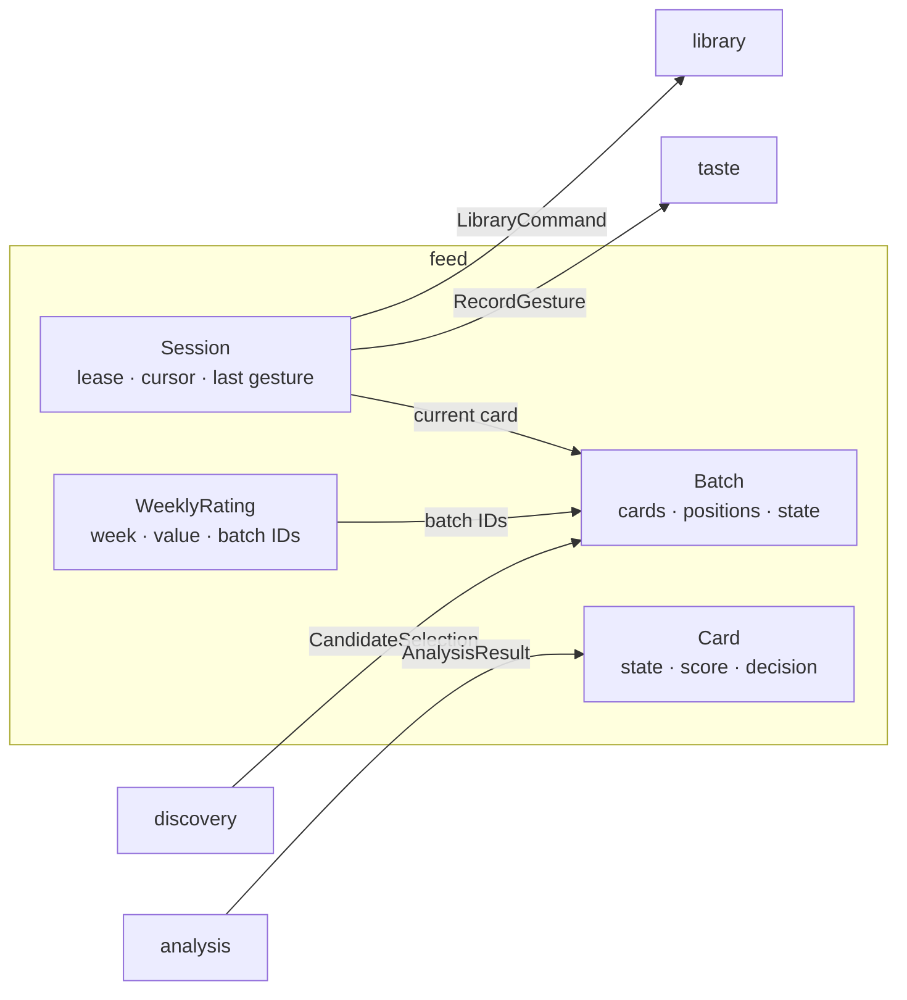

# DDD tactical — `feed`

## Metadata

| Field | Value |
|-------|-------|
| **Context** | `feed` |
| **Document** | Tactical model: sessions, batches, cards, ordering, gestures and ratings |
| **Backlog** | `ARCH-302` |
| **Version** | 0.1 (draft) |
| **Date** | 2026-11-03 |
| **Owner** | Oleg K |
| **Status** | Confirmed at gate `G5` (2026-11-04) |
| **Sources** | [`prd-ytfeed.md`](../../../../10-product/prd-ytfeed.md), [`context-map.md`](../../strategic/context-map.md), [`glossary.md`](../../strategic/glossary.md), [`02-architecture.md`](../../../../00-rules/02-architecture.md), [`04-data-persistence.md`](../../../../00-rules/04-data-persistence.md), [`08-cli-and-ux.md`](../../../../00-rules/08-cli-and-ux.md), [`04-feed-library.md`](../../../c4/03-components/04-feed-library.md), [`session-and-degradation.md`](../../../flows/session-and-degradation.md) |
| **Siblings** | [`aggregates.md`](aggregates.md), [`value-objects.md`](value-objects.md), [`events.md`](events.md), [`repository.md`](repository.md), [`use-cases.md`](use-cases.md) |
| **Next** | `ARCH-303` (`discovery`) |

## 1. Scope

`feed` is the orchestration context. It owns the daily loop: batches, card order, sessions,
the UI lease, gestures and the weekly rating. It holds no product judgment. It calls
`discovery`, `analysis`, `taste` and `library` through their published contracts
(`A-7`, `A-14`).

`feed` is a supporting subdomain, but it has full tactical depth. Its invariants are hard:
a monotone cursor, stable order and commit-before-advance (`SD-3`).

## 2. Model at a glance

The arrow labels are contracts. `feed` is the customer in every call (`A-7`).

## 3. Aggregate boundaries

| Aggregate | Root identity | Consistency boundary | Why this boundary |
|-----------|---------------|----------------------|-------------------|
| **Batch** | `BatchID` | Cards, positions and batch state | Ordering is a property of the whole batch. A card cannot be ordered alone. |
| **Session** | `SessionID` | Lease, cursor, current card, last gesture | The cursor and the lease change together on every interaction (`A-11`, `D-20`). |
| **WeeklyRating** | `RatingID` | One rating for one week | The rating outlives a session and is unique per week (`F21`). |

`Card` is an entity inside the `Batch` aggregate. It is not an aggregate root. Its
position is only meaningful relative to the other cards in the same batch.

## 4. Tactical decisions

| # | Decision | Rationale | Alternative rejected |
|---|----------|-----------|----------------------|
| `D-311` | Three aggregates: `Batch`, `Session`, `WeeklyRating`. `Card` is an entity inside `Batch` | Ordering is a batch invariant. The session has its own lease and cursor lifecycle. | A `Card` aggregate. It would make cross-card ordering impossible to enforce. |
| `D-312` | The cursor is a `CardID`, not a numeric position. A separate `furthest_card_id` marks the furthest card reached | Reordering ahead of the cursor must not move the user. Card identity survives position changes. | A numeric cursor. Inserting a card would silently move the user. |
| `D-313` | Positions are assigned at composition. A card at or behind `furthest_card_id` never moves. A newly analyzed card ahead of it may move into the analyzed block | Satisfies `F14` and `CLI-14a`. A seen card never reorders under the user. | Re-sorting the whole batch on every analysis. It would move seen cards. |
| `D-314` | A gesture updates the card decision and the cursor only after `taste` returns `applied`. `last_gesture_id` makes the advance idempotent | `D-20` requires the signal to commit first. A retry must not advance twice. | Advancing first and compensating later. It can lose a signal. |
| `D-315` | One live lease per user. A lease older than `SESSION_IDLE_TIMEOUT` is reclaimable | `A-11` allows one UI. `OQ-13` defines stale reclaim. | A permanent lock. A crash would lock the owner out. |
| `D-316` | Navigation history is in memory only. A resume restores the cursor, not the history | `F18` discards history when a session closes. `CLI-21` prints `session resumed`. | Persisting history. It would contradict `F18`. |
| `D-317` | A weekly rating is stored per ISO week. `unrated` is a recorded value. At most one rating per user per week | `F21` ties a rating to the feeds shown that week. | Allowing multiple ratings. It would make the measure ambiguous. |
| `D-318` | A degraded batch records one reason and serves the last completed batch as the cached feed | `F24` requires cached cards and a visible reason. | Serving an empty feed. It would hide the degradation. |
| `D-319` | `feed` stores a presentation snapshot copied from `AnalysisResult`. It never imports the analysis schema | `feed` must render a card without a cross-context join. `feed` translates at the boundary (`context-map.md` §6.2). | Reading the analysis table. It would break `A-7`. |

## 5. Cross-context contracts

| Contract | Direction | Shape | Reference |
|----------|-----------|-------|-----------|
| `CandidateSelection` | `discovery` → `feed` | ≤ 20 ordered candidates with metadata, source and subscriber count | [`context-map.md`](../../strategic/context-map.md) §6.1 |
| `AnalysisResult` | `analysis` → `feed` | Schema-constrained result with state, reason, score and presentation fields | [`context-map.md`](../../strategic/context-map.md) §6.1 |
| `RecordGesture` | `feed` → `taste` | Gesture command keyed by `gesture_id` | [`context-map.md`](../../strategic/context-map.md) §6.1 |
| `ActiveColdPeriods` | `taste` → `feed` | Active scope and target pairs | [`context-map.md`](../../strategic/context-map.md) §6.1 |
| `LibraryCommand` | `feed` → `library` | Save, download, remove or open | [`context-map.md`](../../strategic/context-map.md) §6.1 |
| `ExclusionSet` | `feed` → `discovery` | Watched, saved and recently shown IDs | [`context-map.md`](../../strategic/context-map.md) §6.4 |

`feed` translates `AnalysisResult` into the card's presentation snapshot. It translates
the gesture into `RecordGesture`. It does not import another context's schema.

## 6. What is deliberately not here

- Candidate selection, quota and dedupe rules (`discovery`).
- Transcripts, LLM calls and rubric application (`analysis`).
- Signal storage, profile weights and cold-period rows (`taste`).
- Media files and the player (`library`).
- An event bus, a queue or event sourcing. `ARCH-307` assesses evented patterns.
- Cross-context foreign keys. References are values (`context-map.md` §7).

## 7. Open questions

| ID | Effect on this model |
|----|----------------------|
| `OQ-13` | Lease expiry and reclaim are provisional. `D-315` uses the idle timeout. |
| `OQ-14` | History across a resume is in-memory only. `D-316` records the default. |
| `OQ-15` | Late-analysis placement. `D-313` records the rule. |
| `OQ-01`, `OQ-02` | Quota exit code and accounting day affect the degraded batch. |
| `OQ-17` | `--json` buffering is a transport concern. It does not change the batch model. |

## 8. Reading order and acceptance

1. [`aggregates.md`](aggregates.md) — state, invariants and lifecycle.
2. [`value-objects.md`](value-objects.md) — validation and equality.
3. [`events.md`](events.md) — domain events and their payloads.
4. [`repository.md`](repository.md) — persistence contracts and transaction boundaries.
5. [`use-cases.md`](use-cases.md) — commands, queries and failure paths.

| Backlog acceptance criterion | Where it is met |
|------------------------------|-----------------|
| Every aggregate has at least one stated invariant | [`aggregates.md`](aggregates.md) §1.3, §2.3, §3.3 |
| Value objects have validation rules | [`value-objects.md`](value-objects.md) §1–§5 |
| Domain events are past-tense facts with payloads | [`events.md`](events.md) §1–§2 |
| Repository contracts state transaction boundaries | [`repository.md`](repository.md) §2–§3 |
| No evented pattern is adopted without justification | `README.md` §6 and [`events.md`](events.md) §4 |

The tactical model is confirmed at gate `G5`, after `ARCH-307`.
