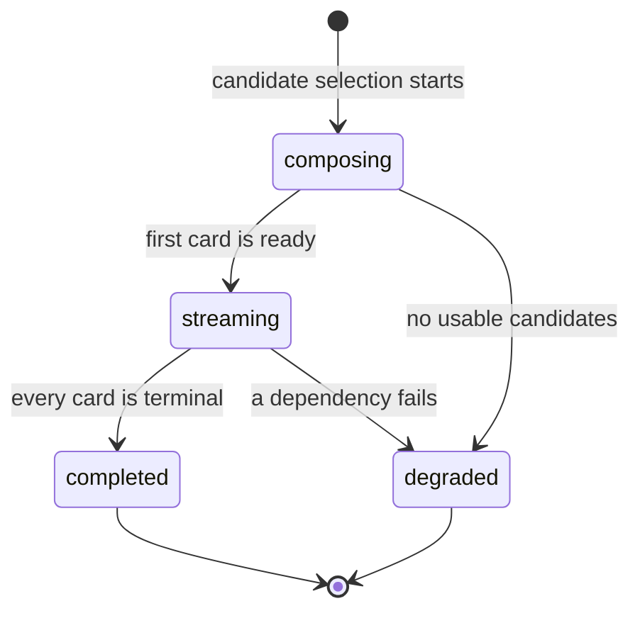
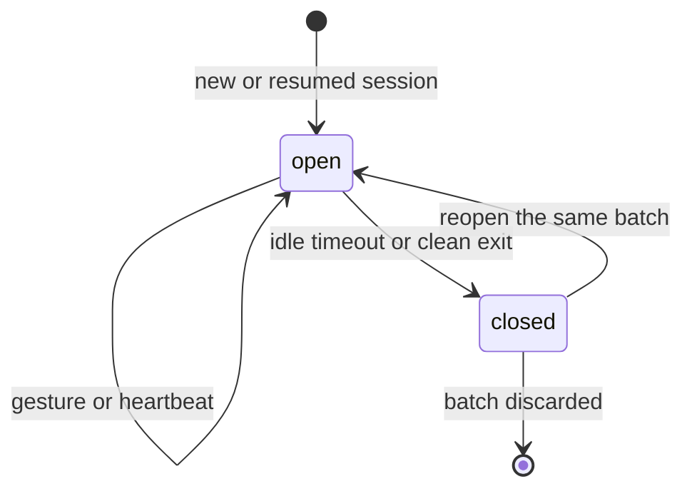

# `feed` — aggregates and invariants

## Metadata

| Field | Value |
|-------|-------|
| **Context** | `feed` |
| **Backlog** | `ARCH-302` |
| **Status** | Confirmed at gate `G5` (2026-11-04) |
| **Parent** | [`README.md`](README.md) |
| **Sources** | `F13`, `F14`, `F16`, `F17`, `F18`, `F21`, `F25`, `A-11`, `CLI-14a`, `CLI-18`, `CLI-21`, `CLI-28`, `D-20`, `OQ-13`, `OQ-15` |

## 1. `Batch` aggregate

### 1.1 State

| Field | Type | Rule |
|-------|------|------|
| `batch_id` | `BatchID` | Aggregate identity. |
| `user_id` | `UserID` | Owner. |
| `size` | integer | Requested size. 1–20 (`F13`). |
| `state` | `BatchState` | `composing`, `streaming`, `completed` or `degraded`. |
| `degradation_reason` | `DegradationReason` | Present only in `degraded`. |
| `created_at` | timestamp | UTC. Set once. |
| `completed_at` | timestamp | UTC. Set when the batch reaches a terminal state. |
| `version` | integer | Optimistic concurrency token for batch-level changes. |

### 1.2 `Card` entity

| Field | Type | Rule |
|-------|------|------|
| `card_id` | `CardID` | Identity inside the batch. |
| `video_id` | `VideoID` | Unique inside the batch. |
| `channel_id` | `ChannelID` | The channel behind the video. |
| `discovery_rank` | `DiscoveryRank` | Stable order from `CandidateSelection`. |
| `position` | `Position` | Dense, unique, zero-based inside the batch. |
| `state` | `CardState` | `pending`, `analyzed` or `failed`. |
| `analysis_id` | `AnalysisID` | Reference to the analysis result. |
| `score` | `Score` | `[0,1]`. Present when `analyzed`. |
| `reason` | `AnalysisReason` | Present when `failed`. |
| `decision` | `CardDecision` | `none`, `rejected`, `accepted` or `saved`. |
| `analyzed_late` | boolean | True when analysis finished after the card was passed. |
| `presentation` | `CardPresentation` | Display fields copied from the analysis contract. |
| `version` | integer | Optimistic token for card updates. |

### 1.3 Invariants

| ID | Invariant | Source |
|----|-----------|--------|
| `I-B1` | A batch has 1–20 cards. | `F13` |
| `I-B2` | `video_id` is unique inside the batch. | `F8`, `D-19` |
| `I-B3` | Positions are dense, unique and zero-based. | `CLI-14a` |
| `I-B4` | A card in `analyzed` has a score and an `analysis_id`. A card in `failed` has a reason. | `F11`, `F12` |
| `I-B5` | A terminal batch has no card in `pending`. | `F14` |
| `I-B6` | A `rejected` card has a rejection reason in its signal. | `F16` |
| `I-B7` | A `degraded` batch carries exactly one reason. | `F24` |

### 1.4 Ordering invariant

The full rule is `D-313`. At composition, positions are assigned in this order:

1. Analyzed cards first, by score descending.
2. Pending cards after them, by `discovery_rank`.
3. Ties break by `discovery_rank`.

After streaming starts, the prefix up to `furthest_card_id` is frozen. A card in that
prefix never moves. A card after the prefix may move into the analyzed block of the unseen
suffix. A card that finishes after it was passed stays where it is and gets
`analyzed_late = true` (`OQ-15`).

### 1.5 Lifecycle

`completed` means every card reached `analyzed` or `failed`. `degraded` means the batch
ended with fewer cards or with a failed dependency. The reason is recorded once.

## 2. `Session` aggregate

### 2.1 State

| Field | Type | Rule |
|-------|------|------|
| `session_id` | `SessionID` | Aggregate identity. |
| `user_id` | `UserID` | Owner. |
| `batch_id` | `BatchID` | The batch being browsed. |
| `state` | `SessionState` | `open` or `closed`. |
| `cursor` | `Cursor` | Current and furthest card. |
| `last_gesture_id` | `GestureID` | The last gesture applied to this session. |
| `lease_owner` | `LeaseOwner` | Identity of the server process that holds the lease. |
| `last_activity_at` | timestamp | UTC. Updated on every interaction. |
| `expires_at` | timestamp | UTC. `last_activity_at` plus the idle timeout. |
| `opened_at` | timestamp | UTC. Set once. |
| `closed_at` | timestamp | UTC. Present when closed. |
| `resume_count` | integer | Number of times the session was reopened. |
| `version` | integer | Optimistic concurrency token. |

### 2.2 Cursor

| Field | Type | Rule |
|-------|------|------|
| `current_card_id` | `CardID` | The card on screen. |
| `furthest_card_id` | `CardID` | The furthest card the owner reached. Never moves backward. |

The cursor uses card identity, not a numeric position (`D-312`). Reordering ahead of the
cursor cannot move the owner.

### 2.3 Invariants

| ID | Invariant | Source |
|----|-----------|--------|
| `I-S1` | A user has at most one session in `open` state. | `A-11` |
| `I-S2` | `current_card_id` and `furthest_card_id` belong to `batch_id`. | `CLI-14a` |
| `I-S3` | `furthest_card_id` never moves backward. `current_card_id` may move up or down. | `CLI-14a` |
| `I-S4` | `last_gesture_id` is monotone per session. A retry with the same ID does not advance twice. | `CLI-18`, `D-314` |
| `I-S5` | `expires_at` is later than `last_activity_at`. | `OQ-13` |
| `I-S6` | A `closed` session accepts no gesture or cursor change. | `F18` |
| `I-S7` | Reopening a closed session increments `resume_count` and keeps the cursor. | `CLI-21`, `D-316` |

### 2.4 Lifecycle

Navigation history is runtime state. It is not persisted (`D-316`). A reopen keeps the
cursor and loses the history (`F18`).

## 3. `WeeklyRating` aggregate

### 3.1 State

| Field | Type | Rule |
|-------|------|------|
| `rating_id` | `RatingID` | Aggregate identity. |
| `user_id` | `UserID` | Owner. |
| `week_start` | `WeekStart` | Monday of the ISO week, UTC. |
| `value` | `RatingValue` | `-1`, `0`, `+1` or `unrated`. |
| `batch_ids` | list of `BatchID` | Batches shown that week. At least 1. |
| `created_at` | timestamp | UTC. Set once. |

### 3.2 Invariants

| ID | Invariant | Source |
|----|-----------|--------|
| `I-R1` | One rating per `(user_id, week_start)`. | `F21`, `D-317` |
| `I-R2` | `value` is one of the four allowed values. | `F21`, `CLI-28` |
| `I-R3` | Every `batch_id` belongs to the user and falls in the week. | `F21` |
| `I-R4` | A rating is created only at session open, never mid-feed. | `CLI-28` |
| `I-R5` | `unrated` is a recorded value, not a missing row. | `CLI-28` |

## 4. Cross-aggregate consistency

| Operation | Aggregates | Rule |
|-----------|------------|------|
| Compose batch | `Batch` | One transaction creates the batch and its cards. |
| Apply analysis | `Batch` and one `Card` | One transaction updates the card and reorders the unseen suffix. |
| Apply gesture | `Session` and one `Card` | `taste` commits first. Then one `feed` transaction updates the card decision, the cursor and `last_gesture_id`. |
| Open or resume session | `Session` | One transaction acquires the lease or reclaims it. |
| Close session | `Session` | One transaction releases the lease and sets `closed`. |
| Record rating | `WeeklyRating` | One transaction inserts the unique weekly row. |

No `feed` transaction spans a context boundary (`context-map.md` §6.3).

## 5. Gesture outcomes

| Gesture | Card decision | Cursor after commit | `taste` command |
|---------|---------------|---------------------|-----------------|
| `left` | `rejected` | Advance | `RecordGesture` |
| `right` | `accepted` | Advance | `RecordGesture` |
| `save` | `saved` | Stays | `RecordGesture` |
| `down` | `none` | Advance | None |
| `up` | `none` | Back to the previous non-left-swiped card | None |

`left` and `right` advance only after `taste` returns `applied` (`D-20`). `up` never
crosses a resume boundary (`OQ-14`).

## 6. Invariant ownership

| Invariant group | Owner | Enforcement |
|-----------------|-------|-------------|
| Card set and positions | `Batch` | Composition and reorder validation. |
| Cursor and lease | `Session` | Session use cases and optimistic version. |
| Weekly uniqueness | `WeeklyRating` | Unique `(user_id, week_start)`. |
| Signal durability | `taste` | Signal committed before `feed` advances (`D-20`). |
| Analysis fields | `analysis` | `feed` stores a presentation snapshot only (`D-319`). |
