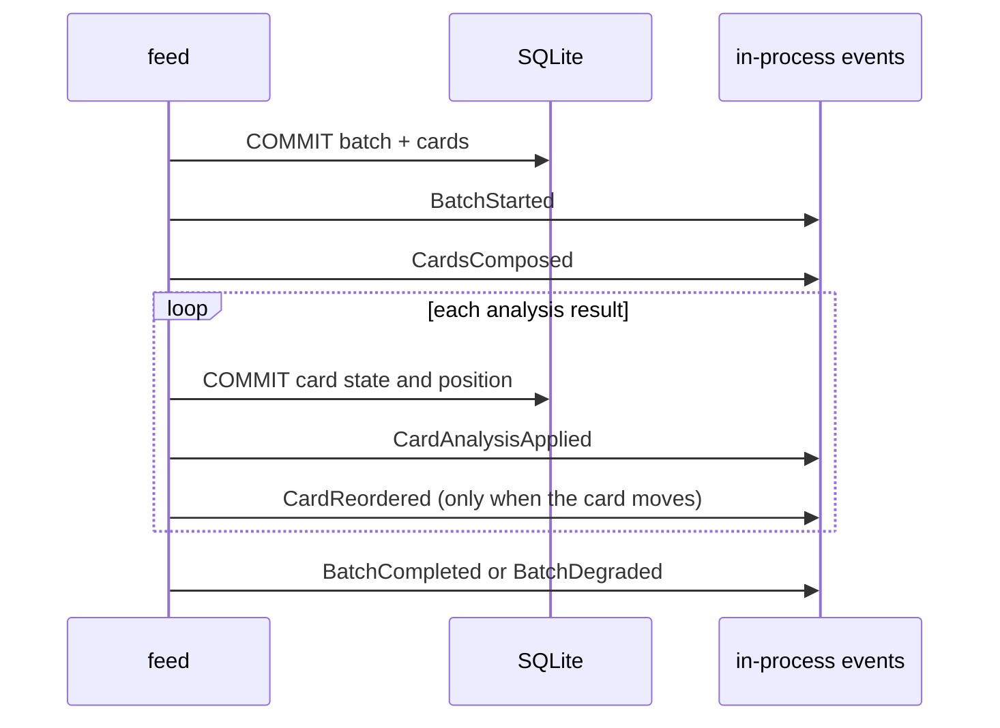

# `feed` — domain events

## Metadata

| Field | Value |
|-------|-------|
| **Context** | `feed` |
| **Backlog** | `ARCH-302` |
| **Status** | Confirmed at gate `G5` (2026-11-04) |
| **Parent** | [`README.md`](README.md) |
| **Sources** | `F13`, `F14`, `F16`, `F18`, `F21`, `F24`, `D-20`, `CLI-14a`, `CLI-28` |

A domain event is a past-tense fact about `feed`. It is immutable. It is emitted after the
transaction commits. The database remains the source of truth.

These are **not** integration events. They do not cross the context boundary. The
cross-context contracts are in [`context-map.md`](../../strategic/context-map.md) §6.1.
No queue, broker or event store is introduced. `ARCH-307` records the evented-pattern
decision.

## 1. Event catalogue

| Event | Trigger | Payload | Emitted when |
|-------|---------|---------|--------------|
| `BatchStarted` | `ComposeBatch` | `batch_id`, `user_id`, `size`, `occurred_at` | A batch row is created. |
| `CardsComposed` | `ComposeBatch` | `batch_id`, `cards`, `occurred_at` | Card rows and positions are committed. |
| `CardAnalysisApplied` | `ApplyAnalysisResult` | `batch_id`, `card_id`, `analysis_id`, `state`, `score`, `position`, `analyzed_late`, `occurred_at` | A card reaches `analyzed` or `failed`. |
| `CardReordered` | `ApplyAnalysisResult` | `batch_id`, `card_id`, `from_position`, `to_position`, `occurred_at` | A newly analyzed card moves inside the unseen suffix. |
| `GestureApplied` | `ApplyGesture` | `session_id`, `batch_id`, `card_id`, `gesture_id`, `gesture`, `cursor`, `occurred_at` | The `feed` transaction commits after `taste` returns `applied`. |
| `SessionOpened` | `OpenSession` | `session_id`, `user_id`, `batch_id`, `occurred_at` | A new open session is created. |
| `SessionResumed` | `OpenSession` | `session_id`, `user_id`, `batch_id`, `resume_count`, `occurred_at` | A closed session is reopened. |
| `SessionClosed` | `CloseSession` | `session_id`, `reason`, `occurred_at` | The session closes by idle timeout or clean exit. |
| `RatingRecorded` | `RecordWeeklyRating` | `rating_id`, `user_id`, `week_start`, `value`, `batch_ids`, `occurred_at` | A weekly rating is stored. |
| `BatchCompleted` | `ComposeBatch` | `batch_id`, `card_count`, `occurred_at` | Every card is terminal. |
| `BatchDegraded` | `ComposeBatch` | `batch_id`, `reason`, `card_count`, `occurred_at` | The batch ends with reduced functionality. |

## 2. Payload rules

| Rule | Detail |
|------|--------|
| Past tense | Every event name describes a fact that already happened. |
| Immutable | A payload is never edited. A correction is a new event. |
| Identifiers | Every payload carries the batch, card or session identity it concerns. |
| No content | A payload never carries transcript text, prompt text or a token. |
| UTC | Every timestamp is UTC (`D-13`). |
| No analysis schema | `CardAnalysisApplied` carries the fields `feed` stores, not the full analysis document. |

### 2.1 `CardAnalysisApplied`

| Field | Type | Note |
|-------|------|------|
| `batch_id` | `BatchID` | Batch that owns the card. |
| `card_id` | `CardID` | Card that changed. |
| `analysis_id` | `AnalysisID` | Analysis that produced the result. |
| `state` | `CardState` | `analyzed` or `failed`. |
| `score` | `Score` | Present when analyzed. |
| `position` | `Position` | Position after any reorder. |
| `analyzed_late` | boolean | True when the card was already passed. |
| `occurred_at` | timestamp | Commit time, UTC. |

### 2.2 `GestureApplied`

| Field | Type | Note |
|-------|------|------|
| `session_id` | `SessionID` | Session that applied the gesture. |
| `batch_id` | `BatchID` | Batch being browsed. |
| `card_id` | `CardID` | Card that received the gesture. |
| `gesture_id` | `GestureID` | Idempotency key from `taste`. |
| `gesture` | `Gesture` | `left`, `right`, `save`, `down` or `up`. |
| `cursor` | `Cursor` | Cursor after the gesture. |
| `occurred_at` | timestamp | Commit time, UTC. |

`GestureApplied` is emitted after the local `feed` transaction. The `taste` transaction
already committed. It does not imply that a signal exists for `down` or `up` (`D-304`).

## 3. Ordering

For a new batch:

For a gesture, `taste` emits its own events first. `feed` emits `GestureApplied` after its
cursor transaction. The two sets are not one atomic stream.

## 4. Delivery and failure

| Property | Decision |
|----------|----------|
| Transport | In-process function calls. No bus and no queue. |
| Durability | Not durable. The database is the truth. |
| Emission point | After the transaction commits. |
| Lost event | Possible after a crash. No durable state is lost. |
| Duplicate event | Possible on retry. Consumers must be idempotent by event identity. |
| Consumers in v1 | Logging and diagnostics only. `stats` reads the database. |
| Cross-context use | None. Use the contracts in `context-map.md` §6.1. |

## 5. Naming

| Rule | Example |
|------|---------|
| Past tense | `BatchStarted`, not `StartBatch` |
| Domain language | `CardReordered`, not `PositionUpdated` |
| One fact per event | `BatchDegraded` does not also report a card analysis |
| No transport verbs | `GestureApplied`, not `GesturePosted` |
| Stable names | Rename only with a new event and a migration note |
