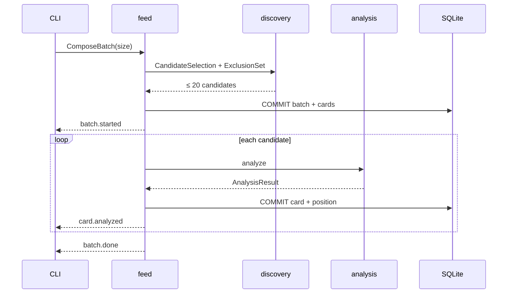
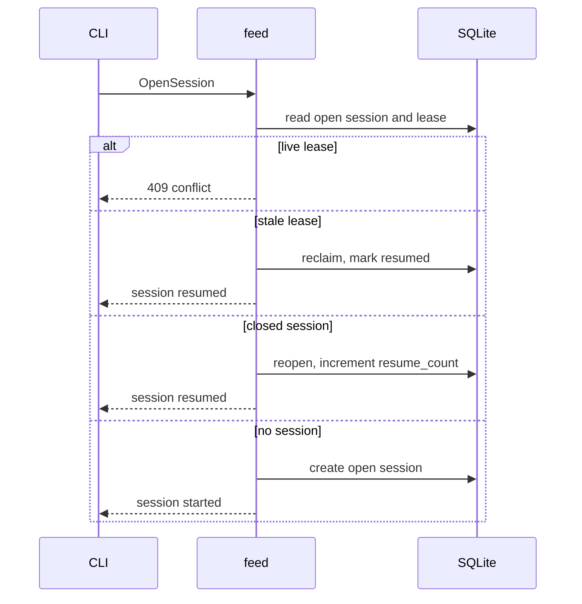
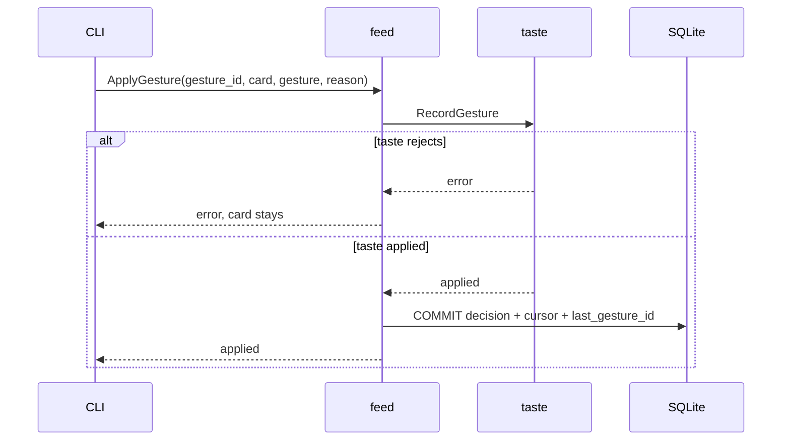

# `feed` — use cases

## Metadata

| Field | Value |
|-------|-------|
| **Context** | `feed` |
| **Backlog** | `ARCH-302` |
| **Status** | Confirmed at gate `G5` (2026-11-04) |
| **Parent** | [`README.md`](README.md) |
| **Sources** | `F13`, `F14`, `F16`, `F17`, `F18`, `F21`, `F24`, `F25`, `CLI-14a`, `CLI-18`, `CLI-21`, `CLI-28`, `D-20` |

A use case is an application service inside `feed`. It coordinates the aggregates and the
contexts. It contains no transport code and no SQL (`A-3`, `H-7`).

## 1. Catalogue

| Use case | Kind | Actor | Input | Result |
|----------|------|-------|-------|--------|
| `ComposeBatch` | Command | CLI `feed` | user, size | New batch with cards, streamed and analyzed. |
| `OpenSession` | Command | CLI start | user, batch | Open or resumed session with a lease. |
| `ApplyGesture` | Command | CLI gesture | session, card, gesture, reason | Card decision and cursor change. |
| `ApplyAnalysisResult` | Command | Analysis pipeline | analysis result | Card state, score and position. |
| `CloseSession` | Command | Idle timer or clean exit | session, reason | Closed session and released lease. |
| `RecordWeeklyRating` | Command | CLI prompt | session, value | Weekly rating row. |
| `GetCachedFeed` | Query | CLI or API | user | Latest completed batch. |
| `GetActiveSession` | Query | CLI or API | user | Open session or none. |

## 2. `ComposeBatch`

**Preconditions:** the user is onboarded. `size` is 1–20. No other batch is being
composed for the user.

**Steps:**

1. Build an `ExclusionSet` from watched, saved and recently shown IDs.
2. Call `discovery` with the interest set and the exclusion set.
3. Create the batch and its cards in one transaction. Cards start `pending`.
4. Assign positions: analyzed first by score, then pending by `discovery_rank`.
5. Stream cards to the UI as they become available.
6. Pass each candidate to `analysis`. Apply each result through
   `ApplyAnalysisResult`.
7. Complete the batch when every card is terminal.

**Failure:** discovery quota or network failure sets the batch to `degraded` with a
reason. The cached feed is served. A failed card does not fail the batch (`F11`, `F24`).

## 3. `OpenSession`

**Preconditions:** a batch exists or can be composed. The user has no live lease.

**Steps:**

1. Read the open session for the user.
2. If a live lease exists, return a conflict (`A-11`).
3. If the lease is stale, reclaim it and resume (`OQ-13`).
4. If a closed session exists for an unfinished batch, reopen it and increment
   `resume_count` (`D-316`).
5. Otherwise create a new open session at the first card.
6. Run the weekly-rating gate (`CLI-28`).

**Failure:** no batch and no way to compose one returns an explicit error. A second UI
gets exit `4` (`CLI-6`).

## 4. `ApplyGesture`

**Preconditions:** the session is open. The card belongs to the session batch. A left
gesture has a reason.

**Steps:**

1. Read the session.
2. If `gesture_id` equals `last_gesture_id`, return the stored cursor. No second write.
3. For `left`, `right` or `save`, call `taste` with `RecordGesture`.
4. If `taste` fails, stop. The card does not advance (`D-20`).
5. In one `feed` transaction: set the card decision, advance the cursor when required,
   and store `last_gesture_id`.
6. Emit `GestureApplied`.

**Gesture rules:**

| Gesture | `taste` call | Advance |
|---------|--------------|---------|
| `left` | Yes | Yes, after commit |
| `right` | Yes | Yes, after commit |
| `save` | Yes | No |
| `down` | No | Yes |
| `up` | No | Back to the previous non-left-swiped card |

`up` and `down` are navigation. They create no signal (`D-304`). `up` does not cross a
resume boundary (`OQ-14`).

**Failure:** a stale session version retries once. A second failure returns conflict. A
database failure leaves the card current and the signal committed in `taste`. The retry
is safe by `gesture_id` (`CLI-18`).

## 5. `ApplyAnalysisResult`

**Preconditions:** the card is `pending`. The result is schema-valid or an explicit
failure.

**Steps:**

1. Update the card to `analyzed` or `failed`, with score, reason and presentation.
2. If the card is at or behind `furthest_card_id`, do not move it. Set
   `analyzed_late = true` when it was pending while the owner passed it (`OQ-15`).
3. Otherwise reorder the unseen suffix: analyzed cards first, then pending, with ties by
   score and `discovery_rank`.
4. Commit the card and positions in one transaction.
5. Emit `CardAnalysisApplied` and, when it moved, `CardReordered`.
6. If every card is terminal, set the batch to `completed`.

**Failure:** an invalid result is already classified by `analysis` as `failed`. `feed`
never coerces it (`A-12b`). A stale card version retries once.

## 6. `CloseSession`

**Preconditions:** the session is open.

**Steps:**

1. Release the lease.
2. Set `state = closed` and `closed_at`.
3. Discard in-memory navigation history.
4. Emit `SessionClosed`.

The batch stays. A later open can resume it (`F25`).

## 7. `RecordWeeklyRating`

**Preconditions:** the session is open. The last rating is at least 7 days old.

**Steps:**

1. Determine `week_start` as the Monday of the current ISO week, UTC.
2. Collect the batch IDs shown during that week.
3. Insert one rating with `value` in `-1`, `0`, `+1` or `unrated`.
4. Emit `RatingRecorded`.

**Failure:** a duplicate week returns the stored rating. The prompt is not shown again
for 7 days (`I-R1`, `I-R4`).

## 8. `GetCachedFeed`

Reads the latest completed batch for the user, with cards in position order. It does not
return a degraded batch as the cached feed. The caller shows the reason and the reset
time (`F24`).

## 9. Mapping to commands and contexts

| Entry point | Use case | Context boundary |
|-------------|----------|------------------|
| `ytfeed feed` | `ComposeBatch`, `OpenSession` | CLI → API → `feed` |
| Left/right/save gesture | `ApplyGesture` | `feed` → `taste` |
| Down/up gesture | `ApplyGesture` | Local to `feed` |
| Analysis worker | `ApplyAnalysisResult` | `analysis` → `feed` |
| Idle timeout | `CloseSession` | `feed` timer |
| Weekly prompt | `RecordWeeklyRating` | CLI → API → `feed` |
| Degraded start | `GetCachedFeed` | `feed` query |

## 10. Failure paths

| Failure | User-visible result | State |
|---------|---------------------|-------|
| Live lease | "Another UI is active." Exit `4` | No session change. |
| Stale lease | `session resumed` | Lease reclaimed. |
| Discovery quota | Cached feed and banner. Exit `6` or `5` (`OQ-01`). | Batch `degraded`. |
| Analysis failure | Card `[unanalyzed: ...]`. Exit `0`. | Card `failed`. |
| Taste rejects a gesture | Error. Card stays current. Exit `1`. | No cursor change. |
| Duplicate gesture | Success, idempotent. Exit `0`. | Stored cursor. |
| Stale session version | Retry once, then conflict. Exit `4`. | No partial write. |
| Duplicate rating | Stored rating. Exit `0`. | No second row. |
