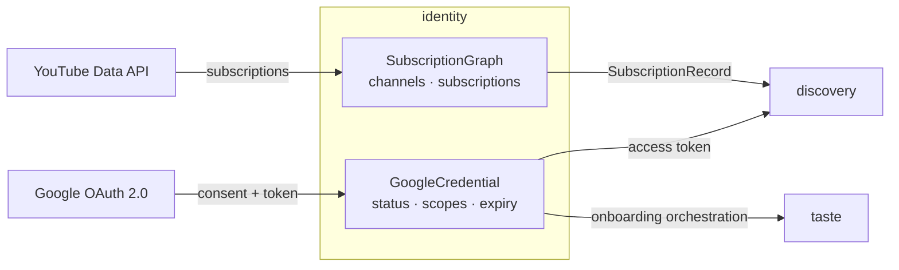

# DDD tactical — `identity` (light)

## Metadata

| Field | Value |
|-------|-------|
| **Context** | `identity` |
| **Document** | Light tactical model: credential, subscription import and token lifecycle |
| **Backlog** | `ARCH-305` |
| **Version** | 0.1 (draft) |
| **Date** | 2026-11-03 |
| **Owner** | Oleg K |
| **Status** | Confirmed at gate `G5` (2026-11-04) |
| **Sources** | [`prd-ytfeed.md`](../../../../10-product/prd-ytfeed.md), [`context-map.md`](../../strategic/context-map.md), [`glossary.md`](../../strategic/glossary.md), [`02-architecture.md`](../../../../00-rules/02-architecture.md), [`04-data-persistence.md`](../../../../00-rules/04-data-persistence.md), [`02-identity-taste.md`](../../../c4/03-components/02-identity-taste.md) |
| **Sibling** | [`model.md`](model.md) |
| **Next** | `ARCH-306` (`library`, light) |

## 1. Scope

`identity` obtains and refreshes one Google credential and imports the subscription graph
once. It owns the credential metadata, channels and subscriptions. It does not own the
profile, the signals or the candidates.

Tactical depth is **light** per `SD-3`. The context is supporting because the subscription
graph is a taste asset (`G4-4`). The model covers the credential aggregate, the
subscription graph, its events and its repository. It does not add tactical detail that
the product does not need.

## 2. Model at a glance

The arrow from `identity` to `taste` is a use case, not a context relationship. Onboarding
is a coordinator that calls published interfaces (`G4-6`, `context-map.md` §9.1).

## 3. Aggregate boundaries

| Aggregate | Root identity | Consistency boundary | Why this boundary |
|-----------|---------------|----------------------|-------------------|
| **GoogleCredential** | `UserID` | Token status, scopes and expiry | One credential per user. The token file and its metadata must agree. |
| **SubscriptionGraph** | `UserID` | The imported channels and subscriptions | The graph is a single read-only snapshot from YouTube. Import is all-or-nothing per page, idempotent overall. |

The onboarding orchestrator is a use case. It is not an aggregate and not a context
(`G4-6`).

## 4. Tactical decisions

| # | Decision | Rationale | Alternative rejected |
|---|----------|-----------|----------------------|
| `D-340` | Two aggregates: `GoogleCredential` and `SubscriptionGraph` | Credential lifecycle and graph content have different change triggers. | One `Identity` aggregate. It would mix security state with imported content. |
| `D-341` | Token bytes live only in `./data/token`. The database stores metadata and a fingerprint | `C-17` and `L-10` forbid token leakage. The file is the single secret store. | A token column. It would enter backups and logs. |
| `D-342` | The only scope is `youtube.readonly` | `F1` fixes the scope. | A broader scope. It would break the privacy promise. |
| `D-343` | Refresh is single-flight. A 401 triggers one refresh, not a retry loop | Prevents a refresh storm and duplicate consent prompts (`F1`). | Refreshing on every call. |
| `D-344` | A revoked grant returns `ErrUnauthorized`, exit `2` | `F1` and `CLI-6` define re-authentication. | Retrying forever. |
| `D-345` | Subscription import is paginated and idempotent by `channel_id` | `F2`, `D-19`. A crash re-runs from page 1. | A transactional import of everything. It would not fit a large graph. |
| `D-346` | Onboarding is a use-case coordinator in `identity` | `A-1` has no application layer. `G4-6` keeps the placement. | Moving it to `feed`. It needs an ADR and a Level 3 revision. |

## 5. Cross-context contracts

| Contract | Direction | Shape | Reference |
|----------|-----------|-------|-----------|
| OAuth / YouTube | Google → `identity` | Anti-corruption layer for consent, token and API errors | [`context-map.md`](../../strategic/context-map.md) REL-1 |
| Credential access | `identity` → `discovery` | Usable access token. The consumer never persists it. | [`context-map.md`](../../strategic/context-map.md) §6.1 |
| `SubscriptionRecord` | `identity` → `discovery` | Channel ID, title, subscriber count, topic tags | [`context-map.md`](../../strategic/context-map.md) §6.1 |

## 6. What is deliberately not here

- The profile and interests (`taste`).
- Candidate selection and quota (`discovery`).
- A second OAuth provider or scope.
- Token encryption at the application layer. The file is `0600` and the OS disk is
  encrypted (`C-17`).
- An event bus, a queue or event sourcing (`ARCH-307`).

## 7. Open questions

| ID | Effect on this model |
|----|----------------------|
| `OQ-12` | yt-dlp absence during onboarding. `onboard` warns, `feed` fails with exit `6`. |
| `OQ-06` | opencode is a preset, not a second adapter. No effect here. |
| `OQ-13` | Lease reclaim is a `feed` concern. No effect here. |

## 8. Reading order and acceptance

1. [`model.md`](model.md) — aggregates, value objects, events, repository and use cases.

| Backlog acceptance criterion | Where it is met |
|------------------------------|-----------------|
| Every aggregate has at least one stated invariant | [`model.md`](model.md) §1.4, §2.3 |
| Value objects have validation rules | [`model.md`](model.md) §3 |
| Domain events are past-tense facts with payloads | [`model.md`](model.md) §4 |
| Repository contracts state transaction boundaries | [`model.md`](model.md) §5 |

The tactical model is confirmed at gate `G5`, after `ARCH-307`.
