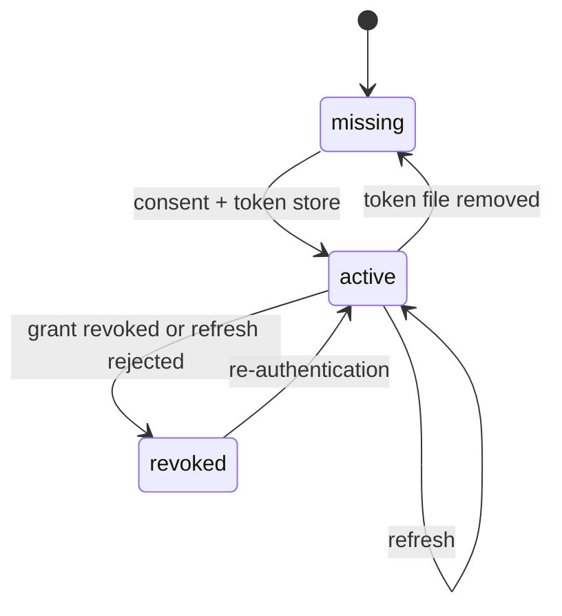

# `identity` — light model

## Metadata

| Field | Value |
|-------|-------|
| **Context** | `identity` |
| **Backlog** | `ARCH-305` |
| **Status** | Confirmed at gate `G5` (2026-11-04) |
| **Parent** | [`README.md`](README.md) |
| **Sources** | `F1`, `F2`, `F3`, `C-2`, `C-17`, `D-19`, `D-22`, `L-10`, `CLI-25`…`CLI-27`, `G4-6` |

## 1. `GoogleCredential` aggregate

### 1.1 State

| Field | Type | Rule |
|-------|------|------|
| `user_id` | `UserID` | Aggregate identity. One credential per user. |
| `status` | `CredentialStatus` | `missing`, `active` or `revoked`. |
| `scope` | `OAuthScope` | Always `youtube.readonly`. |
| `token_fingerprint` | `TokenFingerprint` | A short hash or suffix. Never the token itself. |
| `access_expires_at` | timestamp | UTC. Present when active. |
| `last_refreshed_at` | timestamp | UTC. Present after a refresh. |
| `created_at` | timestamp | UTC. Set once. |

The token bytes live only in `./data/token` with `0600` permissions. The aggregate stores
metadata. The `TokenStore` port performs the file operations (`C-17`, `D-341`).

### 1.2 Invariants

| ID | Invariant | Source |
|----|-----------|--------|
| `I-ID1` | A user has at most one credential. | `F1` |
| `I-ID2` | The only scope is `youtube.readonly`. | `F1` |
| `I-ID3` | The token itself is never stored in the database, logs, traces or errors. | `C-2`, `L-10`, `E-17` |
| `I-ID4` | The token file is `0600` and is re-checked on every read. | `C-17` |
| `I-ID5` | A refresh is single-flight. One 401 triggers at most one refresh. | `D-343` |
| `I-ID6` | A revoked grant returns `ErrUnauthorized` and requires re-authentication. | `F1`, `D-344` |
| `I-ID7` | The fingerprint is not reversible and is safe for `doctor`. | `A-10b` |

### 1.3 Lifecycle

A missing or revoked credential blocks `feed` with exit `2`. `doctor` reports the status
without printing the token (`F27`).

## 2. `SubscriptionGraph` aggregate

### 2.1 State

| Field | Type | Rule |
|-------|------|------|
| `user_id` | `UserID` | Aggregate identity. |
| `imported_at` | timestamp | UTC. Last successful import. |
| `channel_count` | integer | Non-negative. |
| `channels` | list of `Channel` | Unique by `channel_id`. |

### 2.2 `Channel` entity

| Field | Type | Rule |
|-------|------|------|
| `channel_id` | `ChannelID` | Natural key. Unique per user. |
| `title` | text | Trimmed, 1–500 characters. |
| `subscriber_count` | `SubscriberCount` | Non-negative integer. |
| `topic_tags` | list of `TopicTag` | External metadata. May be empty. |

### 2.3 Invariants

| ID | Invariant | Source |
|----|-----------|--------|
| `I-SG1` | `channel_id` is unique inside the graph. | `F2`, `D-19` |
| `I-SG2` | A subscription has a channel ID, a title and a non-negative subscriber count. | `F2` |
| `I-SG3` | Import is idempotent. A crash re-runs from page 1 and upserts. | `F2`, `D-345` |
| `I-SG4` | Topic tags are YouTube metadata, not the product's `topic`. | `G4-7` |
| `I-SG5` | The graph is read-only toward Google. No write scope is requested. | `F1` |

## 3. Value objects

| Object | Validation | Notes |
|--------|------------|-------|
| `UserID` | Non-empty, at most 128 characters | Owner. |
| `ChannelID` | 1–64 characters, `[A-Za-z0-9_-]` | Opaque YouTube ID. |
| `SubscriberCount` | Non-negative integer | Used for micro-blogger classification. |
| `TopicTag` | Trimmed, 1–100 characters | External metadata. |
| `OAuthScope` | Exactly `youtube.readonly` | `F1`. |
| `CredentialStatus` | `missing`, `active`, `revoked` | One state at a time. |
| `TokenFingerprint` | 8–64 printable characters | Never the token. |
| `Expiry` | UTC timestamp | Access or refresh expiry. |

## 4. Domain events

| Event | Trigger | Payload |
|-------|---------|---------|
| `CredentialStored` | `CompleteOAuth` | `user_id`, `scope`, `fingerprint`, `access_expires_at`, `occurred_at` |
| `CredentialRefreshed` | `RefreshToken` | `user_id`, `fingerprint`, `access_expires_at`, `occurred_at` |
| `CredentialRevoked` | `RefreshToken` or API 401 | `user_id`, `reason`, `occurred_at` |
| `SubscriptionsImported` | `ImportSubscriptions` | `user_id`, `channel_count`, `imported_at`, `occurred_at` |
| `SubscriptionImportFailed` | `ImportSubscriptions` | `user_id`, `reason`, `page`, `occurred_at` |

Events are in-process notifications after commit. They are not durable and not
integration events. `ARCH-307` records the evented-pattern decision.

## 5. Repositories and transactions

| Repository | Operation | Transaction boundary |
|------------|-----------|----------------------|
| `CredentialRepository` | `Get`, `Save` | One row per user. Metadata only. |
| `TokenStore` (port) | `Read`, `Write`, `Delete`, `CheckPermissions` | File write is atomic. `0600` verified after write. |
| `SubscriptionRepository` | `UpsertPage`, `Count`, `List` | One transaction per page. The import as a whole is not one transaction. |

| Use case | Steps |
|----------|-------|
| `StartOAuth` | Build the consent URL with PKCE and `state`. |
| `CompleteOAuth` | Verify `state`, exchange the code, write the token file, save metadata, emit `CredentialStored`. |
| `RefreshToken` | Single-flight refresh. On success, update metadata. On rejection, mark `revoked` and emit `CredentialRevoked`. |
| `ImportSubscriptions` | Page through `subscriptions.list`, upsert each page by `channel_id`, update the count. |
| `Onboard` | Coordinate `CompleteOAuth`, `ImportSubscriptions`, `taste.SetInterests`, and the seed-source choice (`CLI-25`…`CLI-27`). |

`ImportSubscriptions` is not one transaction. A failure after page N keeps pages 1…N and
reports the failure. A retry resumes from page 1 and upserts (`D-345`).

## 6. Failure modes

| Failure | Result | Recovery |
|---------|--------|----------|
| Consent denied | `ErrUnauthorized`, exit `2` | Re-run `onboard`. |
| Token file missing | `missing` status | Run `onboard`. |
| Token file world-readable | Warning, continue | `doctor` reports it. |
| Refresh rejected | `revoked`, exit `2` | Re-authenticate. |
| Import fails mid-way | Pages already written stay | Re-run import. |
| YouTube unavailable | `SubscriptionImportFailed` | Retry later. |
| yt-dlp missing during onboarding | Warning, onboarding succeeds | `feed` degrades (`OQ-12`). |
