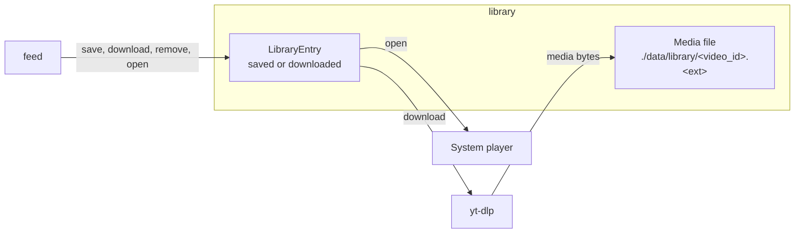

# DDD tactical — `library` (light)

## Metadata

| Field | Value |
|-------|-------|
| **Context** | `library` |
| **Document** | Light tactical model: saved videos, downloads and playback |
| **Backlog** | `ARCH-306` |
| **Version** | 0.1 (draft) |
| **Date** | 2026-11-03 |
| **Owner** | Oleg K |
| **Status** | Confirmed at gate `G5` (2026-11-04) |
| **Sources** | [`prd-ytfeed.md`](../../../../10-product/prd-ytfeed.md), [`context-map.md`](../../strategic/context-map.md), [`glossary.md`](../../strategic/glossary.md), [`02-architecture.md`](../../../../00-rules/02-architecture.md), [`04-data-persistence.md`](../../../../00-rules/04-data-persistence.md), [`04-feed-library.md`](../../../c4/03-components/04-feed-library.md) |
| **Sibling** | [`model.md`](model.md) |
| **Next** | `ARCH-307` (evented pattern assessment) |

## 1. Scope

`library` keeps saved videos and local downloads, and opens them in the system player. It
owns the library entry, the media file reference and the display snapshot. It does not own
discovery metadata, cards or signals.

Tactical depth is **light** per `SD-3`. File management and playback are commodity. The
only product-specific part is the two-state model and its link to a save gesture
(`OQ-04`).

## 2. Model at a glance

`feed` is the only caller. A dead player must not stop card navigation (`F20`, `CLI-23`).

## 3. Aggregate boundary

| Aggregate | Root identity | Consistency boundary | Why this boundary |
|-----------|---------------|----------------------|-------------------|
| **LibraryEntry** | `(UserID, VideoID)` | Entry state, file reference and display snapshot | One video has one library entry per user. The file and the state must agree. |

The media file is not an aggregate. It is a byte stream behind the `FileStore` port. The
file name is derived from the video ID, not stored as a free-form path.

## 4. Tactical decisions

| # | Decision | Rationale | Alternative rejected |
|---|----------|-----------|----------------------|
| `D-350` | One aggregate: `LibraryEntry`, keyed by user and video | A video has at most one library entry per user. | Separate saved and downloaded rows. It would duplicate the identity. |
| `D-351` | Two states: `saved` (no file) and `downloaded` (file present) | `OQ-04` resolves the bookmark ambiguity this way. | A single "downloaded" state. It would lose the save-without-download case. |
| `D-352` | The file path is `./data/library/<video_id>.<ext>` | The video ID is safe and stable. It avoids renaming and path traversal (`F20`). | Title-based paths. They collide and need sanitizing. |
| `D-353` | Download only on an explicit request. Analysis never downloads media | `F9` and `F17`. | Automatic downloads during analysis. It would waste disk and time. |
| `D-354` | File operations are best effort. A failed download leaves the entry `saved` | `CLI-24` and `F17`. The entry is still useful. | Deleting the entry when the download fails. |
| `D-355` | Remove deletes the file and the entry. It never deletes signals, cards or the database | `CLI-19` says removal is not destructive to the database. | A cascade delete across contexts. It would break the audit trail. |
| `D-356` | The player launches asynchronously. The UI never waits for it | `CLI-23` and `CLI-24`. A slow player must not block the feed. | A blocking exec. It would freeze the UI. |

## 5. Cross-context contract

| Contract | Direction | Shape | Reference |
|----------|-----------|-------|-----------|
| `LibraryCommand` | `feed` → `library` | `video_id`, operation (`save`, `download`, `remove`, `open`) | [`context-map.md`](../../strategic/context-map.md) §6.1 |

`library` never reads the profile or the analysis schema. The `feed` card supplies the
video ID. The entry keeps its own display snapshot (`context-map.md` §7).

## 6. What is deliberately not here

- Discovery metadata and candidate state (`discovery`).
- Cards, positions and the cursor (`feed`).
- Signals and the profile (`taste`).
- A media server, streaming or transcoding. The product downloads files.
- An event bus, a queue or event sourcing (`ARCH-307`).

## 7. Open questions

| ID | Effect on this model |
|----|----------------------|
| `OQ-04` | `saved` vs `downloaded`. `D-351` uses two states as the provisional default. |
| `OQ-12` | yt-dlp absence. Download fails, the entry stays `saved`. |
| `OQ-03` | Key bindings for save and remove. The gestures are stable. |

## 8. Reading order and acceptance

1. [`model.md`](model.md) — aggregate, value objects, events, repository and use cases.

| Backlog acceptance criterion | Where it is met |
|------------------------------|-----------------|
| Every aggregate has at least one stated invariant | [`model.md`](model.md) §1.3 |
| Value objects have validation rules | [`model.md`](model.md) §2 |
| Domain events are past-tense facts with payloads | [`model.md`](model.md) §3 |
| Repository contracts state transaction boundaries | [`model.md`](model.md) §4 |

The tactical model is confirmed at gate `G5`, after `ARCH-307`.
