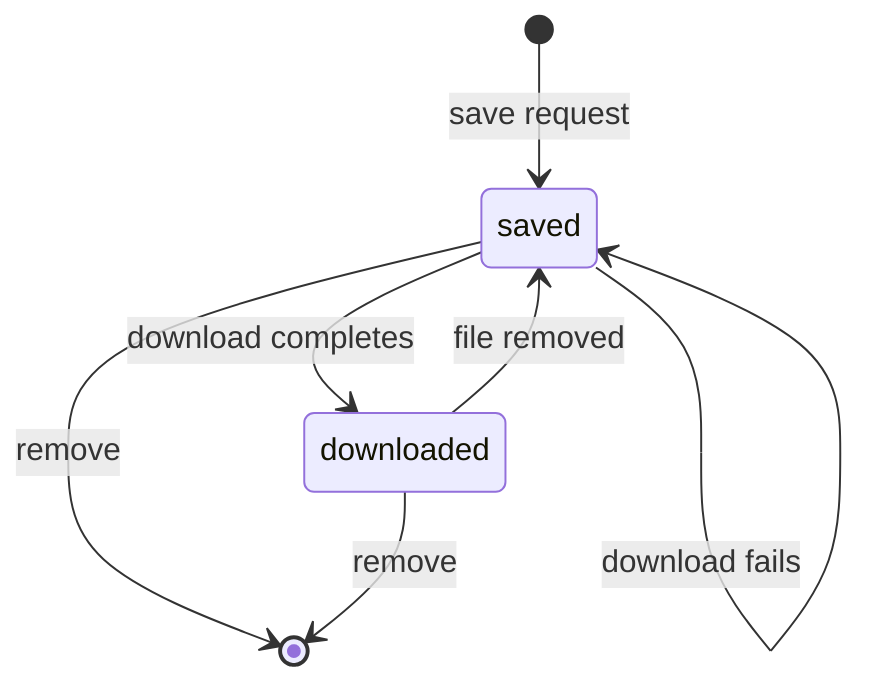

# `library` — light model

## Metadata

| Field | Value |
|-------|-------|
| **Context** | `library` |
| **Backlog** | `ARCH-306` |
| **Status** | Confirmed at gate `G5` (2026-11-04) |
| **Parent** | [`README.md`](README.md) |
| **Sources** | `F17`, `F20`, `CLI-19`, `CLI-23`, `CLI-24`, `OQ-04`, `OQ-12` |

## 1. `LibraryEntry` aggregate

### 1.1 State

| Field | Type | Rule |
|-------|------|------|
| `user_id` | `UserID` | Part of the identity. |
| `video_id` | `VideoID` | Part of the identity. Unique per user. |
| `state` | `LibraryState` | `saved` or `downloaded`. |
| `title` | `Title` | Display snapshot. Trimmed, 1–500 characters. |
| `channel_id` | `ChannelID` | Display snapshot. |
| `duration_seconds` | `Duration` | Non-negative integer. |
| `file_extension` | `MediaExtension` | Present when `downloaded`. |
| `file_bytes` | `ByteSize` | Present when `downloaded`. Positive. |
| `saved_at` | timestamp | UTC. Set once. |
| `downloaded_at` | timestamp | UTC. Present when `downloaded`. |
| `updated_at` | timestamp | UTC. |

The file path is derived: `./data/library/<video_id>.<file_extension>`. It is not stored as
a free-form path (`D-352`).

### 1.2 Invariants

| ID | Invariant | Source |
|----|-----------|--------|
| `I-L1` | One entry per `(user_id, video_id)`. | `F20` |
| `I-L2` | `saved` means no local file. `downloaded` means a local file exists. | `OQ-04`, `D-351` |
| `I-L3` | A `downloaded` entry has an extension, a positive size and `downloaded_at`. | `F20` |
| `I-L4` | The file name is derived from `video_id` and contains no separator. | `F20`, `D-352` |
| `I-L5` | Removing an entry deletes the file and the entry. It never deletes signals, cards or the database. | `CLI-19`, `D-355` |
| `I-L6` | A failed download leaves the entry `saved`. | `CLI-24`, `D-354` |
| `I-L7` | The entry never stores media bytes in the database. | `F20`, `D-356` |

### 1.3 Lifecycle

A remove deletes the row and the file. A failed remove leaves the row `downloaded` and
reports the error. The state never claims a file that is missing.

## 2. Value objects

| Object | Validation | Notes |
|--------|------------|-------|
| `UserID` | Non-empty, at most 128 characters | Owner. |
| `VideoID` | 1–64 characters, `[A-Za-z0-9_-]` | Used in the file name. |
| `ChannelID` | 1–64 characters, `[A-Za-z0-9_-]` | Display snapshot. |
| `LibraryState` | `saved`, `downloaded` | One state at a time. |
| `Title` | Trimmed, 1–500 characters | Display only. |
| `Duration` | Non-negative integer | Seconds. |
| `MediaExtension` | Lowercase, 1–8 characters, `[a-z0-9]` | Example: `mp4`, `webm`. |
| `ByteSize` | Positive integer | File size. |
| `FileName` | `<video_id>.<extension>` | Derived. No path separator. |

## 3. Domain events

| Event | Trigger | Payload |
|-------|---------|---------|
| `VideoSaved` | `SaveVideo` | `user_id`, `video_id`, `saved_at`, `occurred_at` |
| `DownloadCompleted` | `DownloadVideo` | `user_id`, `video_id`, `extension`, `bytes`, `occurred_at` |
| `DownloadFailed` | `DownloadVideo` | `user_id`, `video_id`, `reason`, `occurred_at` |
| `LibraryEntryRemoved` | `RemoveVideo` | `user_id`, `video_id`, `had_file`, `occurred_at` |
| `PlaybackOpened` | `OpenVideo` | `user_id`, `video_id`, `occurred_at` |

Events are in-process notifications after commit. They are not durable and not
integration events. `ARCH-307` records the evented-pattern decision.

## 4. Repositories and transactions

| Repository or port | Operation | Boundary |
|--------------------|-----------|----------|
| `LibraryRepository` | `Get`, `List`, `Save`, `MarkDownloaded`, `Remove` | One entry per transaction. |
| `FileStore` (port) | `Write`, `Stat`, `Delete` | Atomic write to a temporary name, then rename. |
| `Downloader` (port) | `Download` | External process. Progress on stderr. |
| `Player` (port) | `Open` | Asynchronous process launch. Never blocks. |

| Use case | Steps |
|----------|-------|
| `SaveVideo` | Insert an entry in `saved` state. A second save returns the existing entry. |
| `DownloadVideo` | Mark the file intent, call `Downloader`, write the file, mark `downloaded`. On failure keep `saved`. |
| `RemoveVideo` | Delete the file, then delete the entry. A missing file is not an error. |
| `OpenVideo` | Check that the file exists, then launch the player. A missing file returns an explicit error. |
| `ListLibrary` | Read entries ordered by `saved_at`. |

`DownloadVideo` is not one transaction across the file and the row. The file write happens
first. The row update commits after the file exists. A crash leaves the entry `saved` and
an orphan file. The next download overwrites it or the orphan sweep removes it.

## 5. Failure modes

| Failure | Result | Recovery |
|---------|--------|----------|
| Download fails | Entry stays `saved`. Error with correlation ID. | Retry the download. |
| Disk full | Partial file removed. Entry stays `saved`. | Free space, retry. |
| Player missing | Explicit message naming `PLAYER_CMD` | Configure a player. |
| File missing on open | Explicit error. Entry stays `downloaded`. | Re-download or remove. |
| Remove fails | File remains, entry stays `downloaded` | Retry remove. |
| Duplicate save | Existing entry returned | Idempotent. |
| Path invalid | Validation error before any write | Fix the video ID. |
