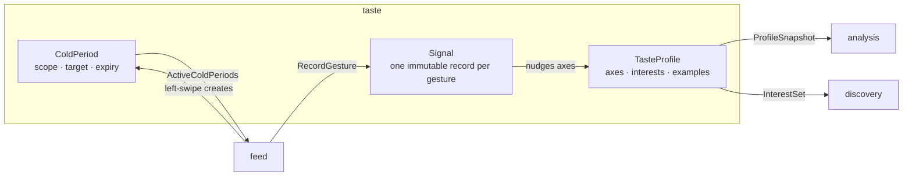

# DDD tactical — `taste`

## Metadata

| Field | Value |
|-------|-------|
| **Context** | `taste` |
| **Document** | Tactical model: aggregates, invariants, value objects, events and repositories |
| **Backlog** | `ARCH-301` |
| **Version** | 0.1 (draft) |
| **Date** | 2026-11-03 |
| **Owner** | Oleg K |
| **Status** | Confirmed at gate `G5` (2026-11-04) |
| **Sources** | [`prd-ytfeed.md`](../../../../10-product/prd-ytfeed.md), [`context-map.md`](../../strategic/context-map.md), [`glossary.md`](../../strategic/glossary.md), [`02-architecture.md`](../../../../00-rules/02-architecture.md), [`04-data-persistence.md`](../../../../00-rules/04-data-persistence.md), [`08-cli-and-ux.md`](../../../../00-rules/08-cli-and-ux.md), [`02-identity-taste.md`](../../../c4/03-components/02-identity-taste.md) |
| **Siblings** | [`aggregates.md`](aggregates.md), [`value-objects.md`](value-objects.md), [`events.md`](events.md), [`repository.md`](repository.md), [`use-cases.md`](use-cases.md) |
| **Next** | `ARCH-302` (`feed`) |

## 1. Scope

`taste` owns the durable preference. That means the profile axes, the interests, the
examples, the signals and the cold periods. It does not own the rubric artifact, the
analyses, the cards or the feed cursor. Those belong to `analysis`, `feed` or the product
documentation (`A-19`, `G4-8`).

This is a full-depth tactical model because `taste` is a core subdomain (`SD-3`). The
model derives from `F4`, `F5`, `F16` and `F19`, and from `A-20`, `D-20`, `D-21` and `D-22`.
It does not introduce a new bounded context or a new external dependency.

## 2. Model at a glance

The arrow labels are contracts, not call direction. `feed` is the customer in every
runtime call. `taste` supplies the contracts (`A-7`, `A-14`).

## 3. Aggregate boundaries

| Aggregate | Root identity | Consistency boundary | Why this boundary |
|-----------|---------------|----------------------|-------------------|
| **TasteProfile** | `UserID` | Axes, weights, examples, note and interests change together | `F4` and `A-20` define one structured profile. A partial profile is not a valid profile. |
| **Signal** | `SignalID` | One immutable gesture record | `D-20` makes the signal the durable asset. Signals are append-only and never edited. |
| **ColdPeriod** | `ColdPeriodID` | One suppression record per target | `D-21` makes the cold period a record with its own expiry. It is queried by `feed` and retained after expiry. |

A gesture changes all three. `taste` treats the signal, the profile weight update and the
cold period as one **transactional consistency cluster**. The transaction is owned by the
`RecordGesture` use case, not shared with `feed` (`D-16`, `D-17`). This is a deliberate
choice. Splitting the three would either lose a signal or advance the UI before the
preference is durable (`D-20`).

The classic "one aggregate per transaction" rule is relaxed here on purpose. The
alternative, eventual consistency between the signal and the profile, cannot satisfy
`F5` and `D-20` in a local single-writer system. See
[`aggregates.md`](aggregates.md) §4 for the transaction sequence.

## 4. Tactical decisions

| # | Decision | Rationale | Alternative rejected |
|---|----------|-----------|----------------------|
| `D-301` | Three aggregates: `TasteProfile`, `Signal`, `ColdPeriod` | Each has a distinct identity and lifecycle. The profile is mutable, the signal is immutable, the cold period expires. | One large `Taste` aggregate. It would load every signal to change one weight. |
| `D-302` | Signals are append-only. Weights are derived state on the profile | `D-20` calls signals the product's only asset. A raw fact must not be rewritten. | Mutating a signal when a weight changes. It would destroy the audit trail. |
| `D-303` | One cold-period row per `(user_id, scope, target)`. A repeat mute updates `expires_at` | `CLI-18` requires refresh, not a duplicate. Expired rows stay for audit (`D-21`). | A new row per mute. It would make "active" ambiguous and break the refresh contract. |
| `D-304` | Only `left`, `right` and `save` produce signals | `F17` treats `up` and `down` as navigation. A signal is a preference fact (`F5`). | Recording every key as a signal. It would train the profile on navigation. |
| `D-305` | Nudge only axes that exist in the profile. Ignore unknown axes and log a warning | A rubric version bump can change the axis set. A gesture must not fail because the profile is older than the rubric. | Reject the gesture. It would break the UI on a content change. |
| `D-306` | Provisional weight rule: ±0.05 on scored axes, clamped to `[0,1]`, no decay in v1 | `OQ-18` has no owner decision yet. This default is bounded and testable. | An unbounded or multiplicative update. It could flip an axis on one gesture. |
| `D-307` | Interests are 1–10 normalized slugs, default 5, stored with the profile | `F3`, `OQ-08` and the `G4-7` decision. Interests and topics share one slug namespace. | A free-text interest list. It could not be matched to analysis topics. |
| `D-308` | `rubric_version` is a read reference on the profile, not a rubric copy | `G4-8` gives the rubric artifact to `analysis` and the product docs. `taste` owns only axis weights. | Storing the rubric in `taste`. It would duplicate a content artifact. |
| `D-309` | `gesture_id` is unique in `signals`. A retry returns the first outcome | `CLI-18` makes the gesture idempotent. A retry must not nudge the profile twice. | A best-effort duplicate check in memory. It fails after a crash. |

## 5. Cross-context contracts

| Contract | Direction | Shape | Reference |
|----------|-----------|-------|-----------|
| `ProfileSnapshot` | `taste` → `analysis` | Axes, weights, positive and negative examples, note, `rubric_version` | [`context-map.md`](../../strategic/context-map.md) §6.1 |
| `InterestSet` | `taste` → `discovery` | 1–10 interests, default 5 | [`context-map.md`](../../strategic/context-map.md) §6.1 |
| `RecordGesture` | `feed` → `taste` | `gesture_id`, card and video references, gesture, reason, scored axes, `rubric_version` | [`context-map.md`](../../strategic/context-map.md) §6.1 |
| `ActiveColdPeriods` | `taste` → `feed` | Active scope and target pairs at a given instant | [`context-map.md`](../../strategic/context-map.md) §6.1 |

`feed` translates the analysis schema into the scored-axis value object. `taste` never
imports the analysis schema (`context-map.md` §6.2). The commit order is also a contract.
`taste` commits, then `feed` advances (`context-map.md` §6.3).

## 6. What is deliberately not here

- The rubric artifact and its JSON schema (`A-19`, `G4-8`).
- The analysis result schema and the per-axis justification (`analysis`, `A-20`).
- Cards, positions and the cursor (`feed`, `A-7`).
- An event bus, a queue or event sourcing. All domain events are in-process facts.
  `ARCH-307` assesses evented patterns and is expected to reject them.
- Cross-context foreign keys. References are values, not joins (`context-map.md` §7).

## 7. Open questions

| ID | Effect on this model |
|----|----------------------|
| `OQ-08` | Interest count is provisional: default 5, range 1–10. The aggregate enforces the range. |
| `OQ-18` | The weight-update rule is provisional. `D-306` records the default. |
| `OQ-19` | Resolved at `G4`. Axis, interest, topic and topic tag are four concepts. |
| `OQ-20` | Resolved at `G4`. `taste` owns axis weights, not the rubric artifact. |

## 8. Reading order

1. [`aggregates.md`](aggregates.md) — state, invariants and lifecycle.
2. [`value-objects.md`](value-objects.md) — validation and equality.
3. [`events.md`](events.md) — domain events and their payloads.
4. [`repository.md`](repository.md) — persistence contracts and transaction boundaries.
5. [`use-cases.md`](use-cases.md) — commands, queries and failure paths.

## 9. Acceptance check

| Backlog acceptance criterion | Where it is met |
|------------------------------|-----------------|
| Every aggregate has at least one stated invariant | [`aggregates.md`](aggregates.md) §1.3, §2.2, §3.3 |
| Value objects have validation rules | [`value-objects.md`](value-objects.md) §1–§5 |
| Domain events are past-tense facts with payloads | [`events.md`](events.md) §1–§2 |
| Repository contracts state transaction boundaries | [`repository.md`](repository.md) §2–§3 |
| No evented pattern is adopted without justification | `README.md` §6 and [`events.md`](events.md) §4 |

Then proceed to `ARCH-302` (`feed`). The tactical model is confirmed at gate `G5`, after
`ARCH-307`.
