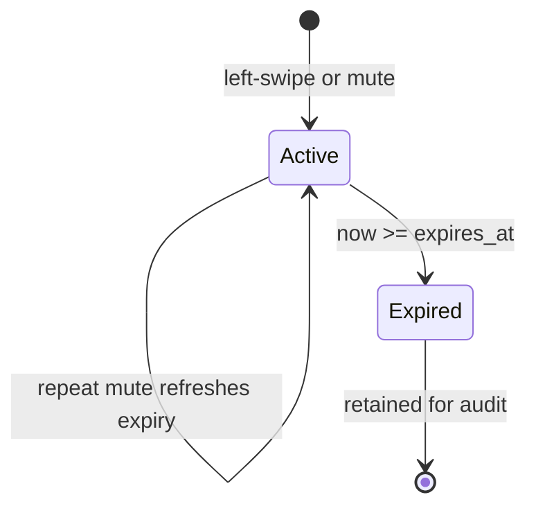
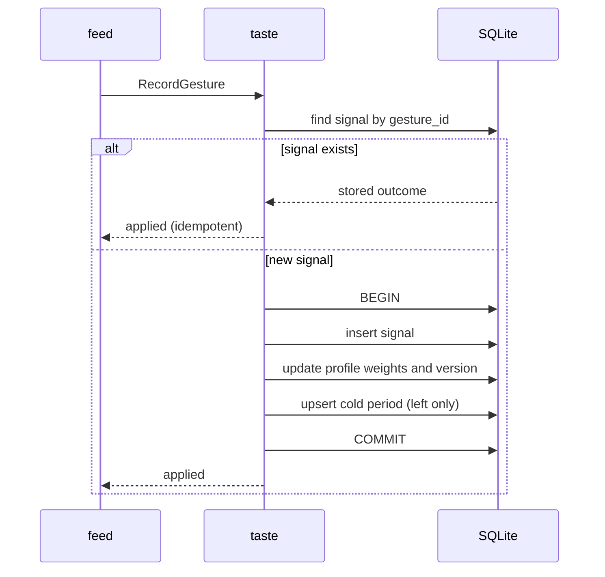

# `taste` — aggregates and invariants

## Metadata

| Field | Value |
|-------|-------|
| **Context** | `taste` |
| **Backlog** | `ARCH-301` |
| **Status** | Confirmed at gate `G5` (2026-11-04) |
| **Parent** | [`README.md`](README.md) |
| **Sources** | `F4`, `F5`, `F16`, `F19`, `A-20`, `D-16`, `D-17`, `D-20`, `D-21`, `D-22`, `CLI-18`, `CLI-20a` |

## 1. `TasteProfile` aggregate

### 1.1 State

| Field | Type | Rule |
|-------|------|------|
| `user_id` | `UserID` | One profile per user. Natural key. |
| `axes` | list of `Axis` | At least 3. Axis names are unique within the profile. |
| `interests` | list of `InterestSlug` | 1–10 entries. Default 5. Unique within the profile. |
| `note` | text | Optional free text. It never replaces axes. |
| `rubric_version` | text | The rubric version that last shaped the profile. A reference, not a copy. |
| `version` | integer | Optimistic concurrency token. Starts at 1 and increases on each change. |
| `created_at` | timestamp | UTC. Set once. |
| `updated_at` | timestamp | UTC. Updated on each change. |

### 1.2 `Axis`

| Field | Type | Rule |
|-------|------|------|
| `name` | `AxisName` | Unique within the profile. Normalized slug. |
| `weight` | `AxisWeight` | `[0,1]`. Default 0.5. |
| `positive_examples` | list of `Example` | At least 1. |
| `negative_examples` | list of `Example` | At least 1. |

### 1.3 Invariants

| ID | Invariant | Source |
|----|-----------|--------|
| `I-P1` | A user has exactly one `TasteProfile`. | `D-22` |
| `I-P2` | A profile has at least 3 axes. | `F4` |
| `I-P3` | Axis names are unique inside the profile. | `F4`, `A-20` |
| `I-P4` | An axis weight is inside `[0,1]`. | `F4`, `A-20` |
| `I-P5` | Every axis has at least 1 positive and 1 negative example. | `F4` |
| `I-P6` | A profile has 1–10 interests. | `F3`, `OQ-08` |
| `I-P7` | Interest slugs are unique inside the profile. | `F3`, `G4-7` |
| `I-P8` | `version` increases on every accepted change. A stale write is rejected. | `D-16` |
| `I-P9` | `rubric_version` is a reference. The rubric content is not stored here. | `A-19`, `G4-8` |

### 1.4 Lifecycle

- **Create.** `DefineProfile` supplies axes, examples and the initial interests. The
  profile is valid only when `I-P2`…`I-P7` hold.
- **Change interests.** `SetInterests` replaces the set. The 1–10 range and the slug rules
  apply. Onboarding calls this use case.
- **Adjust weights.** `RecordGesture` nudges the axes that the card scored. The profile
  version increases once per gesture, not once per axis.
- **Read.** `ProfileSnapshot` is a read-only projection for `analysis`. It carries the
  current axes, weights, examples, note and `rubric_version`.

## 2. `Signal` aggregate

### 2.1 State

| Field | Type | Rule |
|-------|------|------|
| `signal_id` | `SignalID` | Aggregate identity. |
| `gesture_id` | `GestureID` | Idempotency key. Unique across all signals. |
| `user_id` | `UserID` | Must match the profile owner. |
| `session_id` | `SessionID` | The session that produced the gesture. |
| `card_id` | `CardID` | The card that was shown. |
| `video_id` | `VideoID` | The video behind the card. |
| `channel_id` | `ChannelID` | The channel behind the video. |
| `topic` | `TopicSlug` | The content label that `analysis` produced. |
| `gesture` | `SignalGesture` | `left`, `right` or `save`. |
| `reason` | `RejectionReason` | Required for `left`. Absent for `right` and `save`. |
| `scored_axes` | list of `AxisScore` | The axes and scores from the card's analysis. |
| `rubric_version` | text | The rubric version of the analysis that scored the card. |
| `occurred_at` | timestamp | UTC. Set once. |

### 2.2 Invariants

| ID | Invariant | Source |
|----|-----------|--------|
| `I-S1` | One signal per `gesture_id`. A retry returns the stored outcome. | `CLI-18` |
| `I-S2` | A signal is immutable after commit. | `D-20` |
| `I-S3` | A left-swipe carries one rejection reason. | `F16`, `CLI-20a` |
| `I-S4` | A right-swipe or save carries no rejection reason. | `F17` |
| `I-S5` | Each scored axis appears once and its score is inside `[0,1]`. | `F10`, `A-20` |
| `I-S6` | `user_id` matches the profile owner. | `D-22` |
| `I-S7` | `occurred_at` is UTC. | `D-13` |

### 2.3 Signal gestures

| Gesture | Meaning | Reason | Profile effect |
|---------|---------|--------|----------------|
| `left` | Reject the card | Required: `marketing`, `ai-slop`, `value-misaligned` or `other` | Negative nudge on scored axes. A cold period starts or refreshes. |
| `right` | Accept the card | None | Positive nudge on scored axes. |
| `save` | Keep the card | None | Positive nudge on scored axes. |

`up` and `down` are navigation. They do not create a signal (`F17`, `D-304`).

### 2.4 Unknown axes

The command can carry a scored axis that the current profile does not have. That happens
after a rubric version bump. `taste` ignores the unknown axis for the weight update and
records the signal as it arrived. The gesture never fails for this reason (`D-305`).

## 3. `ColdPeriod` aggregate

### 3.1 State

| Field | Type | Rule |
|-------|------|------|
| `cold_period_id` | `ColdPeriodID` | Aggregate identity. |
| `user_id` | `UserID` | Owner. |
| `scope` | `ColdPeriodScope` | `topic` or `channel`. Derived from the reason. |
| `target` | `ColdPeriodTarget` | `TopicSlug` for a topic, `ChannelID` for a channel. |
| `reason` | `RejectionReason` | The reason that created the period. |
| `created_at` | timestamp | UTC. Set once. |
| `expires_at` | timestamp | UTC. Must be later than `created_at`. |
| `last_refreshed_at` | timestamp | UTC. Updated when a repeat mute refreshes the period. |

### 3.2 Scope derivation

| Reason | Scope | Target |
|--------|-------|--------|
| `value-misaligned` | channel | `channel_id` |
| `marketing` | channel | `channel_id` |
| `ai-slop` | topic | `topic` slug |
| `other` | topic | `topic` slug |

The mapping is fixed by `CLI-20a` and `R-17`. The owner does not choose the scope in v1.

### 3.3 Invariants

| ID | Invariant | Source |
|----|-----------|--------|
| `I-C1` | One row per `(user_id, scope, target)`. A repeat mute refreshes this row. | `CLI-18`, `D-303` |
| `I-C2` | `target` matches the scope: a slug for `topic`, a channel ID for `channel`. | `CLI-20a` |
| `I-C3` | `expires_at` is later than `created_at`. | `F19`, `D-21` |
| `I-C4` | A refresh moves `expires_at` forward and updates `last_refreshed_at`. The original `created_at` stays. | `CLI-18` |
| `I-C5` | An expired row is retained for audit and never filters. | `D-21`, `F19` |
| `I-C6` | `reason` and `scope` follow the table in §3.2. | `CLI-20a`, `R-17` |

### 3.4 Lifecycle

`ActiveColdPeriods` returns rows whose `expires_at` is later than the query instant.
`Expired` is a filtering state, not a deletion. The row stays in the table.

## 4. The gesture transaction

A gesture changes three aggregates. The `RecordGesture` use case runs one transaction:

1. Read `signals` by `gesture_id`. If a row exists, return its stored outcome.
2. Load the profile. Reject the command if the user does not match.
3. Validate the gesture, the reason and the scored axes.
4. Append the signal.
5. Nudge the matching axes. Increment the profile version.
6. For a left-swipe, upsert the cold period.
7. Commit.
8. Emit the domain events after the commit.

### 4.1 Crash behaviour

| Crash point | Persisted state | Retry behaviour |
|-------------|-----------------|-----------------|
| Before `BEGIN` | Nothing | The gesture is new. |
| Inside the transaction | Nothing | SQLite rolls back. The gesture is new. |
| After `COMMIT`, before the reply | Signal, profile and cold period | The retry finds `gesture_id` and returns the stored outcome. |
| After the reply | Same | No further write. |

The transaction is local to `taste`. `feed` does not share it. `feed` advances only after
`taste` returns `applied` (`context-map.md` §6.3, `D-20`).

### 4.2 Events are notifications

The events in [`events.md`](events.md) are in-process notifications. The database is the
source of truth. A crash after the commit can lose the notification, but it cannot lose
the signal, the profile update or the cold period. No consumer may depend on an event for
durable state. `ARCH-307` records the evented-pattern decision.

## 5. Invariant ownership

| Invariant group | Owner | Enforcement |
|-----------------|-------|-------------|
| Profile shape, axes, examples, interests | `TasteProfile` | Constructor and `Save` validation. |
| Signal identity and immutability | `Signal` | Insert-only repository and unique `gesture_id`. |
| Cold-period scope and expiry | `ColdPeriod` | Constructor, scope derivation and upsert. |
| Gesture atomicity | `RecordGesture` use case | One repository transaction. |
| UI advance | `feed` | Advance only after `applied` (`D-20`). |
