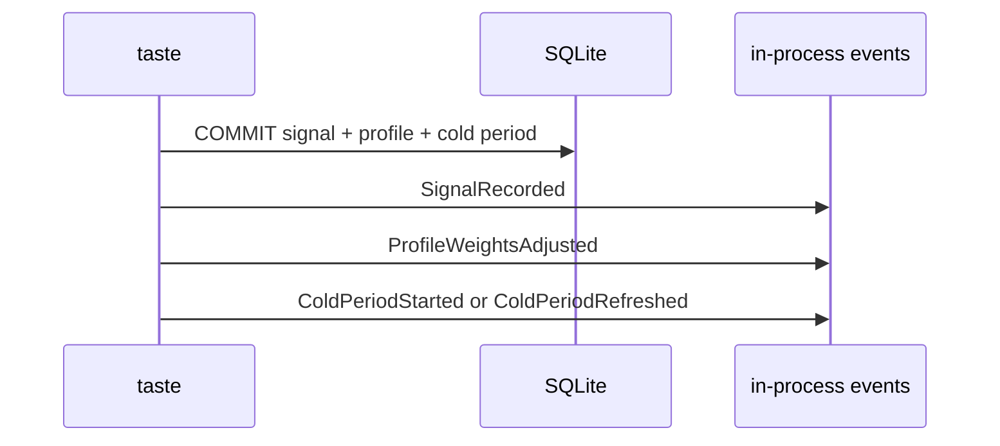

# `taste` — domain events

## Metadata

| Field | Value |
|-------|-------|
| **Context** | `taste` |
| **Backlog** | `ARCH-301` |
| **Status** | Confirmed at gate `G5` (2026-11-04) |
| **Parent** | [`README.md`](README.md) |
| **Sources** | `F4`, `F5`, `F16`, `F19`, `D-20`, `D-21`, `CLI-18`, `CLI-20a` |

A domain event is a past-tense fact about `taste`. It is immutable. It is emitted after
the transaction commits. The database remains the source of truth.

These are **not** integration events. They do not cross the context boundary. The
cross-context contracts are in [`context-map.md`](../../strategic/context-map.md) §6.1.
No queue, broker or event store is introduced. `ARCH-307` records the evented-pattern
decision.

## 1. Event catalogue

| Event | Trigger | Payload | Emitted when |
|-------|---------|---------|--------------|
| `TasteProfileDefined` | `DefineProfile` | `user_id`, `axes`, `interests`, `rubric_version`, `occurred_at` | A profile is created with a valid shape. |
| `InterestsChanged` | `SetInterests` | `user_id`, `interests`, `occurred_at` | The interest set is replaced. |
| `SignalRecorded` | `RecordGesture` | `signal_id`, `gesture_id`, `user_id`, `session_id`, `card_id`, `video_id`, `channel_id`, `topic`, `gesture`, `reason`, `scored_axes`, `rubric_version`, `occurred_at` | A new signal commits. |
| `ProfileWeightsAdjusted` | `RecordGesture` | `user_id`, `adjustments`, `profile_version`, `rubric_version`, `occurred_at` | Matching axes receive a nudge. |
| `ColdPeriodStarted` | `RecordGesture` or `MuteTarget` | `cold_period_id`, `user_id`, `scope`, `target`, `reason`, `expires_at`, `occurred_at` | No active cold period existed for the target. |
| `ColdPeriodRefreshed` | `RecordGesture` or `MuteTarget` | `cold_period_id`, `user_id`, `scope`, `target`, `previous_expires_at`, `expires_at`, `occurred_at` | An active cold period receives a later expiry. |

## 2. Payload rules

| Rule | Detail |
|------|--------|
| Past tense | Every event name describes a fact that already happened. |
| Immutable | A payload is never edited. A correction is a new event or a new signal. |
| Identifiers | Every payload carries the identifiers needed to trace the fact. |
| No content | A payload never carries transcript text, prompt text or a token. |
| UTC | Every timestamp is UTC (`D-13`). |
| No secrets | The payload follows `C-2`, `L-10` and `E-17`. |

### 2.1 `SignalRecorded`

| Field | Type | Note |
|-------|------|------|
| `signal_id` | `SignalID` | New signal identity. |
| `gesture_id` | `GestureID` | Idempotency key. |
| `user_id` | `UserID` | Owner. |
| `session_id` | `SessionID` | Session that produced the gesture. |
| `card_id` | `CardID` | Card shown to the owner. |
| `video_id` | `VideoID` | Video behind the card. |
| `channel_id` | `ChannelID` | Channel behind the video. |
| `topic` | `TopicSlug` | Content label from analysis. |
| `gesture` | `SignalGesture` | `left`, `right` or `save`. |
| `reason` | `RejectionReason` | Present only for `left`. |
| `scored_axes` | `ScoredAxes` | Scores used for the nudge. |
| `rubric_version` | text | Rubric version of the analysis. |
| `occurred_at` | timestamp | Commit time, UTC. |

### 2.2 `ProfileWeightsAdjusted`

| Field | Type | Note |
|-------|------|------|
| `user_id` | `UserID` | Owner. |
| `adjustments` | list | Each item has `axis`, `before`, `after` and `delta`. |
| `profile_version` | `ProfileVersion` | Version after the update. |
| `rubric_version` | text | Version that scored the card. |
| `occurred_at` | timestamp | Commit time, UTC. |

`adjustments` contains only axes that exist in the profile. An unknown axis is absent
(`D-305`).

### 2.3 `ColdPeriodStarted` and `ColdPeriodRefreshed`

`ColdPeriodStarted` carries the new row. `ColdPeriodRefreshed` carries the previous and
new expiry. Both carry the scope and target so a reader does not need a join. The reason
is the one that created the period. A refresh does not change it (`I-C4`).

## 3. Ordering

For one left-swipe, the application emits the events in this order after the commit:

For a right-swipe or save, the order is `SignalRecorded` then `ProfileWeightsAdjusted`.
For a profile change outside a gesture, the order is `TasteProfileDefined` or
`InterestsChanged`. The order inside one command is stable. Events from different
commands are not globally ordered.

## 4. Delivery and failure

| Property | Decision |
|----------|----------|
| Transport | In-process function calls. No bus and no queue. |
| Durability | Not durable. The database is the truth. |
| Emission point | After the transaction commits. |
| Lost event | Possible after a crash. No durable state is lost. |
| Duplicate event | Possible on retry. Consumers must be idempotent by event identity. |
| Consumers in v1 | Logging and diagnostics only. `stats` reads the database, not the events. |
| Cross-context use | None. Use the contracts in `context-map.md` §6.1. |

A consumer must not depend on an event to create durable state. If a future feature needs
that, it must read the database or introduce a documented outbox. That is an ADR and is
outside `ARCH-301`.

## 5. Naming

| Rule | Example |
|------|---------|
| Past tense | `SignalRecorded`, not `RecordSignal` |
| Domain language | `ColdPeriodStarted`, not `ColdPeriodCreated` |
| One fact per event | `ProfileWeightsAdjusted` does not also report a cold period |
| No transport verbs | `SignalRecorded`, not `SignalPosted` |
| Stable names | Rename only with a new event and a migration note |
