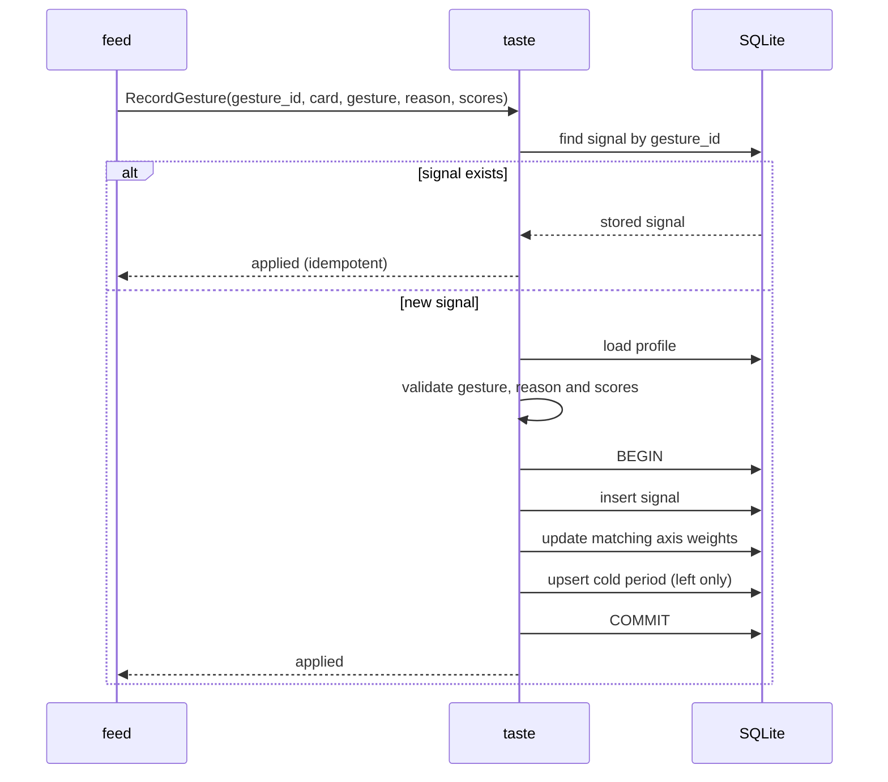

# `taste` — use cases

## Metadata

| Field | Value |
|-------|-------|
| **Context** | `taste` |
| **Backlog** | `ARCH-301` |
| **Status** | Confirmed at gate `G5` (2026-11-04) |
| **Parent** | [`README.md`](README.md) |
| **Sources** | `F3`, `F4`, `F5`, `F16`, `F19`, `CLI-18`, `CLI-20a`, `CLI-25`…`CLI-27`, `D-20` |

A use case is an application service inside `taste`. It coordinates the aggregates and
the repositories. It contains no transport code and no SQL (`A-3`, `H-7`).

## 1. Catalogue

| Use case | Kind | Actor | Input | Result |
|----------|------|-------|-------|--------|
| `DefineProfile` | Command | Onboarding or profile reset | axes, examples, note, `rubric_version` | New profile at version 1. |
| `SetInterests` | Command | Onboarding or edit | 1–10 interest slugs | Replaced interest set. |
| `RecordGesture` | Command | `feed` | gesture command from the card | Signal, weight update and optional cold period. |
| `MuteTarget` | Command | CLI `mute` | scope, target, duration, reason | New or refreshed cold period. |
| `GetProfileSnapshot` | Query | `analysis` | `user_id` | Axes, weights, examples, note, `rubric_version`. |
| `GetInterestSet` | Query | `discovery` | `user_id` | 1–10 slugs in stable order. |
| `GetActiveColdPeriods` | Query | `feed` | `user_id`, instant | Active scope and target pairs. |

## 2. `DefineProfile`

**Preconditions:** no profile exists for the user. The axis set has at least 3 axes. Each
axis has a weight and at least 1 positive and 1 negative example.

**Content source:** the axis names, weights and examples are product content. They come
from the rubric definition work (`Q3`, `OQ-07`). `taste` validates the shape. It does not
invent the axes.

**Postconditions:** the profile exists at version 1. `rubric_version` is recorded as a
reference. `TasteProfileDefined` is emitted.

**Failure:** fewer than 3 axes, duplicate axis names, a missing example, a weight outside
`[0,1]`, or an existing profile. The command fails and writes nothing.

## 3. `SetInterests`

**Preconditions:** a profile exists. The set has 1–10 unique normalized slugs.

**Postconditions:** the profile holds the new set. The profile version increases.
`InterestsChanged` is emitted. `discovery` sees the new set on its next query.

**Failure:** zero interests, more than 10, a duplicate slug, or an invalid slug. The
command fails and the old set stays.

`CLI-27` allows onboarding to skip step 2. In that case the use case is not called. The
feed composes from subscriptions and shows the banner. `taste` does not invent a default
set.

## 4. `RecordGesture`

This is the critical use case. It changes three aggregates in one transaction.

**Preconditions:** the profile exists. The gesture is `left`, `right` or `save`. A left
has a reason. A right or save has no reason. The scores are in `[0,1]`.

**Postconditions:** one signal exists. Matching axes have a bounded nudge. A left-swipe
has an active cold period. The profile version increased once. The events in
[`events.md`](events.md) are emitted after the commit.

**Idempotency:** a retry with the same `gesture_id` returns `applied` and changes nothing
(`CLI-18`).

**Failure:** missing profile, invalid gesture, missing reason, invalid score, or a write
failure. The transaction rolls back. `feed` does not advance (`D-20`).

## 5. `MuteTarget`

**Preconditions:** the target matches the scope. A topic target is a normalized slug. A
channel target is a `ChannelID`. The duration is positive.

**Postconditions:** one cold-period row exists for `(user, scope, target)`. A new row emits
`ColdPeriodStarted`. An existing row gets a later expiry and emits `ColdPeriodRefreshed`.
No signal is created and no weight changes. A direct mute is not a card gesture.

**Scope rule:** the reason determines the scope (`CLI-20a`). The command does not accept a
scope that contradicts the reason.

**Failure:** invalid target, invalid duration, or a reason that does not map to the scope.
The command fails and writes nothing.

## 6. Queries

### 6.1 `GetProfileSnapshot`

Reads the profile, axes and examples in one transaction. It returns the note and
`rubric_version`. It does not return interests, signals or cold periods. `analysis` uses
the snapshot to build the prompt (`F4`, `A-20`).

### 6.2 `GetInterestSet`

Reads the interest rows in position order. It returns 1–10 slugs. `discovery` uses the set
to plan queries (`F3`, `F6`).

### 6.3 `GetActiveColdPeriods`

Reads the rows whose `expires_at` is later than the supplied instant. It returns scope and
target only. Expired rows stay in the table for audit (`D-21`).

## 7. Mapping to commands and contexts

| Entry point | Use case | Context boundary |
|-------------|----------|------------------|
| `ytfeed onboard` step 2 | `SetInterests` | `identity` orchestrates, `taste` stores |
| `ytfeed mute <target> --for 24h` | `MuteTarget` | CLI → API → `taste` |
| `ytfeed feed` left/right/save | `RecordGesture` | `feed` calls `taste` |
| `analysis` prompt build | `GetProfileSnapshot` | `taste` supplies the contract |
| `discovery` query planning | `GetInterestSet` | `taste` supplies the contract |
| `feed` composition | `GetActiveColdPeriods` | `taste` supplies the contract |

`feed` translates the analysis `axis_scores` into `ScoredAxes`. `taste` never imports the
analysis schema (`context-map.md` §6.2).

## 8. Failure paths

| Failure | User-visible result | State |
|---------|---------------------|-------|
| No profile | "Run `ytfeed onboard` first." Exit `2` | Nothing written. |
| Invalid interest count | Validation message. Exit `2` | Old set stays. |
| Invalid gesture or reason | Command error. Exit `2` | No signal, no cold period. |
| Duplicate `gesture_id` | Success, idempotent. Exit `0` | Original outcome returned. |
| Stale profile version | Retry once. If it fails again, conflict. Exit `4` | No partial write. |
| Cold-period write fails | Gesture fails. Exit `1` | Card does not advance. |
| Database write fails | Generic error with correlation ID. Exit `1` | Transaction rolls back. |
