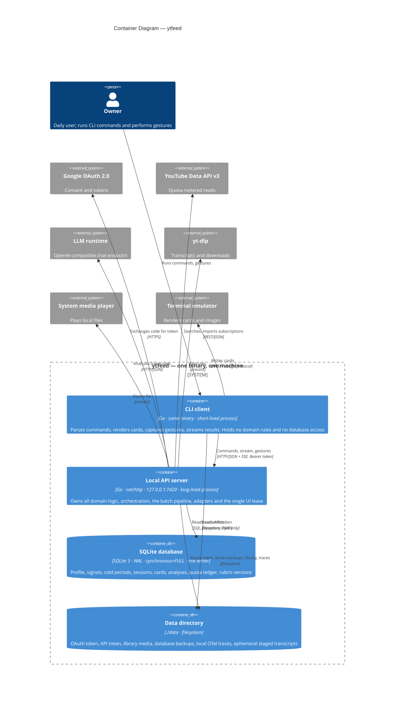

# C4 Level 2 — Containers

## Metadata

| Field | Value |
|-------|-------|
| **System** | `ytfeed` — Personal YouTube Feed Composer |
| **Document** | C4 Level 2 (Containers) |
| **Version** | 0.1 (draft) |
| **Date** | 2026-11-02 |
| **Owner** | Oleg K |
| **Status** | Awaiting confirmation at gate `G2` |
| **Sources** | [`01-system-context.md`](01-system-context.md), [`02-architecture.md`](../00-rules/02-architecture.md), [`04-data-persistence.md`](../00-rules/04-data-persistence.md), [`08-cli-and-ux.md`](../00-rules/08-cli-and-ux.md) |
| **Next** | `03-components/` (`ARCH-103`…`ARCH-106`) |

## How "container" is interpreted here

The C4 definition assumes a container is a separately deployable runtime. `ytfeed` ships
as **one binary**, so a literal reading produces a single box and the level becomes
useless. This document uses the runtime/trust reading agreed in the backlog (finding
`F3`):

> **Container = a separately running process, or a persistent store with its own
> lifecycle and access rules.**

That yields four containers, and it exposes a fact that the phrase "single binary, single
process" hides: **one binary runs as two process roles.** A short-lived CLI client and a
long-lived API server, both produced from `cmd/ytfeed`, communicating over loopback HTTP.
This is not a contradiction of `A-10`; it is what `A-10` and `R-9` describe once the
process boundary is drawn. The lifecycle rules are recorded as `OQ-16`.

## Level 2 diagram



## Container summary

| Container | Technology | Role | Interfaces | Persistent state | Rules |
|-----------|------------|------|------------|------------------|-------|
| **CLI client** | Go, `internal/transport/cli` + `cmd/ytfeed`, short-lived | Parse the command, call the API, render cards, capture gestures, translate errors to exit codes | Outbound HTTP to `127.0.0.1:7420`; stdout/stderr; terminal protocols | None | `A-2`, `A-10`, `CLI-1`…`CLI-4`, `E-10` |
| **Local API server** | Go, `internal/transport/http` + domain + adapters, long-lived | All product decisions: composition, dedupe, quota, analysis, gestures, sessions, library | Inbound HTTP; outbound HTTPS; local process execution; SQL | None of its own (state is in SQLite and the data directory) | `A-3`, `A-10`…`A-13`, `A-14` |
| **SQLite database** | SQLite 3, WAL, `foreign_keys=ON`, `busy_timeout=5000`, `synchronous=FULL`, `SetMaxOpenConns(1)` for writes | Durable domain state, resume checkpoints, quota ledger, audit trail | SQL from `internal/repository/sqlite` only | All domain state | `D-1`…`D-22` |
| **Data directory** | Filesystem under `$YTFEED_DATA_DIR` → `./data` | Credentials and binary artifacts that are not rows: tokens, media files, backups, traces | Filesystem, `0600` for tokens | OAuth token, API token, `library/`, `*.db.bak-*`, trace JSONL | `C-15`, `C-17`, `F20`, `R-24` |

### Why the CLI is a container and not a component

It is a separate process with its own lifetime, its own failure mode (a crashed terminal
must not corrupt a batch), and a narrow interface (HTTP + stdout). Treating it as a
component inside the server would hide the single most important boundary rule in the
product: **the CLI has no database access and no business logic** (`A-2`, `A-15`, `H-7`).

### Why there is no worker container

The batch pipeline (`A-14`) runs **in-process** with a bounded number of goroutines
(`ANALYSIS_CONCURRENCY`, default 2). There is no queue, broker, scheduler or second
binary. Resumability comes from persisted stage checkpoints (`F25`), not from an external
job system. This is a deliberate constraint, not an omission: a local single-user tool
that requires Redis to start would fail its own onboarding story (`US-11`).

## Data ownership

Every piece of state has exactly one owning container. Anything not in this table does not
exist.

| State | Owner | Store | Notes |
|-------|-------|-------|-------|
| Subscriptions, channel metadata | API server | SQLite | Imported once, refreshed on demand (`F2`) |
| Taste profile, axes, weights, examples | API server | SQLite | Structured, not a prompt string (`A-20`) |
| Signals, gestures, cold periods | API server | SQLite | Committed before the card advances (`D-20`, `D-21`) |
| Sessions and the UI lease | API server | SQLite | One live lease (`A-11`, `OQ-13`) |
| Candidates, batch stages, checkpoints | API server | SQLite | Natural keys with `UNIQUE` for idempotency (`D-19`) |
| Analyses and rubric version | API server | SQLite | Failure states are rows, never silent nulls (`E-12`) |
| Quota ledger | API server | SQLite | Per accounting day (`F7`, `OQ-02`) |
| Weekly ratings | API server | SQLite | Week number + feed IDs (`F21`) |
| OAuth token | API server / CLI (read) | Data directory | `0600`, checked on read (`C-17`) |
| API bearer token | API server (create), CLI (read) | Data directory | Fingerprint only in `doctor` (`A-10b`) |
| Library media files | API server | Data directory | Metadata in SQLite, bytes on disk (`F20`) |
| DB backups | API server | Data directory | Last 5 kept (`D-11a`) |
| OTel traces | API server | Data directory | JSONL, no collector (`R-24`) |
| **Transcripts** | API server | Data directory (`tmp/transcripts/`) | Ephemeral. Written between fetch and analysis commit, deleted on commit, swept after the TTL. Never in the database, logs, traces, or backups (`OQ-05`, `ARCH-105a`) |

## Runtime topology

### Process model

```
ytfeed feed ──► CLI process ──HTTP──► API server process ──► SQLite + ./data
                    │                        │
                    └── renders terminal     └── adapters: YouTube, LLM, yt-dlp, player
```

Both processes are the same executable. The server is a subcommand (`ytfeed serve`), and
the CLI starts it when `GET /v1/health` does not answer (`A-10`, `OQ-16`).

### Start-up sequence for a daily run

1. The owner runs `ytfeed feed`.
2. The CLI resolves the data directory and prints it at debug level (`C-15`).
3. The CLI reads the API token; if absent, it is generated by the first server start with
   `0600` (`A-10b`).
4. The CLI probes `GET /v1/health`.
5. If no server answers, the CLI spawns `ytfeed serve`, waits for readiness with a bounded
   timeout, and proceeds only when healthy.
6. The server acquires the UI lease. A live lease is a conflict; a stale lease is
   reclaimable (`A-11`, `OQ-13`).
7. The CLI opens the feed stream and renders cards as events arrive (`F14`).
8. Each gesture is a request that must be acknowledged before the next card is shown
   (`D-20`).
9. After `SESSION_IDLE_TIMEOUT` with no interaction, the server closes the session
   (`F18`, `CLI-21`).

### Interface groups

Level 2 names the interface groups; `ARCH-103` fixes the endpoints and payloads.

| Group | Direction | Purpose | Shape |
|-------|-----------|---------|-------|
| Health | CLI → API | Readiness probe, version, schema version | Request/response |
| Onboarding | CLI → API | OAuth start/finish, subscription import, interests, seed source | Request/response |
| Feed | CLI → API | Request a batch, stream cards, request the next batch | Streamed response |
| Gestures | CLI → API | Left/right/up/down, save, remove, reason selection | Request/response, idempotent |
| Library | CLI → API | List, save, download, remove, open | Request/response |
| Diagnostics | CLI → API | `doctor`, `stats` | Request/response, read-only |
| Rating | CLI → API | Weekly −1/0/+1 | Request/response |

## Trust boundary at Level 2

| Control | Implementation | Limit |
|---------|----------------|-------|
| Network exposure | Bind `127.0.0.1:7420`; non-loopback requires `--allow-remote` plus a warning | `A-10a` |
| Caller authentication | Random bearer token, `0600`, generated on first run | Protects against other *users*, not against a process running as the same user (`A-10b`) |
| Concurrency | One UI lease at a time | Does not prevent two CLI processes from fighting; the second gets a conflict (`A-11`) |
| Secret hygiene | `redact()` on config and error dumps; `doctor` prints fingerprints | `C-14`, `E-17` |
| Transcript handling | Memory, plus a `0700` staging directory with `0600` files between fetch and analysis commit; deleted on commit, TTL-swept; no logs, traces, DB column, or backup copy | `OQ-05`, `ARCH-105a`, `L-10` |

The honest statement of the model: this is a **single-user local trust boundary**. It
raises the cost of accidental interference and cross-user access. It is not a defence
against malware already running under the owner's account, and the docs should say so
rather than imply otherwise.

## Failure isolation

Each container fails in a way the others can describe.

| Failure | Effect | Recovery | Source |
|---------|--------|----------|--------|
| CLI process dies | Session stays open until idle timeout; lease becomes stale | Next run reclaims the stale lease | `OQ-13` |
| API server dies mid-batch | In-flight analyses lost; persisted stages survive | Restart resumes from the last checkpoint; a crash after staging re-analyzes without a fetch (`ARCH-105a`) | `F25`, `OQ-05` |
| SQLite unreadable / corrupt | Server refuses to start with an explicit path and reason | `doctor`; restore a backup | `CLI-22`, `D-11a` |
| Database newer than binary | Hard refusal, no downgrade | Upgrade the binary | `D-11b`, `US-E4` |
| Data directory unwritable | Refuses to start; prints the resolved path | Fix permissions; never writes elsewhere | `C-15` |
| YouTube unreachable / quota exhausted | Cached feed and library remain available; banner and exit code | Wait for reset or next day | `F7`, `F24`, `OQ-01` |
| LLM slow or failing | Cards marked `[unanalyzed: analysis slow]`; batch continues | Retry on the next batch | `F11` |
| LLM returns invalid JSON | Card `failed: invalid_model_output`; never coerced | Visible state stays | `A-12b` |
| yt-dlp missing | `feed` degrades with exit `6`; library downloads unavailable | Install yt-dlp; `doctor` reports it | `SD-6`, `OQ-12` |
| Terminal lacks image support | Text-only cards, no reserved space | `--no-images` | `CLI-15`, `CLI-16` |

## Containers deliberately absent

Listed so a later reader does not add them by reflex:

- **No second binary.** No worker, no migrator, no separate client (`R-10`).
- **No message broker or queue.** The pipeline is in-process and DB-backed (`A-14`).
- **No cache server.** The SQLite feed and the library are the cache (`F24`).
- **No reverse proxy, no TLS termination.** Loopback only (`A-10a`).
- **No container/VM runtime.** The product is a binary plus a data directory (`F22`).
- **No hosted database in v1.** Postgres is a future repository adapter (`F37`, `D-6`).
- **No telemetry exporter.** Traces are local JSONL (`R-24`).

## Mapping to the package layout (`A-9`)

| Container | Packages |
|-----------|----------|
| CLI client | `cmd/ytfeed`, `internal/transport/cli` |
| Local API server | `internal/transport/http`, `internal/domain/{identity,taste,discovery,analysis,feed,library}`, `internal/integration/{youtube,ytdlp,llm}`, `internal/config`, `internal/pkg/logger` |
| SQLite database | `internal/repository/sqlite`, `migrations/` (embedded), `internal/storage` |
| Data directory | `internal/storage` (paths, backup, permissions), `internal/integration/ytdlp` (media files) |

`shared/` is deliberately unassigned at this level. `A-8` forbids using it as a grab-bag;
a package earns a place there only by being used by two or more contexts, and that is
decided in Level 3.

## Container-level invariants

1. **Only the API server touches SQLite.** The CLI never opens the database (`A-4`,
   `A-15`, `D-1`).
2. **Only the API server holds product rules.** Handlers parse and translate; commands
   dispatch and render (`A-2`, `A-3`, `H-7`).
3. **One writer.** All writes go through a single connection or a single goroutine, and
   `synchronous=FULL` is not relaxed without an ADR (`D-7`, `D-8`).
4. **Loopback plus token plus one lease** are three independent controls, not one
   (`A-10a`, `A-10b`, `A-11`).
5. **No container depends on another instance.** There is no shared state to depend on
   (`NFR: Scalability`).
6. **A transcript is never stored permanently.** It exists in the API server's memory and,
   between fetch and analysis commit, as a `0600` file in `./data/tmp/transcripts/`. It is
   deleted on commit and swept by TTL (`OQ-05`, `ARCH-105a`).
7. **The batch pipeline is a bounded in-process pipeline**, never an external job system
   (`A-14`, `NFR: Performance`).

## Open questions raised at this level

| ID | Relevance |
|----|-----------|
| `OQ-16` | Server lifecycle: ownership, auto-start, port collision, shutdown, orphans |
| `OQ-17` | `--json` cannot both stream and emit a single JSON value |
| `OQ-13` | Lease expiry and reclaim after a crash |
| `OQ-01`, `OQ-02` | Quota degradation visible through the API and the exit code |
| `OQ-11` | LLM egress through the API server's outbound adapter |
| `OQ-12` | yt-dlp absence during `onboard` and `feed` |

## Preliminary design decisions (confirm at Level 3)

These are design choices, not product conflicts, so they are not open questions. They are
listed here because Level 3 depends on them.

| ID | Decision | Rationale |
|----|----------|-----------|
| `DD-01` | Card streaming uses Server-Sent Events over the same authenticated HTTP connection | One-way server→client stream, trivially works with `net/http`, no extra dependency, matches `F14` |
| `DD-02` | Gestures are individual idempotent requests, not a batched log | `D-20` requires a commit before the card advances; batching would reintroduce the loss window |
| `DD-03` | The API is versioned under `/v1` | Cheap now, avoids a breaking change when the web UI arrives (`F35`) |
| `DD-04` | The CLI reads the API token from the data directory; it never mints one | One owner for token creation (`A-10b`), no race between two processes |
| `DD-05` | Transcripts are staged in `./data/tmp/transcripts/` for crash-safe resume, best-effort and TTL-bounded | Satisfies `F25` without an external job system; failure to stage degrades to memory-only, never to a failed card (`ARCH-105a`) |

## Level 3 consistency check (`ARCH-109`)

Checked after `ARCH-103`…`ARCH-106` were written. Scope: does the component decomposition
still match `A-9` (package layout), `A-7` (six contexts), `A-12` (ports) and `A-14`
(pipeline), and did any boundary leak?

### Package coverage

| `A-9` path | Covered by | Status |
|------------|------------|--------|
| `cmd/ytfeed` | [`01-transport.md`](03-components/01-transport.md) | Covered |
| `internal/transport/cli` | `01-transport.md` | Covered |
| `internal/transport/http` | `01-transport.md` | Covered |
| `internal/domain/identity` | [`02-identity-taste.md`](03-components/02-identity-taste.md) | Covered |
| `internal/domain/taste` | `02-identity-taste.md` | Covered |
| `internal/domain/discovery` | [`03-discovery-analysis.md`](03-components/03-discovery-analysis.md) | Covered |
| `internal/domain/analysis` | `03-discovery-analysis.md` + [`03a-transcript-staging.md`](03-components/03a-transcript-staging.md) | Covered |
| `internal/domain/feed` | [`04-feed-library.md`](03-components/04-feed-library.md) | Covered |
| `internal/domain/library` | `04-feed-library.md` | Covered |
| `internal/repository/sqlite` | Component tables in 02/03/04; `D-1`…`D-24` | Structural — no dedicated doc by design |
| `internal/integration/youtube` | `03-discovery-analysis.md` | Covered |
| `internal/integration/ytdlp` | `03-discovery-analysis.md`, `04-feed-library.md` | Covered |
| `internal/integration/llm` | `03-discovery-analysis.md` | Covered |
| `internal/config` | `01-transport.md`, `03a` §12 | Covered |
| `internal/storage` | Data ownership table (Level 2), `03a` §8 | Covered |
| `internal/pkg/logger` | Cross-cutting, `06-logging-and-observability.md` | Covered by rules |
| `shared/` | — | **Deferred** |
| `migrations/` | Not architecture; `D-9`…`D-12` | Out of scope |

### Findings

| # | Finding | Severity | Action |
|---|---------|----------|--------|
| 1 | Two additive adapters are not in the `A-9` comment: `internal/integration/transcripts` and `internal/integration/player` | Low | Consistent with `A-12`; propose a rules-text update, **not applied** (`H-9`) |
| 2 | `shared/` remains empty | Low | Deferred to tactical design. Recommendation: no shared domain types; IDs stay per-context. A future shared package needs a written justification (`A-8`) |
| 3 | `A-14` names six stages; the data-flow doc names fourteen steps | None | The extra steps are sub-steps of "candidates" and "feed composition", not new layers. A rules annotation would prevent a future reader from seeing a contradiction |
| 4 | Six contexts, none merged or added | None | Two documents cover two contexts each — a documentation grouping, not a context merge |
| 5 | No fourth layer | None | Onboarding orchestration lives in `identity`; batch orchestration in `feed`, which `A-7` defines as pure orchestration |
| 6 | Transport contains no SQL and no product rules | None | Verified against the component tables in `01-transport.md` (`A-2`, `A-15`) |
| 7 | Every outbound dependency has a port and a compile-time assertion | None | See the contract table below (`A-5`, `A-6`, `D-3`) |

### Port and adapter contracts

| Consumer | Port | Adapter | Assertion required |
|----------|------|---------|--------------------|
| `identity` | `TokenStore` | `internal/storage` (file) | `var _ identity.TokenStore = ...` |
| `discovery` | `Source` | `internal/integration/youtube` | `var _ discovery.Source = ...` |
| `analysis` | `TranscriptFetcher` | `internal/integration/ytdlp` | `var _ analysis.TranscriptFetcher = ...` |
| `analysis` | `TranscriptStore` | `internal/integration/transcripts` | `var _ analysis.TranscriptStore = ...` |
| `analysis` | `Analyzer` | `internal/integration/llm` | `var _ analysis.Analyzer = ...` |
| `library` | `Downloader` | `internal/integration/ytdlp` | `var _ library.Downloader = ...` |
| `library` | `Player` | `internal/integration/player` | `var _ library.Player = ...` |
| `feed`, `taste`, `library` | Repositories | `internal/repository/sqlite` | `var _ <ctx>.Repository = ...` |

### Verdict

**No blocking contradiction.** Two additive package entries and one deferred decision
(`shared/`) are recorded. The architecture is consistent with the frozen rules; the rules
text is slightly narrower than the design in one place, and that is reported rather than
silently forked.

## Next step

The C4 stage is complete: Level 1, Level 2, Level 3, data flow and control flow. Next is
DDD strategic design (`ARCH-201`…`ARCH-205`), which validates the six contexts as
subdomains and produces the boundary map and glossary.
