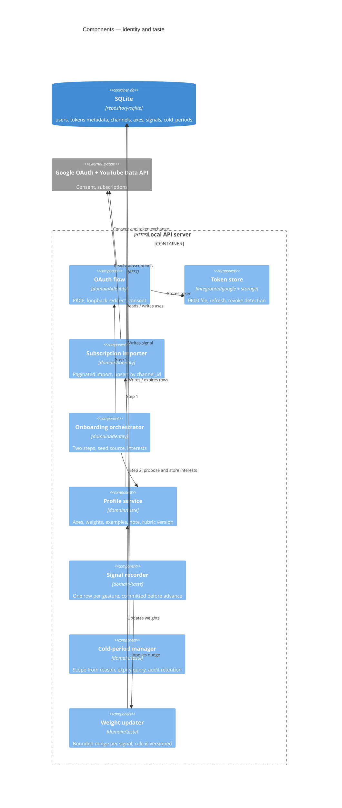

# Components — Identity and taste

## Metadata

| Field | Value |
|-------|-------|
| **Contexts** | `identity`, `taste` |
| **Version** | 0.1 (draft) |
| **Date** | 2026-11-02 |
| **Backlog** | `ARCH-104` |
| **Parent** | [`02-container-diagram.md`](../02-container-diagram.md) |
| **Status** | Awaiting gate `G3` |

## Scope

Two contexts that together answer "who is this person and what do they like".

`identity` owns credentials and the subscription graph. `taste` owns the profile, the
signals that change it, and the cold periods that suppress content. They are separate
because they fail differently: an expired token must not corrupt personalization, and a
corrupt profile must not force a re-login (`A-7`).

## Component view

## Identity components

| Component | Responsibility | Rules |
|-----------|----------------|-------|
| **OAuth flow** | Authorization-code + PKCE, loopback redirect on an ephemeral port, `state` check, 2-minute timeout, `youtube.readonly` only | `F1` |
| **Token store** | Atomic write to `./data/token` with `0600`; verify permissions on read; warn if world-readable | `C-17`, `F1` |
| **Refresh** | Single-flight refresh on 401; a revoked grant returns `ErrUnauthorized`, exit `2` | `F1` |
| **Subscription importer** | Paginate `subscriptions.list`, upsert by `channel_id`, store title, subscriber count, topic tags; print the count | `F2` |
| **Onboarding orchestrator** | Exactly two steps; step 2 may be skipped with a banner | `CLI-25`, `CLI-26`, `CLI-27` |

**Onboarding placement.** `A-1` allows three layers only, so there is no application
layer. The orchestrator lives in `domain/identity` and calls `taste` and `discovery`
through their published interfaces (`A-7`). It owns sequencing, not their rules.

**Import idempotency.** A crash mid-import restarts from page 1 and upserts. No page
token is persisted; the cost is a repeated read, never a duplicate row (`D-19`).

## Taste components

### Profile

| Field | Type | Constraint |
|-------|------|------------|
| Axis name | text | Unique per user; free text, e.g. `depth-over-hype` |
| Weight | real | `[0,1]`, default 0.5 |
| Positive examples | list | ≥ 1 per axis |
| Negative examples | list | ≥ 1 per axis |
| Note | text | Optional free-text |
| Rubric version | text | The rubric that produced the current shape |
| User ID | text | Present from day one (`D-22`) |

Creation fails if fewer than three axes are supplied (`F4`). The profile is a structured
record, never a prompt string (`A-20`).

### Signal

One row per gesture: `id`, `user_id`, `session_id`, `card_id`, `video_id`, `channel_id`,
`topic`, `gesture`, `reason`, `created_at`. Written **before** the card advances
(`D-20`). Signals are retained for `stats` and audit; they are the product's only asset.

### Cold period

A cold period is a record, not a flag (`D-21`). Scope is derived from the reason and is
not user-selectable in v1 (`CLI-20a`, `R-17`):

| Reason | Scope | Target |
|--------|-------|--------|
| `value-misaligned` | channel | `channel_id` |
| `marketing` | channel | `channel_id` |
| `ai-slop` | topic | topic slug |
| `other` | topic | topic slug |

Expired rows are excluded from composition and retained for audit (`F19`). Repeating a
mute refreshes `expires_at` instead of erroring (`CLI-18`).

### Weight update

`F5` requires every gesture to update the profile, but no rule defines the magnitude
(`OQ-18`). Provisional: a bounded nudge of ±0.05 on the axes the card scored, clamped to
`[0,1]`, with the update rule versioned alongside the rubric so a change is measurable.
The raw signal is always stored first; the weight is derived state.

## Failure modes

| Failure | Behaviour | User sees |
|---------|-----------|-----------|
| Token file missing | `onboard` required | "Not authenticated. Run `ytfeed onboard`." Exit `2` |
| Token revoked / expired grant | `ErrUnauthorized`, no retry loop | "Re-authenticate: `ytfeed auth login`." Exit `2` |
| Refresh fails transiently | One retry, then explicit failure | Message with correlation ID |
| Token file world-readable | `Warn`, continue, `doctor` reports it | Warning line |
| Subscription import partial | Rows already written stay; re-run upserts | Count printed on completion |
| Fewer than 5 interest proposals | Propose what discovery can support, minimum 3 axes still required | Explicit shortfall message |
| Profile below 3 axes | Refuse to save | Validation error |
| Cold period write fails | Gesture fails, card does **not** advance | Explicit error, exit `1` |
| Expired rows | Excluded from filtering, kept in the table | Nothing |

## Invariants

1. The only OAuth scope is `youtube.readonly` (`F1`).
2. The token is never logged, never in an error, never in a trace (`C-2`, `L-10`, `E-17`).
3. Token file is `0600` and re-checked on every read (`C-17`).
4. A subscription is unique by `channel_id`; import is idempotent (`D-19`).
5. A profile has ≥ 3 axes, each with a weight, ≥ 1 positive and ≥ 1 negative example
   (`F4`).
6. A gesture commits its signal before the UI advances (`D-20`).
7. For a left-swipe, exactly one cold period is created or refreshed, with scope derived
   from the reason (`F19`, `CLI-20a`).
8. Expired cold periods never filter, but are never deleted (`F19`).
9. Every row carries `user_id` (`D-22`).

## Open questions

`OQ-08` (interest count), `OQ-18` (weight update rule). Token handling is decided; no
open question there.

## Next

`ARCH-105` — discovery and analysis components.
