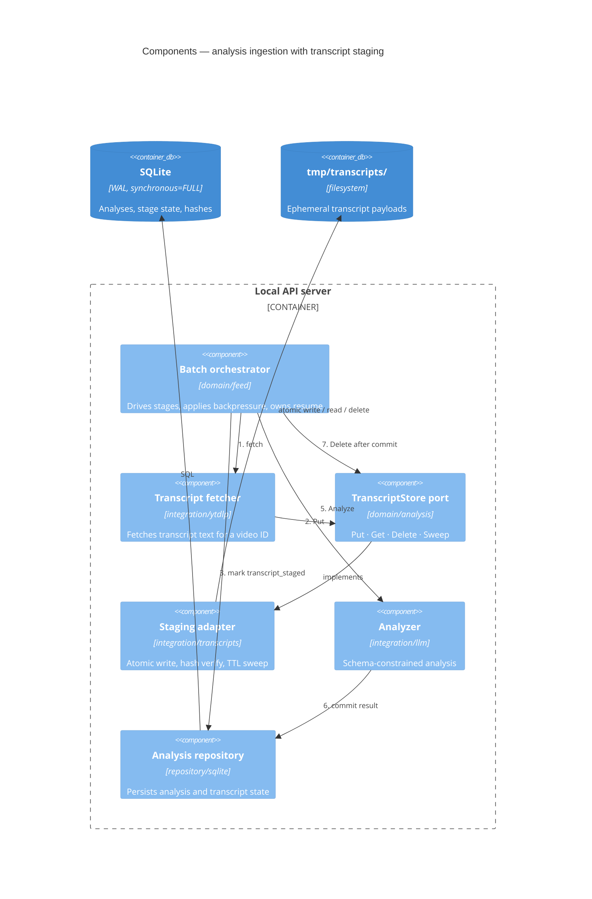
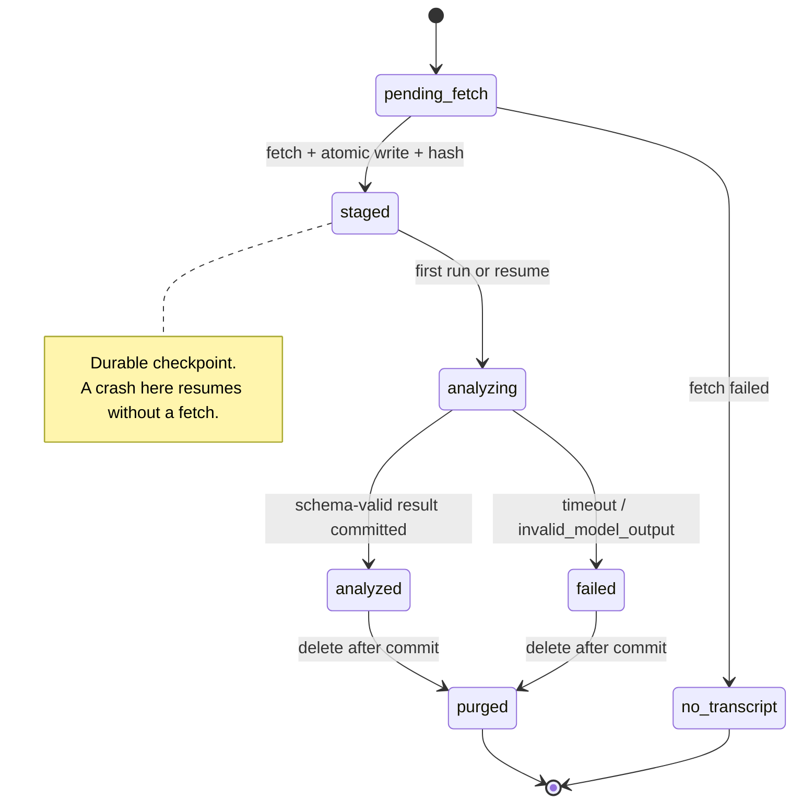

# Components — Transcript staging (crash-safe analysis resume)

## Metadata

| Field | Value |
|-------|-------|
| **System** | `ytfeed` |
| **Document** | C4 Level 3 delta — transcript staging component |
| **Version** | 0.1 (proposal, awaiting confirmation) |
| **Date** | 2026-11-02 |
| **Owner** | Oleg K |
| **Status** | Awaiting owner approval; upstream PRD amendment proposed, not applied |
| **Backlog** | `ARCH-105a` |
| **Relates to** | `OQ-05` (resolved by this proposal), ADR-0005, PRD `F9`, `F25`, `Q8`, Privacy NFR |
| **Parent** | [`02-container-diagram.md`](../02-container-diagram.md) |

---

## 1. Why this document exists

The owner's proposal: keep the fetched transcript in a **temp subfolder** between
receipt and analysis commit, so that a server crash during analysis does not force a
second fetch.

This review accepts the proposal. It closes `OQ-05`, which was a genuine contradiction:

- `F9` and the Privacy NFR said transcripts are never persisted.
- `F25` promised that a restarted batch "does not re-fetch completed transcripts".

Both cannot be true for a crash in the window between fetch and analysis. The original
provisional default resolved it by weakening `F25` (re-fetch on crash). The owner's
proposal resolves it the other way: agree to a **bounded, short-lived, permission-
restricted staging file**, and make `F25` literally true.

This is a deliberate change to a stated privacy guarantee, not an implementation detail.
Section 11 states exactly what is weakened and how it is contained. Section 16 contains
the PRD wording that must be approved before this is final.

---

## 2. Review — what it buys, what it costs

### Buys

| Benefit | Why it matters |
|---------|----------------|
| Resume without re-fetch | `yt-dlp` is the least reliable dependency in the product (`R4`); a crash during a 20-card batch no longer pays the fetch cost twice |
| Deterministic batch cost | Quota and wall-clock estimates stop depending on crash history |
| Cleaner failure semantics | The pipeline has one durable checkpoint per candidate instead of a memory-only gap |
| Testable resume | A `kill -9` test can assert "zero fetch calls on restart", not just "some progress was made" |

### Costs and risks

| Cost / risk | Severity | Containment |
|-------------|----------|-------------|
| Transcript plaintext touches disk, contradicting `F9` as written | High | PRD amendment (§16); `0700` dir, `0600` files, immediate delete, TTL sweep |
| Stale files accumulate after abandoned batches | Medium | Sweep on start and after each batch; `TRANSCRIPT_STAGING_TTL` default 24h |
| Backups could carry transcripts | High | Backups copy the database file only (`D-11a`); the staging directory is never in scope |
| Path traversal if a video ID is used as a filename | High | Strict ID validation (`^[A-Za-z0-9_-]{11}$`), `O_NOFOLLOW`, `lstat` check |
| Two writers racing on the same file | Low | Atomic rename; hash verification on read; one UI lease (`A-11`) |
| Users assume "never on disk" | Medium | `doctor` and `stats` state staging status; `TRANSCRIPT_STAGING=false` disables it |

### Alternatives considered and rejected

| Option | Why not |
|--------|---------|
| Keep memory-only (status quo) | Cannot satisfy `F25`; every crash re-fetches |
| Store the transcript as a SQLite `BLOB` | Grows the database with content, puts transcripts into every backup, and deletion requires `VACUUM`. Worse for privacy than a file that can be unlinked |
| Encrypt the staging file | Adds a key to protect and a failure mode to debug, for a single-user local tool. OS full-disk encryption (FileVault) is the correct layer; app-level crypto here is theatre |
| Persist indefinitely for re-analysis | Explicitly out of v1 (`Q8`); turns a temporary buffer into a content archive |
| Re-fetch on every resume | Simplest, but pays the fragile dependency twice and contradicts `F25` |

### Decision

Adopt **best-effort, bounded transcript staging** in `./data/tmp/transcripts/`, deleted
when the analysis result commits, with a TTL sweep as a backstop. Staging is an
optimisation for resume — **its failure must never fail a card**.

---

## 3. Component view



## 4. Component responsibilities

| Component | Responsibility | Must not do |
|-----------|----------------|-------------|
| **Batch orchestrator** | Own the stage order, decide resume point, call `Put` / `Get` / `Delete` | Touch the filesystem directly |
| **Transcript fetcher** | Produce transcript text for a video ID; report `no_transcript` explicitly | Decide whether to stage, retry, or score |
| **`TranscriptStore` port** | Define the four operations and their errors | Know about paths, permissions, or SQL |
| **Staging adapter** | Validate the ID, write atomically, compute and verify SHA-256, enforce size cap, sweep by age | Contain product rules; log content |
| **Analyzer** | Turn transcript + rubric + profile into schema-valid JSON | Read or write staging files |
| **Analysis repository** | Persist the analysis row and the stage state in one transaction | Delete files |

The port lives in `internal/domain/analysis` because the consuming context owns the
interface (`A-5`, `D-2`). The adapter lives in `internal/integration/transcripts` because
the filesystem is an external dependency behind a boundary (`A-12`). The compile-time
assertion is mandatory (`A-6`, `D-3`).

## 5. Port contract

Expressed as intent, not final Go syntax — the signatures are fixed at implementation
time, the semantics are not negotiable.

```go
// internal/domain/analysis/transcript_store.go
type TranscriptStore interface {
    // Put stages the transcript and returns its content hash and size.
    // ErrTooLarge means the caller must analyse from memory instead.
    Put(ctx context.Context, videoID VideoID, body io.Reader) (Staged, error)

    // Get returns a staged transcript only if its hash matches want.
    // ErrStageMiss means "re-fetch", never "fail the card".
    Get(ctx context.Context, videoID VideoID, want Hash) (Staged, error)

    // Delete removes the staged file. Missing files are not an error.
    Delete(ctx context.Context, videoID VideoID) error

    // Sweep removes files older than the cutoff and returns the count.
    Sweep(ctx context.Context, olderThan time.Time) (int, error)
}
```

## 6. Transcript lifecycle



`staged` is the only new durable state. `no_transcript`, `analysis_slow`, and
`invalid_model_output` remain exactly as `F11` requires — no new failure reason is
introduced.

## 7. Write and read ordering

The ordering is the whole design. Files are not transactional, so the protocol makes the
database the authority and the file the payload.

**Put (fetch → stage):**

1. Validate `video_id` against `^[A-Za-z0-9_-]{11}$`. Reject anything else.
2. Ensure `./data/tmp/transcripts/` exists with `0700`.
3. Open `<id>.<random>.part` with `O_CREATE|O_EXCL|O_WRONLY`, mode `0600`.
4. Stream the body, computing SHA-256 and enforcing the size cap.
5. `fsync` the file.
6. `rename` to `<id>.txt` — atomic within one filesystem.
7. `fsync` the directory.
8. Commit `transcript_state = staged`, `transcript_sha256`, `transcript_bytes`,
   `staged_at` to SQLite.

**Read (resume):**

1. `lstat`; reject symlinks and non-regular files.
2. Read up to the size cap.
3. Recompute SHA-256 and compare to the database.
4. Match → analyze. Missing, unreadable, or mismatched → `ErrStageMiss`, re-fetch once.

**Delete (after commit):**

1. `unlink` the file. Missing is not an error.
2. Mark `transcript_state = purged` in the same follow-up write.
3. If either step fails, the TTL sweep is the backstop.

The invariant direction is one-way: **a row in `staged` implies a readable file with a
matching hash.** The reverse — a file with no `staged` row — is expected after a crash and
is cleaned by the sweep.

## 8. On-disk layout

```
./data/
├── ytfeed.db
├── ytfeed.db.bak-<UTC>              # DB-only backups (D-11a) — never include tmp/
├── token                            # 0600
├── api-token                        # 0600
├── library/                         # F20
├── traces/                          # local OTel JSONL (R-24)
└── tmp/
    └── transcripts/                 # 0700
        ├── dQw4w9WgXcQ.txt         # 0600, ephemeral
        └── dQw4w9WgXcQ.<rand>.part # 0600, only during a write
```

Everything is inside `./data`, so `C-15` ("nothing is written outside `./data`") holds
without amendment. The directory is not a second data directory: it is derived state and
can be deleted at any time without loss.

## 9. Crash matrix

| Crash point | Database state | File state | Restart behaviour | Re-fetch? |
|-------------|----------------|------------|-------------------|-----------|
| During fetch, before rename | `pending_fetch` | `.part` file | `.part` swept; fetch again | Yes, once |
| After rename, before DB commit | `pending_fetch` | Complete orphan | Fetch again, atomic overwrite | Yes, once |
| After DB commit | `staged` | Complete | Verify hash, analyze | **No** |
| During the LLM call | `staged` | Complete | Re-analyze from file | **No** |
| After analysis commit, before delete | `analyzed` / `failed` | Complete | No re-analysis; sweep deletes | No |
| During delete | `analyzed` / `failed` | Complete or gone | Sweep deletes | No |
| Staging dir deleted externally | `staged` | Missing | `ErrStageMiss`, fetch once | Yes, once |

The middle two rows are the owner's requirement, and they are the only rows where the
design changes behaviour compared with the memory-only baseline.

## 10. Concurrency and idempotency

- Different videos write different files; `ANALYSIS_CONCURRENCY` needs no lock.
- The same video cannot appear twice in one batch: dedupe (`F8`) plus a `UNIQUE`
  constraint on the video's natural key (`D-19`).
- If two batches overlap, the second atomic rename wins; the hash check prevents a
  mismatch from being analyzed.
- One UI lease (`A-11`) means one server, but the design does not depend on it for
  correctness — only for efficiency.
- `Put` is idempotent for identical content: same bytes, same hash, same file.

## 11. Security and privacy controls

| Control | Implementation |
|---------|----------------|
| Directory permissions | `0700`, verified after creation |
| File permissions | `0600`, verified after creation (same discipline as tokens, `C-17`) |
| Path safety | Strict `video_id` validation, no separators, `O_NOFOLLOW`, `lstat` before read |
| Backups | `D-11a` copies `ytfeed.db` only; `tmp/` is structurally excluded |
| Logs | Never log content (`L-10`, `L-11`); log `video_id`, bytes, `staged`, `cache_hit` |
| Traces | Span attributes only; no content and no prompt text (`L-10`) |
| Errors | No transcript bytes in error strings (`E-17`) |
| Lifetime | Deleted on analysis commit; swept after `TRANSCRIPT_STAGING_TTL` (default 24h) |
| Opt-out | `TRANSCRIPT_STAGING=false` restores memory-only behaviour; resume then re-fetches |
| At-rest protection | Delegated to the OS (FileVault). No app-level encryption, by decision |

**What is weakened, stated plainly:** before this change, the guarantee was "transcript
text never touches disk". After it, the guarantee is "transcript text touches disk only
inside one `0700` directory, as a `0600` file, only between fetch and analysis commit, and
for no longer than the TTL". That is a weaker claim and the PRD must say so.

## 12. Configuration

| Variable | Default | Meaning | Validation |
|----------|---------|---------|------------|
| `TRANSCRIPT_STAGING` | `true` | Enable the staging directory | Strict bool (`C-8`) |
| `TRANSCRIPT_STAGING_TTL` | `24h` | Maximum age of a staged file before the sweep removes it | Duration > 0 (`C-7`) |
| `TRANSCRIPT_STAGING_MAX_BYTES` | `8388608` (8 MiB) | Above this, analyse from memory without staging | Integer > 0 |

All three must appear in `.env.example` with a comment, or they do not exist (`C-3`).
Defaults live in the struct (`C-6`).

## 13. Degradation — staging is best-effort

| Condition | Behaviour |
|-----------|-----------|
| Staging directory unwritable | Analyze from memory, `Warn` once, `staged=false`; resume falls back to re-fetch |
| Disk full during write | Same as unwritable; the `.part` file is removed |
| Transcript larger than the cap | Analyze from memory, `staged=false`, `Debug` note |
| Staged file missing on resume | `ErrStageMiss` → one re-fetch |
| Hash mismatch on resume | Delete the bad file, re-fetch once, never analyze mismatched content |
| Sweep failure | `Warn`, continue serving; retried at the next start |
| `TRANSCRIPT_STAGING=false` | No file is written at all; behaviour is the pre-change baseline |

No condition in this table changes a card's `AnalysisState`. Staging never introduces a
new user-visible failure.

## 14. Observability

| Signal | Content |
|--------|---------|
| Span `transcript.stage` | `video_id`, `bytes`, `staged`, `reason` |
| Span `transcript.load` | `video_id`, `cache_hit`, `bytes` |
| `stats` counters | `staged_reused`, `staged_miss`, `staged_swept` |
| `doctor` | Staging on/off, directory path, file count, total bytes, oldest age |
| Never | Content, prompt text, hashes in logs (hashes are not secret, but they are noise) |

## 15. Invariants

1. **I-1** — A row in `transcript_staged` implies a readable, hash-matching file. If the
   file is gone, the row is downgraded to `pending_fetch`; the card is never failed.
2. **I-2** — Transcript content never enters the database, logs, traces, backups, or error
   strings.
3. **I-3** — Staging failure never fails a card. The pipeline falls back to memory.
4. **I-4** — A staged file is deleted only after the terminal analysis row commits. Never
   before.
5. **I-5** — Every staged file has a bounded lifetime, independent of batch outcome.
6. **I-6** — A video ID becomes a path segment only after strict validation.

## 16. Required upstream amendments (proposed — awaiting approval)

Per `H-9` these are **not applied**. They are the exact edits needed for the documents to
become true again. No rule file in `docs/00-rules/` requires a change: `C-15` already
confines writes to `./data`, and `L-10`, `L-11`, `E-17` remain satisfied.

### PRD `F9` — current

> Given a candidate, when ingestion runs, then only the transcript is fetched (no
> video/audio download). Transcripts are processed in memory and not persisted.

### PRD `F9` — proposed

> Given a candidate, when ingestion runs, then only the transcript is fetched (no
> video/audio download). The transcript is staged in a permission-restricted temporary
> directory inside the data directory between fetch and analysis commit, and deleted as
> soon as the analysis result is stored. It is never written to the database, logs,
> traces, or backups.

### Privacy NFR — current

> Given an analysis, then only derived attributes are stored; transcript text exists only
> in memory and in no log or trace.

### Privacy NFR — proposed

> Given an analysis, then only derived attributes are stored permanently. Transcript text
> is held in memory and, between fetch and analysis commit, in `./data/tmp/transcripts/`
> with `0600` permissions; it is deleted when the analysis result commits and swept after
> `TRANSCRIPT_STAGING_TTL` (default 24h). It never appears in the database, logs, traces,
> or backups.

### PRD `Q8` — current answer

> No — v1: not persisted

### PRD `Q8` — proposed answer

> Transient staging only, for crash-safe resume; deleted when the analysis commits.

### Other documents

| Document | Change |
|----------|--------|
| `OQ-05` | Move to Resolved; this document is the decision record |
| ADR-0005 | Reframe from "no transcript persistence" to "bounded transcript staging"; record the privacy trade-off explicitly |
| `c4/01-system-context.md` | Trust boundary and invariant 3 updated (done in this change) |
| `c4/02-container-diagram.md` | Data directory contents, ownership row, failure matrix, invariant 6, `DD-05` (done in this change) |
| `.env.example` | Three new variables with comments (`C-3`) |
| `R4` risk row | Already inconsistent ("yt-dlp used only for explicit downloads") — transcripts use yt-dlp too. Flagged, not edited here |

## 17. Acceptance checks

Each is testable and would fail without the change.

- [ ] Kill the server after `transcript_staged` and before the LLM call; on restart the
      batch re-analyzes with **zero** fetch calls.
- [ ] Kill the server after the analysis commit and before delete; on restart the card is
      not re-analyzed and not re-fetched; the file is removed by the sweep.
- [ ] Corrupt a staged file; resume re-fetches exactly once and never analyzes the
      corrupted bytes.
- [ ] Make the staging directory read-only; the batch still completes and the card is
      analyzed, with one `Warn`.
- [ ] A transcript above the size cap is analyzed from memory and leaves no file.
- [ ] Staged files are `0600` and the directory is `0700`.
- [ ] `grep` the logs and the trace JSONL for a known transcript phrase: zero matches.
- [ ] The database backup contains no transcript text.
- [ ] `TRANSCRIPT_STAGING=false` leaves the directory empty and the resume test degrades
      to a re-fetch.

## 18. Next step

Approve or amend §16. On approval:

1. Apply the PRD edits (owner sign-off required — this changes a P0 privacy guarantee).
2. Keep ADR-0005 as the decision record for the trade-off.
3. Continue Level 3 with `ARCH-103`…`ARCH-106`; the discovery+analysis component
   document references this one instead of restating it.
