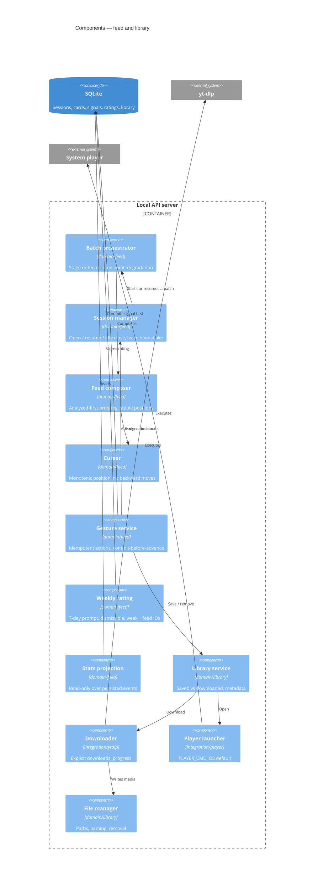

# Components — Feed and library

## Metadata

| Field | Value |
|-------|-------|
| **Contexts** | `feed`, `library` |
| **Version** | 0.1 (draft) |
| **Date** | 2026-11-02 |
| **Backlog** | `ARCH-106` |
| **Parent** | [`02-container-diagram.md`](../02-container-diagram.md) |
| **Status** | Awaiting gate `G3` |

## Scope

`feed` is the orchestration context: sessions, ordering, gestures, the weekly prompt. It
holds no data of its own beyond session and cursor state (`A-7`). `library` owns saved
and downloaded videos, local files and playback.

The split matters: losing a session must not lose a download, and a broken player must
not break the feed.

## Component view

## Feed components

| Component | Responsibility | Rules |
|-----------|----------------|-------|
| **Batch orchestrator** | Drive `candidates → dedupe → transcript → analysis → scoring`; persist checkpoints; decide the resume point | `A-14`, `F25` |
| **Session manager** | Open a session or resume one younger than `SESSION_IDLE_TIMEOUT`; close on idle; expose the lease | `F18`, `CLI-21` |
| **Feed composer** | Order cards: analyzed first, then unanalyzed; ties by score desc, then discovery order | `CLI-14a`, `F14` |
| **Cursor** | Track the user's position; enforce monotonicity | `CLI-14a` |
| **Gesture service** | Apply left/right/up/down/save/remove; commit the signal, then advance | `F5`, `F17`, `D-20` |
| **Weekly rating** | Prompt once per 7 days on session open; store week number and that week's feed IDs | `F21`, `CLI-28` |
| **Stats projection** | Compute swipe distribution, cold-period effectiveness, diversity, quota trend | `F31` (P1) |

### Ordering and the cursor

The only non-obvious rule in the product. Positions are assigned at composition:

1. Analyzed cards first, sorted by score descending.
2. Unanalyzed cards after, in discovery order.
3. Ties break by discovery order, so the order is deterministic.

When a pending card finishes analysis:

- If its position is **ahead of the cursor**, it may move into the analyzed block.
- If the cursor has **already passed it**, it stays where it is and is marked
  `analyzed (late)` (`OQ-15`).
- A card never moves backwards past the cursor (`CLI-14a`).

This is the only way to satisfy both "analyzed first" and "the screen does not reorder
under your finger".

### Gestures

| Gesture | Domain effect | Advances? |
|---------|---------------|-----------|
| Left | Reason picker → signal + cold period (scope from reason) | Yes, after commit |
| Right | Positive signal, open in YouTube | Yes, after commit |
| Down | None; "not now" is not destructive | Yes |
| Up | Move to the previous non-left-swiped card | No (moves back) |
| Save / download | Library entry, optionally a file | No |
| Remove from library | File and metadata removal, one confirmation | No |

Every action is idempotent (`CLI-18`). A repeat left-swipe refreshes the cold-period
expiry instead of erroring.

### Session lifecycle

| Event | Behaviour |
|-------|-----------|
| Start | Resume if the last session is younger than 1h; print `session resumed` (`CLI-21`) |
| Idle 1h | Close; discard navigation history (`F18`) |
| Second UI | Rejected by the lease, `409`, exit `4` (`A-11`) |
| Crash | Lease expires by idle timeout; persisted signals survive (`D-20`) |

## Library components

| Component | Responsibility | Rules |
|-----------|----------------|-------|
| **Library service** | One entity with two states: `saved` (metadata only) and `downloaded` (file present) | `OQ-04` |
| **Downloader** | Download on explicit request only; progress on stderr; idempotent by `video_id` | `F17`, `CLI-24` |
| **File manager** | `./data/library/<video_id>.<ext>`, no title-based paths | `F20` |
| **Player launcher** | `PLAYER_CMD` or OS default; never blocks the UI | `CLI-23` |

File naming by `video_id` avoids renaming, path traversal, and collisions. A title is
display metadata, never a path segment.

## Failure modes

| Failure | Behaviour |
|---------|-----------|
| Empty feed after dedupe | Explanation + next action, never a blank screen (`US-E6`) |
| Batch interrupted | Resume from the last checkpoint (`F25`) |
| Cursor target card disappeared | Skip forward to the next valid position; never error |
| Rating write fails | `Warn`, prompt again next session; never block the feed |
| Download fails | Library entry stays `saved`; error with correlation ID |
| Disk full during download | Partial file removed; entry stays `saved` |
| `PLAYER_CMD` missing | Explicit message naming the variable and the fallback tried |
| Remove fails | File remains, metadata stays `downloaded`; no silent divergence |
| Session expires mid-gesture | Gesture fails explicitly; card does not advance |

## Invariants

1. A gesture's signal is committed before the card advances (`D-20`).
2. The cursor never moves backwards over a card that was not left-swiped (`CLI-14a`).
3. Analyzed cards precede unanalyzed ones, with deterministic tie-breaking (`F14`).
4. Every gesture is idempotent from the user's point of view (`CLI-18`).
5. Navigation history is in-memory and dies with the session (`F18`, `OQ-14`).
6. The weekly prompt appears at most once per 7 days, never mid-feed (`F21`, `CLI-28`).
7. Library files live under `./data/library/` and are named by `video_id` (`F20`).
8. Removing a library item never deletes the database (`CLI-19`).
9. `feed` never blocks on `library`; a dead player does not stop card navigation.

## Open questions

`OQ-03` (save/remove key bindings), `OQ-04` (saved vs downloaded), `OQ-14` (history across
resume), `OQ-15` (late analysis ordering).

## Next

`ARCH-107` — data flow for the batch pipeline; `ARCH-108` — control flow for sessions and
degradation.
