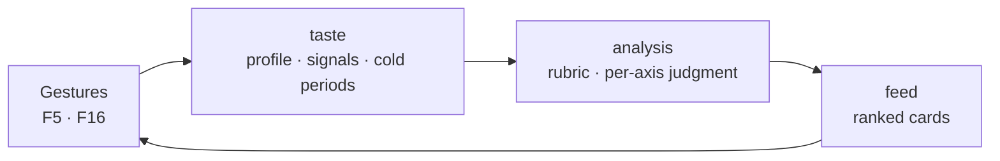

# DDD strategic — subdomain map

## Metadata

| Field | Value |
|-------|-------|
| **Domain** | `ytfeed` — personal YouTube feed composition |
| **Document** | Subdomain classification: core, supporting, generic |
| **Backlog** | `ARCH-202` |
| **Version** | 1.0 |
| **Date** | 2026-11-03 |
| **Owner** | Oleg K |
| **Status** | Confirmed at gate `G4` (2026-11-03) |
| **Sources** | [`prd-ytfeed.md`](../../../10-product/prd-ytfeed.md), [`02-architecture.md`](../../../00-rules/02-architecture.md), [`DECISIONS.md`](../../../00-rules/DECISIONS.md), [`context-map.md`](context-map.md) |
| **Sibling** | [`glossary.md`](glossary.md) |
| **Next** | `ARCH-203` (context map, `DONE`), `ARCH-204` (glossary, `DONE`), `ARCH-301` (tactical) |

## 0. Purpose and method

This document answers one question: **where does the product's value come from, and where
should design effort be spent?** It classifies the domain capabilities of `ytfeed` as core,
supporting or generic subdomains. It does not draw boundaries — that is `ARCH-203` — and it
does not choose tactical patterns — that is Phase 3.

**Method.** Every capability in the PRD (`F1`…`F28`) was grouped by the model it needs, then
tested against three questions:

1. **Differentiator** — does the capability create the product promise in PRD §1 (an
   explicable feed that learns from the owner), or does it only deliver it?
2. **Substitutability** — could a commodity component replace it without losing that
   promise?
3. **Distinct model** — does it have its own language and its own failure mode, as `A-7`
   requires of a context?

| Classification | Differentiator | Substitutable | Distinct model | Design posture |
|----------------|----------------|---------------|----------------|----------------|
| **Core** | Yes | No | Yes | Invest; model it fully (`SD-3`) |
| **Supporting** | No | Partly | Yes | Build economically, but correctly; invariants still matter |
| **Generic** | No | Yes | Thin | Keep thin; buy or use a standard approach where possible (`H-10` still applies) |

The classification is a **documentation finding** derived from the PRD, not a preference.
The owner confirms it at `G4` (`context-map.md` §10).

---

## 1. The differentiator, named

> **The differentiator is the closed loop between rubric-driven judgment (`analysis`) and
> gesture-driven preference (`taste`).** A transcript is judged against a versioned rubric
> and a structured profile; the owner's gestures become durable signals that change the
> profile; the next batch is judged differently. Neither half is the product on its own.

Evidence:

| Claim | Source |
|-------|--------|
| The promise is judgment in seconds, not more search results | `US-3` ("judge in seconds instead of minutes"), `UG-4` ("stop investing 40 minutes in a 4-minute idea") |
| Judgment must be rubric-driven and explicable | `F10`, `A-19`, `A-20`, `CLI-13` |
| The profile must learn from every gesture | `F5`, `F4`, `OQ-18` |
| Signals are the product's only durable asset | `D-20`; component `02` ("the product's only asset") |
| The rubric is expected to evolve and be measured | `BG-3`, `F12`, `F32` |
| Taste & Filtering is the epic the PRD calls "the differentiator" | PRD §15.1, E3 |
| Discovery & Analysis is "the engine" | PRD §15.1, E4 |

The loop runs **through** `feed`, but `feed` adds no judgment. The value is created at the
two ends: the profile that accumulates, and the rubric that judges. That is why `feed` is
supporting even though it is the surface the owner sees every day.

**A finding, not a slogan.** The PRD groups "rubric" under E3 (Taste & Filtering), while the
architecture puts rubric *content* in `docs/10-product/` (`A-19`), rubric *application* in
`analysis`, and the *profile* in `taste`. No single context owns the differentiator; the
**contract between `taste` and `analysis`** does. That contract therefore deserves the most
careful tactical design in Phase 3 (`ARCH-301`, `ARCH-304`).

---

## 2. Subdomain map

### 2.1 Core subdomains

#### `taste` — the accumulating preference

| Field | Value |
|-------|-------|
| **Class** | Core |
| **Capability** | Turn gestures into a durable, structured preference and suppress what the owner rejected |
| **PRD** | `F4` (profile axes), `F5` (every gesture updates the profile), `F16` (reason picker), `F19` (cold periods) |
| **Rules** | `A-20` (structured profile, justified scores), `D-20` (signal before advance), `D-21` (cold periods are records), `D-22` (per-user data) |
| **Why core** | It is the only state that accumulates across sessions. Without it the rubric is a static filter and the product cannot get better at the owner's taste. |
| **If removed** | The feed becomes a fixed query; `F5` fails; the "only asset" in `D-20` disappears. |

#### `analysis` — the explicable judgment

| Field | Value |
|-------|-------|
| **Class** | Core |
| **Capability** | Turn a transcript into a schema-valid, per-axis, explained judgment under a versioned rubric |
| **PRD** | `F9` (transcript-only ingestion), `F10` (structured attributes), `F11` (explicit failure states), `F12` (rubric version per result), `F26` (pluggable endpoint) |
| **Rules** | `A-12a` (one OpenAI-compatible adapter), `A-12b` (schema-constrained JSON), `A-19` (versioned rubric), `A-20` (per-axis justification) |
| **Why core** | It is the promise "know in seconds whether this is worth 40 minutes". It is also the highest technical risk (`R1`, `R2`, `Q1`), so it is where quality effort pays back most. |
| **If removed** | Cards become titles and thumbnails; `UG-4` is unmeasurable; the product is a YouTube search client with a nicer UI. |

### 2.2 Supporting subdomains

#### `discovery` — the bounded candidate set

| Field | Value |
|-------|-------|
| **Class** | Supporting |
| **Capability** | Turn interests and the subscription graph into a deduped, quota-bounded, micro-blogger-balanced candidate pool |
| **PRD** | `F6` (search + graph expansion + micro-bloggers), `F7` (quota accounting), `F8` (dedupe), `F13` (20 cards) |
| **Rules** | `A-7` (candidate pool), `A-14` (pipeline stage), `F7`/`OQ-02` (accounting day) |
| **Why supporting** | Search and graph expansion are commodity API calls. The product-specific rules — the 20% micro-blogger target (`OQ-09`), the quota ledger, the 7-day dedupe window — are real, but they are not a moat: a competitor with the same API can copy them. |
| **If replaced** | Another source of candidates would still feed the core, provided the `CandidateSelection` contract holds. |

#### `feed` — the daily loop

| Field | Value |
|-------|-------|
| **Class** | Supporting |
| **Capability** | Orchestrate the batch, open and resume sessions, order cards, apply gestures, prompt the weekly rating, degrade gracefully |
| **PRD** | `F13`, `F14` (streaming, analyzed first), `F16`…`F18` (gestures, session), `F21` (weekly rating), `F24` (degradation) |
| **Rules** | `A-7` ("pure orchestration"), `A-14`, `CLI-14a` (ordering), `CLI-18` (idempotency), `CLI-21` (session), `CLI-28` (rating), `D-20` (commit before advance) |
| **Why supporting** | It is the delivery vehicle. Its invariants are hard — monotone cursor, stable order, commit-before-advance — but correct orchestration does not make the judgment better. `A-7` explicitly gives it the failure mode "nothing". |
| **If replaced** | A different UI over the same contracts would still deliver the same judgment and the same learning. |

#### `library` — saved and downloaded videos

| Field | Value |
|-------|-------|
| **Class** | Supporting |
| **Capability** | Keep saved videos and local downloads, and open them in the system player |
| **PRD** | `F17` (tap downloads, double-tap removes), `F20` (library with local playback) |
| **Rules** | `A-7` (saved videos, downloads, local playback), `CLI-23` (`PLAYER_CMD`), `OQ-04` (`saved` vs `downloaded`) |
| **Why supporting** | File management, download and playback are commodity. The only product-specific part is the two-state model and its link to a save gesture. |
| **If replaced** | A plain folder plus the OS player would work; the product would lose organisation, not judgment. |

#### `identity` — credentials and the subscription graph

| Field | Value |
|-------|-------|
| **Class** | Supporting (confirmed at `G4-4`, 2026-11-03) |
| **Capability** | Obtain and refresh a Google credential, and import the subscription graph once |
| **PRD** | `F1` (OAuth, `youtube.readonly`), `F2` (subscription import) |
| **Rules** | `F1` (OAuth scope and token), `A-12` (port), `C-17` (`0600`), `D-19` (idempotent upsert) |
| **Why supporting** | The OAuth mechanics are commodity, but the imported graph is the product's cold-start taste input: it seeds `discovery` with channels and topic tags and shapes the interests proposed during onboarding (`F3`, `CLI-25`…`CLI-27`, `US-1`, `A1`). It makes no judgment of its own, but it is not interchangeable plumbing either. |
| **If replaced** | A standard OAuth library plus a CSV import would still authenticate. The graph import, idempotent upsert (`D-19`) and topic-tag quality would be lost, so the feed would start colder — degraded, not broken. |
| **Decision** | First draft classified it **generic**. The owner chose **supporting** at `G4-4` on 2026-11-03 because the subscription graph is a proprietary taste asset, not ordinary YouTube state. Tactical depth stays **light** per `SD-3`: the class changes framing and epic priority, not the frozen depth decision. |

### 2.3 Generic subdomains — none

After `G4-4` no subdomain is classified generic. The mechanics that would have been generic —
OAuth, token refresh, a paginated import — remain commodity and are still kept thin
(`SD-3`), but they sit inside a supporting subdomain because of the graph they carry. The
Generic row in §0 is kept as a definition, not as a populated class.

---

## 3. Traceability — every subdomain to a PRD capability

| Subdomain | PRD functional requirements | User stories | Epic (PRD §15.1) |
|-----------|-----------------------------|--------------|------------------|
| `identity` | `F1`, `F2` | `US-1`, `US-12` | E2 — Identity & Onboarding |
| `taste` | `F3` (interests, with `OQ-19`), `F4`, `F5`, `F16`, `F19` | `US-2`, `US-4`, `US-5`, `US-10` | E3 — Taste & Filtering |
| `discovery` | `F6`, `F7`, `F8` | `US-9` | E4 — Discovery & Analysis |
| `analysis` | `F9`, `F10`, `F11`, `F12`, `F25` (analysis side), `F26` | `US-3`, `US-E1`, `US-E2`, `US-E3` | E4 — Discovery & Analysis |
| `feed` | `F13`, `F14`, `F16`…`F18`, `F21`, `F24`, `F25` (orchestration side) | `US-6`, `US-7`, `US-8`, `US-9`, `US-10` | E5 — Feed & Library |
| `library` | `F17`, `F20` | `US-8` | E5 — Feed & Library |

No subdomain exists without a PRD capability, and no P0 functional requirement is left
without a subdomain. The full requirement-to-component-to-context matrix is `ARCH-503`.

---

## 4. Capabilities that are deliberately **not** subdomains

This section exists so a later reader does not invent a seventh context (which would
contradict `A-7` and require an ADR).

| Capability | Where it lives | Why it is not a subdomain | Source |
|------------|----------------|---------------------------|--------|
| CLI command contract, card rendering, terminal capabilities | Transport (`internal/transport/cli`) | No domain decision; parsing, rendering and error translation only | `A-2`, `H-7`, `F15`, `F28`, `CLI-1`…`CLI-17` |
| Local HTTP API, bearer auth, loopback guard, SSE | Transport (`internal/transport/http`) | Infrastructure; it carries domain calls, it does not decide them | `A-10`…`A-10b`, `F22`, `OQ-17` |
| UI lease and session concurrency | `feed` (lease) + transport | A concurrency control, not a domain model | `A-11`, `OQ-13` |
| SQLite, migrations, backup | `internal/repository`, `internal/storage` | Storage mechanism behind repository interfaces | `D-1`…`D-12`, `F23` |
| Degradation policy and exit codes | Transport translation + `feed` orchestration | A policy over domain outcomes; no model of its own | `F24`, `CLI-6`, `E-10`, `OQ-01` |
| `doctor`, `stats` | Diagnostics projection + transport | Read-only reporting over persisted facts | `F27`, `F31`, `L-17`, `L-15` |
| Configuration and secrets | `internal/config` | Cross-cutting configuration | `C-1`…`C-17` |
| Scheduled background composition | Not built in v1 | Explicitly out of scope | `F40`, PRD §3 |
| Onboarding orchestration | Use case in `identity` | Calls `taste`/`discovery`; not a model of its own | `CLI-25`…`CLI-27`; `context-map.md` §9.1 |

---

## 5. Sensitivity — what would change the classification

| If this changes… | Then… | Default / status today |
|------------------|-------|------------------------|
| The profile stops learning from gestures (`F5` weakened) | `taste` drops to supporting; the differentiator becomes the rubric alone | `F5` is P0, so this is out of scope |
| External trend adapters (`F29`) become a proprietary graph | `discovery` could become core | `F29` is P1; discovery stays supporting |
| The subscription graph is ordinary YouTube state rather than a taste asset | `identity` could return to generic | Supporting — fixed at `G4-4` |
| The library adds recommendations or a watch-history model | `library` could move to supporting-plus or core | `library` is file management in v1 |
| The rubric becomes a fixed, untuned filter | `analysis` drops to supporting | `BG-3` and `F32` require it to evolve |

Except where a `G4` decision has closed a row, none of these is a decision made here. They
are recorded so a later reader can see which classification is load-bearing and which is
provisional.

---

## 6. Consequences for the rest of the design

1. **Tactical depth follows the classes plus `SD-3`.** Full depth for `taste`, `feed`,
   `discovery`, `analysis`; light for `identity`, `library`. Full depth for `feed` and
   `discovery` is justified by their **invariants**, not by core status — a supporting
   subdomain can still have hard rules. `identity` is supporting but stays light: class and
   depth are separate decisions, and deepening it would require reopening `SD-3`.
2. **ADR priority.** `ADR-0004` (analysis contract) is the ADR that protects the core; it
   should carry the most careful negatives and risks.
3. **Sequencing.** `ARCH-601` should put the `taste`↔`analysis` contract in the first
   vertical slice after the walking skeleton, because it is the product's differentiator.
4. **No new context.** The capabilities in §4 are layers, adapters or policies. A seventh
   context would need an ADR and a rules-PR proposal (`H-9`).

---

## 7. Open questions

| ID | Relevance |
|----|-----------|
| `OQ-08` | Interest count (1–10, default 5) |
| `OQ-09` | Micro-blogger floor is a target, not a hard gate |
| `OQ-04` | `saved` vs `downloaded` in `library` |
| `OQ-18` | Profile update magnitude and clamping |

`OQ-19` and `OQ-20` were resolved at gate `G4` on 2026-11-03 and no longer constrain this
map; their answers are in [`glossary.md`](glossary.md) §3.13 and §3.6.

## 8. Next step

`ARCH-203` used this classification in the context map and validated it against `A-7`. Gate
`G4` passed on 2026-11-03 (`context-map.md` §10), so this map is frozen for the design and
Phase 3 (`ARCH-301`…) starts from it.
