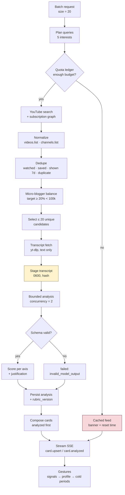
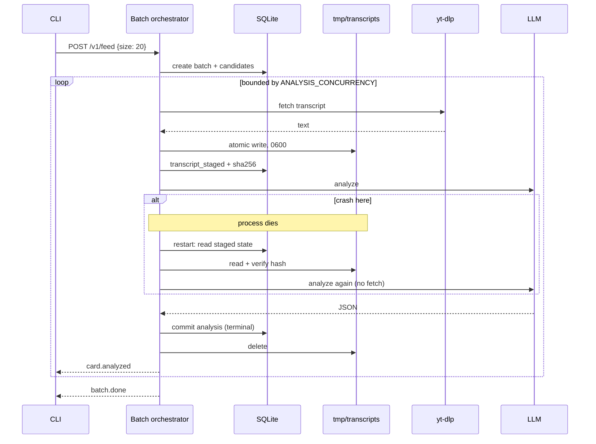

# Data flow — batch pipeline

## Metadata

| Field | Value |
|-------|-------|
| **Document** | Data flow — batch composition and analysis |
| **Version** | 0.1 (draft) |
| **Date** | 2026-11-03 |
| **Backlog** | `ARCH-107` |
| **Depends on** | [`03-discovery-analysis.md`](../c4/03-components/03-discovery-analysis.md), [`03a-transcript-staging.md`](../c4/03-components/03a-transcript-staging.md) |
| **Status** | Awaiting C4 close |

## Purpose

Show what data enters, changes shape, persists, and is deleted during one batch. The
pipeline is the product's engine (`A-14`); this document is the contract between its
stages.

## End-to-end flow

Yellow is ephemeral state; red is the degraded path. Everything else persists in SQLite.

## Stages

| # | Stage | Input | Output | Persisted | Idempotency key | Resume from |
|---|-------|-------|--------|-----------|-----------------|-------------|
| 1 | Batch request | size, user | `batch` row | `batches` | `batch_id` | — |
| 2 | Query planning | interests, profile | queries | derived, not stored | `(batch_id, interest)` | recompute |
| 3 | Discovery | queries | raw candidates | `candidates` | `video_id` | re-query if quota allows |
| 4 | Normalize | video IDs | metadata | `videos` | `video_id` | skip if present |
| 5 | Dedupe | candidates | kept set | candidate state | `video_id` | recompute |
| 6 | Balance | kept set | ordered set | candidate `rank` | `(batch_id, video_id)` | recompute |
| 7 | Selection | ordered set | ≤ 20 | `cards` (pending) | `(batch_id, position)` | keep existing |
| 8 | Fetch | video ID | transcript | staging file | `video_id` | staged file |
| 9 | Stage | transcript | file + hash | `transcripts` state | `video_id` | file + hash |
| 10 | Analyze | transcript, rubric, profile | analysis JSON | `analyses` | `(video_id, rubric_version)` | staged file |
| 11 | Validate | JSON | accepted / classified | `analyses.state` | `analysis_id` | re-validate |
| 12 | Score | analysis | ranked card | `cards.score` | `card_id` | recompute from analysis |
| 13 | Compose | cards | ordered feed | `cards.position` | `card_id` | keep positions |
| 14 | Stream | ordered cards | SSE events | — | `event_id` | reconnect from cursor |

No stage calls a later stage's adapter directly (`A-14`). The orchestrator is the only
caller.

## Sequence — happy path with a crash

## Data retention

| Data | Persisted? | Location | Lifetime | Rule |
|------|------------|----------|----------|------|
| Subscription graph | Yes | SQLite | Until re-import | `F2` |
| Candidate metadata | Yes | SQLite | Indefinite (audit + dedupe) | `F8` |
| Quota usage | Yes | SQLite | Per accounting day, retained | `F7` |
| Card / feed | Yes | SQLite | Indefinite (stats + rating linkage) | `F13`, `F21` |
| Analysis result | Yes | SQLite | Indefinite | `F10` |
| Signals | Yes | SQLite | Indefinite | `F5` |
| **Transcript** | **Ephemeral** | `tmp/transcripts/` | Until commit, TTL 24h | `ARCH-105a` |
| Traces | Yes | `traces/` | 7 days | `L-15` |
| Media files | Yes | `library/` | Until removed | `F20` |

## Volumes (design estimates, not commitments)

| Quantity | Estimate | Consequence |
|----------|----------|-------------|
| Cards per batch | 20 | `FEED_SIZE` |
| Searches per batch | 2–5 | 200–500 quota units |
| Transcript size | 20–100 KB | Staging is cheap; 8 MiB cap is generous |
| Analysis JSON | 1–3 KB | One row per video |
| Batch wall clock | 5–20 min on a laptop | Streaming is mandatory (`F14`) |
| Concurrent LLM calls | 2 | `ANALYSIS_CONCURRENCY` |

## Quota flow

1. The planner estimates cost before each call.
2. The ledger refuses a call that would exceed the budget (`F7`).
3. On success, actual units are recorded.
4. At 80%, one warning per day.
5. At 100%, no further search calls; the cached feed is served (`F24`).
6. The accounting day is UTC by PRD (`F7`), though YouTube resets at midnight Pacific —
   unresolved in `OQ-02`.

## Crash checkpoints

| Crash after | Survives | Restart does |
|-------------|----------|--------------|
| Candidate selection | `batches`, `candidates`, `cards` | Continue from stage 8 |
| Transcript staged | Staging file + hash | Analyze without re-fetch |
| Analysis committed | `analyses` row | Skip the card, delete the file |
| Card streamed | All rows | Re-stream from persisted positions |

The only unrecoverable loss is in-flight work, never a committed signal (`D-20`).

## Data-flow invariants

1. Every externally sourced row has a natural key (`D-19`).
2. A transcript exists on disk only between stages 9 and 10 (`ARCH-105a`).
3. No analysis is persisted without `rubric_version` and `model_id` (`F12`).
4. No card is composed from a failed analysis without an explicit state and reason
   (`F11`).
5. Quota is charged before the call, not after (`F7`).
6. A stage never skips forward or backward in the order above (`A-14`).

## Next

`ARCH-108` — control flow for sessions and degradation.
