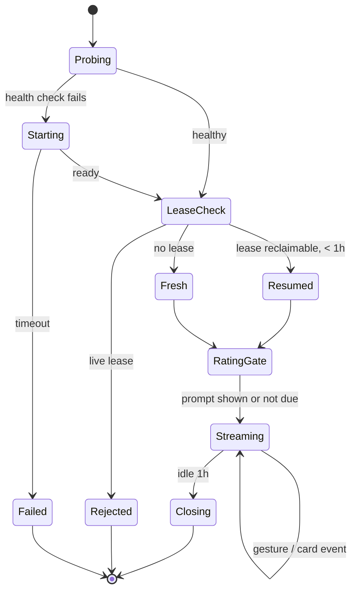
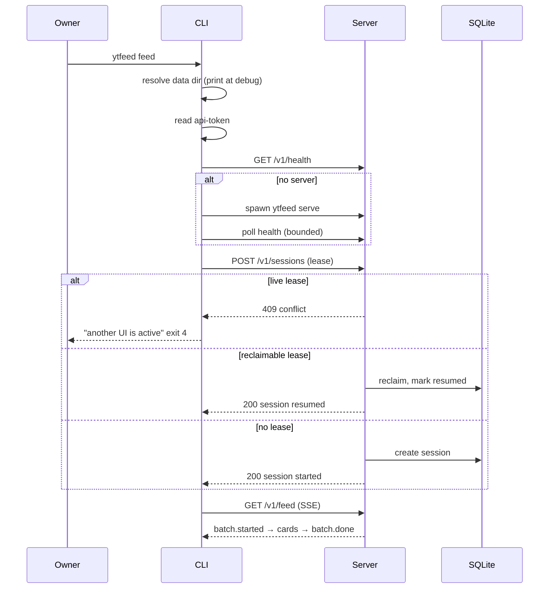
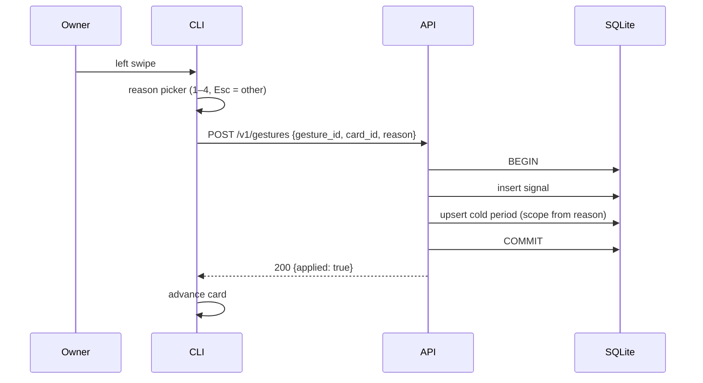

# Control flow — session lifecycle and degradation

## Metadata

| Field | Value |
|-------|-------|
| **Document** | Control flow — sessions, gestures, weekly rating, degradation |
| **Version** | 0.1 (draft) |
| **Date** | 2026-11-03 |
| **Backlog** | `ARCH-108` |
| **Depends on** | [`01-transport.md`](../c4/03-components/01-transport.md), [`04-feed-library.md`](../c4/03-components/04-feed-library.md) |
| **Status** | Awaiting C4 close |

## Purpose

Describe the states the app moves through, who decides each transition, and what happens
when a dependency is missing. The batch pipeline is covered separately; this document is
about the user-facing loop.

## Session state machine

`RatingGate` is the only place the weekly prompt can appear — never mid-feed (`CLI-28`).

## Start sequence

## Gesture control flow

The critical ordering: **commit, acknowledge, then advance.** A lost signal is a lost
product asset (`D-20`), so the UI moves only after the server confirms the write.

`gesture_id` is generated by the client and is the idempotency key. A retried request with
the same ID returns the original outcome and does not create a second cold period
(`CLI-18`).

If the request times out, the card does **not** advance. The user retries; the retry is
safe.

## Weekly rating flow

| Step | Behaviour |
|------|-----------|
| Check | On session open, `now - last_rating_at ≥ 7 days` |
| Prompt | `-1 worse / 0 same / +1 better`; Esc records `unrated` |
| Store | Week number + IDs of feeds shown that week (`F21`) |
| Failure | `Warn`, do not block the feed, try again next session |
| Repeat | At most once per 7 days, never mid-feed (`CLI-28`) |

## Session timing

| Parameter | Default | Source |
|-----------|---------|--------|
| `SESSION_IDLE_TIMEOUT` | `1h` | `R-18` |
| Health probe timeout | 5 s | design |
| Server readiness timeout | 10 s | design |
| SSE heartbeat | 15 s | design |
| Weekly prompt interval | 7 days | `F21` |
| Lease reclaim threshold | idle timeout | `OQ-13` |

## Degradation decision table

Every dependency failure has exactly one user-visible outcome and one exit code. "It
depends" is not an answer.

| Condition | Detection | User sees | Exit | Source |
|-----------|-----------|-----------|------|--------|
| YouTube quota exhausted, cached feed served | Ledger at 100% or API 403 | Banner + reset time; cached cards | `6` | `F24` |
| Fresh batch requested, no quota | Ledger refuses before calls | Same banner, no new cards | `5` or `6` (`OQ-01`) | `F7` |
| YouTube unreachable | Network error after one retry | Cached cards + library | `6` | `F24` |
| No transcript for a video | yt-dlp returns none | Card `[unanalyzed: no transcript]` | `0` | `F11` |
| LLM slow / timeout | Per-request deadline | Card `[unanalyzed: analysis slow]`, batch continues | `0` | `F11` |
| LLM returns invalid JSON | Schema validation | Card `failed: invalid_model_output` | `0` | `A-12b` |
| yt-dlp missing | Binary probe | `feed` refuses with an explicit message | `6` | `SD-6`, `OQ-12` |
| Terminal has no image support | Capability probe | Text card, no reserved space | `0` | `CLI-16` |
| Player command missing | Exec error | Message naming `PLAYER_CMD` and the fallback | `1` | `CLI-23` |
| Database newer than binary | `schema_version` check | Refusal + upgrade instruction | `1` | `D-11b` |
| Database unreadable | Open error | Refusal + path + backup hint | `1` | `CLI-22` |
| Data directory unwritable | Path check | Refusal + resolved path | `1` | `C-15` |
| Second UI active | Lease check | Conflict message | `4` | `A-11` |
| Token revoked | 401 from Google | Re-authenticate message | `2` | `F1` |
| Ctrl-C | Signal | Consistent state, no partial write | `130` | `CLI-7` |

## Exit-code matrix by command

| Command | Success | Degraded | Quota | Auth | Conflict | Error |
|---------|---------|----------|-------|------|----------|-------|
| `feed` | 0 | 6 | 5/6 | 2 | 4 | 1 |
| `onboard` | 0 | 6 | 5 | 2 | 4 | 1 |
| `auth login/status` | 0 | — | — | 2 | — | 1 |
| `save` / `mute` | 0 | — | — | 2 | 4 | 1 |
| `library` | 0 | — | — | 2 | — | 1 |
| `stats` | 0 | — | — | — | — | 1 |
| `doctor` | 0 | 0 | 0 | 0 | — | 1 |
| `serve` | 0 | — | — | — | 4 (bind) | 1 |

`doctor` returns `0` whenever it can report; a broken integration is data, not a command
failure (`F27`, `C-14`).

## Crash and restart control flow

| Crash point | What the user sees next run | Automatic? |
|-------------|-----------------------------|------------|
| Before session commit | Fresh session | Yes |
| After lease, before batch | `session resumed`, batch restarts | Yes |
| Mid-batch, transcript staged | Batch resumes, no re-fetch | Yes |
| Mid-gesture | Card still current; gesture was not applied | Yes — retry is safe |
| After signal commit, before advance | Card advanced on reload | Yes |
| During download | Library entry `saved`, partial file removed | Yes |
| After rating commit | Prompt suppressed for 7 days | Yes |

## Control-flow invariants

1. The UI advances only after the server acknowledges the write (`D-20`).
2. Every gesture carries an idempotency key (`CLI-18`).
3. The weekly prompt appears only at session open (`CLI-28`).
4. Idle close discards navigation history, never persisted data (`F18`).
5. Every degradation names its cause and its next action (`E-16`).
6. No dependency failure blocks the UI if the database is readable (`CLI-22`).
7. `doctor` works offline and redacts secrets (`F27`, `C-14`).

## Open questions

`OQ-01` (quota exit code), `OQ-12` (yt-dlp absent), `OQ-13` (lease reclaim), `OQ-16`
(server lifecycle).

## Next

`ARCH-109` — consistency check against the `A-9` package layout.
